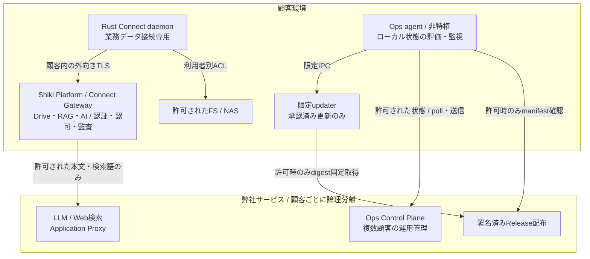

# Shiki Connect / Shiki Ops 共通接続基盤

> 状態: 設計先行。2026-11-19。**この文書の機能・プロトコル・配備は未実装**。
> 製品別の契約は [Connect](./shiki-connect.md) / [Ops](./shiki-ops.md)、検証事実は [PoC記録](./connect-poc-evidence.md)。
> 本書は [design.md](./design.md) のチョークポイント、[requirements.md](./requirements.md) のNFR-1〜4・NFR-6を拡張し、置き換えない。

## 1. 決定と責務

**Connectは業務データ接続、Opsはオンプレ環境の運用・セキュリティ管理。共通化するのは接続の仕組みであり、権限ではない。**
最初のConnect実装はファイルコネクターに限定する。Opsは任意コマンドを実行する遠隔管理シェルにしない。

| 項目 | Connect | Ops | 共通ライブラリ |
| --- | --- | --- | --- |
| 対象 | ファイル、将来はDB・社内API・イベント | バージョン、稼働状態、送信許可済み運用情報、更新 | TLS、フレーム、期限、接続状態、再接続 |
| 実行主体 | Shikiの利用者・明示委譲されたサービス主体 | 環境エージェント・運用担当・限定されたupdater | 製品の業務権限を持たない |
| 認可 | 利用者ReBAC ∩ コネクター許可 ∩ 接続先ACL | 顧客のローカル許可 ∩ 環境束縛 ∩ 承認済み運用操作 | 認証済みpeer・製品・環境・世代を検証 |
| 禁止 | 接続資格情報だけで利用者権限を代行 | 本文閲覧、Connect操作、任意SQL・shell・トンネル | 製品間token交換、共有万能トークン |
| 永続状態 | 観測・変更・操作の台帳 | 送信キュー・受信操作・更新状態 | DBエンジン用の薄い共通部品まで |

ライブラリの再利用を推奨し、両製品を束ねる必須の常駐ハブは作らない。
Connect daemonとOps agentは別プロセス、別OSサービス主体、別鍵・token、別DBファイル、別キュー、別接続を既定とする。
同一マシンにも配置できるが、相手の秘密・状態ディレクトリ・IPCへアクセスさせない。
同一コードベースでもrelease・停止・リソース制限を独立にし、Ops未導入でもConnectを使用可能にする。

## 2. 配備と接続方向

図はオンプレ版の配置。Connect Gatewayは顧客Shiki側に置き、Ops Control Planeとは別サービス。
SaaS版ConnectではGatewayがShiki SaaS側にあり、本文が顧客外へ渡るため、その配置を送信先として明示承認する。
顧客環境への受信ポート公開は不要。顧客側から開始したTLS上のpoll応答として要求を受け取る。
「アウトバウンドのみ」は本文送信や遠隔操作の安全性を自動保証しない。以下の許可判定を常に適用する。
弊社プロキシは固定APIのアプリケーションプロキシであり、sandboxのegress forward proxy（PIT-25）とは別物。

## 3. 共通transportの契約

| 共通化するもの | 製品別に残すもの |
| --- | --- |
| TLS/企業proxy/追加CA、timeout、keepalive | 接続先allowlistと顧客の外部送信ポリシー |
| enrollmentの部品、鍵保管のOS adapter、短命証明書更新 | 登録承認、trust store、issuer/audience、失効epoch |
| 指数backoff＋jitter、poll、接続世代、サイズ制限 | 操作語彙、利用者ReBAC、承認、更新署名の検証 |
| request ID、期限、ACK、protocol version、エラー形式 | 各台帳の意味・復旧・保持・監査要件 |

これは将来の内部契約であり、新しいRust trait名、公開APIパス、OpenFGA relation名、scope文字列を確定しない。
実装時に既存チョークポイント配下へ配置し、認可語彙・型は単一定義から生成する。既存trait/schemaの変更は別途レビューする。

### 3.1 認証と登録

- 顧客管理者が製品ごとに、一回限り・短期限・環境束縛された登録要求を承認する。秘密鍵は端末側で生成する。
- オンプレの業務ユーザー認証はローカルIdPで成立させる。弊社IdPやOpsのオンライン照会をログイン条件にしない。
- peer identityは顧客組織、オンプレ環境、製品、端末、credential epochへ束縛する。短命mTLS証明書と厳密なissuer/audience検証を基本とする。
- Connect、Ops、LLM/Web proxy、updaterの資格情報を分離する。同じPKI用ライブラリを使っても検証する用途・trust設定は別。
- device identityは業務利用者の代理権ではない。Connectではサーバーが利用者を確定し、daemon側でも登録済みmount/viewと照合する。
- ローカル無効化で即座に接続・操作を止められる。オンライン失効通知＋短TTLで遠隔失効を収束させるが、分断中の瞬時の遠隔失効は保証しない。
- 期限切れ・失効不明の資格情報で新しい遠隔操作を開始しない。ローカルShiki全体は停止させない。
- trust anchor変更は顧客承認と旧鍵/新鍵による検証可能な移行を要求する。TLS検証無効化による復旧は禁止。

### 3.2 配送と復旧

フレームにprotocol version、製品、顧客/環境/端末、接続世代、request/operation ID、期限、操作種別、対象、policy revision、payload digestを含める。
受信側は経路とcredentialに束縛された値と一致するか検証し、未知のversion・操作・サイズ超過・期限切れ・世代不一致を拒否する。
署名が必要な運用指示はこれらの束縛も署名対象にする。ACK前に受信台帳をdurableにし、同じIDの別引数を拒否する。

切断後は新しい接続世代で再認証し、cursor/ACKを照合して未確認イベントを再送する。
配送はat-least-once、効果の重複防止は製品側の操作台帳で行う。ネットワーク・FS・redb・Postgresを跨ぐexactly-onceは宣言しない。
更新・削除等の結果不明は「失敗したはず」として新しいIDで再実行せず、同じID・同じ引数で照会/再開する。
期限超過した古い指示は新規実行しない。既に開始した操作の照会・安全な回復は別の認可済み手順で行う。

redbを端末のローカル永続台帳に採用する。NAS上にDBを置かず、製品/環境/端末/rootを束縛する。
破損・消失時の自動空初期化は、重複操作を招くため拒否する。再登録/再照合と監査付き復旧を必要とする。
この共通部品にもConnect PoCの未検証事項（電源断・ENOSPC・複数OS等）は残る。

### 3.3 リソースと障害隔離

キュー・DB容量・フレーム・同時実行・接続時間・再送期間を有界にする。製品別にCPU/メモリ/帯域の上限を設ける。
監視データは顧客設定のTTL後に低優先度から破棄し、欠落件数を記録する。業務変更・更新指示の未ACK記録は黙って捨てない。
記録不能なら新しい変更操作を拒否し、利用可能な読取・ローカル機能は継続する。再接続時の一斉送信をjitterと流量制御で抑える。

## 4. 外部送信の判定

顧客側での最終判定を必須とし、弊社の設定・署名・運用権限だけで顧客ポリシーを緩められない。
実効許可は **配備モード ∩ 顧客管理者の送信設定 ∩ 組織/利用者の権限 ∩ 対象データ/用途/送信先/保持条件 ∩ 操作承認**。
本人同意が必要なデータではそれも交差させる。Connect閲覧許可は外部LLM投入の同意ではなく、Ops加入はログ本文の送信同意ではない。

| データ | 弊社側への既定 | 有効化時の制御 |
| --- | --- | --- |
| Connectの接続identity・製品/環境・protocol情報 | Connectの接続先/送信許可がなければ送らない | SaaS接続時は必要な最小項目を顧客が明示承認。Ops加入/監視送信の許可とは独立 |
| Opsの接続identity・製品/環境・protocol情報 | Opsの登録/加入許可がなければ送らない | 登録/加入を明示承認したときだけ、通信に必須な最小項目を事前明示して送信 |
| 稼働/版/集約リソース量 | 外部送信オフ | フィールドallowlist、環境単位の明示許可、保持/宛先/上限 |
| 脆弱性ID・構成適合性 | 外部送信オフ | 顧客内評価を基本にし、最小結果だけ送信 |
| 構造化ログ | 外部送信オフ | schema allowlist、自由文・URI query・パス・利用者識別子を除去 |
| 会話/文書/検索語/画像/ツール結果 | Ops監視では収集しない | 外部LLM/Web利用時のみ必要な内容を別途許可。検索語も機密扱い |
| プロンプト/補完を含むLangfuse・trace属性 | 外部送信オフ | ローカル保持が基本。本文exportを監視設定で暗黙に有効化しない |
| secret/token、環境変数全体、DB dump、core dump | 送信対象外 | 通常Opsに取得経路を作らない |
| 更新確認/成果物取得 | 外部接続オフ | 署名・digest・承認済み配布元、本文を含めない |

接続メタデータの許可も製品ごとに分け、Connect加入をOps加入や監視送信許可と同一視しない。
「同意済み」という1bitで全カテゴリーを許可しない。送信前に属性を落とし、弊社受信側でもschema検証・顧客別隔離を行う。
queue済みデータは送信時にも現在のポリシーを適用し、許可撤回後は外へ送らず削除/顧客内保持へ切り替える。
宛先/保持/処理地域・再委託先の変更は再承認対象。顧客の監査正本は顧客内に保持し、弊社側の操作監査とrequest IDで突合する。

## 5. エアギャップと独立稼働

| モード | Connect | Ops | 外部LLM/Web・更新 |
| --- | --- | --- | --- |
| 外部接続なし | 顧客内Gateway/daemon/sourceのみ | ローカル監視・検査・監査 | ローカル推論。外部検索無効、署名bundleの手動搬入 |
| 選択的接続 | 承認されたShiki配置へ接続 | 許可カテゴリーだけ送信・poll | 許可されたproxy/provider/配布先のみ |
| 接続断/弊社障害 | 到達可能な顧客内経路は継続 | ローカル監視継続、弊社表示はstale/unknown | 外部依存要求だけ失敗。許可済みローカルfallbackのみ |

エアギャップは「顧客境界外への接続ゼロ」であり、顧客内LANのNASや認証基盤への接続を禁じる意味ではない。
そのモードではexporter・poller・外部DNS・ライセンス照会・更新確認を起動しない。モデル/依存物/脆弱性DB/署名鍵更新の搬入手順を用意する。
Ops障害・証明書失効・加入解除を業務APIのreadiness、ローカル推論、ローカルユーザー認証の必須条件にしない。
ただしローカルのPostgres等の既存必須依存まで不要になるという保証ではない（PIT-29）。

## 6. 実装前の契約と受入れゲート

[実装フェーズ](./roadmap/parallel-tracks.md#connect-ops-track)に従い、
認可語彙・protocol/schema・顧客送信設定・署名/鍵管理・配備RBACは実装PRで個別に確定する。本書のマージは機能完了を意味しない。

- 他製品token、他顧客/環境ID、古いepoch/世代、期限切れ、replay、未知操作をnegative testで拒否。
- TLS/企業proxy/証明書更新、切断・復帰・長期offline・clock skew・容量枯渇を実環境で試験。
- エアギャップ時の外部通信ゼロをpacket/DNSの観測で確認。Ops断でも顧客内Connect・コア機能のE2Eを継続。
- redb破損・失効・送信許可撤回時のfail-closedと、ローカル業務継続を別々に検証。
- 多数顧客の同時復帰、キュー上限、帯域/CPU/RSSを測定し、SLO/運用上限を決める。PoC単回値を本番SLOに転用しない。
