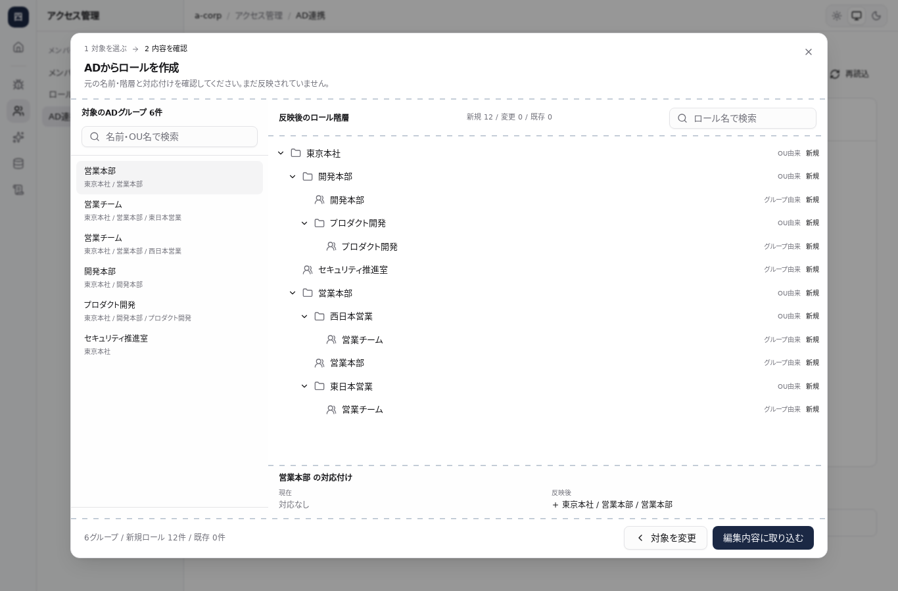

# AD連携とロール管理

組織管理者は「アクセス管理 → AD連携」で、Keycloak経由のAD接続、グループ同期、ロールとの対応付けを管理する。「ロール」は同じ管理APIと保存内容を使用し、「メンバー」は最終認証同期時の所属を表示する。

## 運用者の事前設定

Keycloak 26.2.5のLDAP federationと管理REST、および[GUIDマッパー](../../deploy/keycloak/guid-mapper/README.md)を使用する。Composeには拡張を組み込み、外部Keycloakではjarを配置して再ビルドする。1組織につき1接続を対象とする。APIの`auth.provisioner_client_id` / `auth.provisioner_client_secret`を設定し、対象realmのユーザー・グループ・LDAP componentを管理できるサービスアカウントを用意する。管理資格情報はブラウザへ渡さない。

`config/default.toml`と同じ形式の運用設定の`[auth]`に、接続を認めるADホストを明示する。

```toml
[auth]
directory_ldap_allowed_hosts = ["ad.example.co.jp"]
```

許可リストの既定は空で、未設定では新規保存・接続テストを拒否する。LDAPSの636番だけを許可する。KeycloakがADへ到達できることと、KeycloakのJava truststoreがADの証明書を信頼することを事前に確認する。

## 接続・同期

1. 接続先、ユーザー／グループの検索ベースDN、読み取り用バインドDN・パスワードを入力して「テストして保存」する。
2. 「ADを同期」でグループを取得する。処理は永続キューで実行し、進捗と履歴を画面で確認できる。
3. OUをたどるか、全OUからグループ名・OU名を検索する。ロールも階層移動とサーバ検索で探す。

パスワードはKeycloakに保存し、ShikiのDB、操作キュー、監査メタデータ、API応答へ保存しない。入力を空欄にすると保存済みcredentialを維持する。接続先またはバインドDNを変更する場合はパスワードの再入力を必須とし、保存済みcredentialを別ホストへ転送しない。LDAPはREAD_ONLYで、シキのロール定義はLDAP同期先の外に作る。

接続と固定tenant／orgマッパーは組織ごとに分離し、AD属性で認証先のtenantを変更できない構成にする。同期先は`/tenants/<tenant>/<org>/ad-guid-v1`、ロール定義は`/__shiki_roles/<tenant>/<org>`。後者をLDAP mapperの同期先に含める構成は拒否する。ロール定義のグループはAD所属の正本には使用しない。

接続先・検索DN・階層保持の設定を変えると、旧スナップショットは保存処理の前に無効化されます。再同期が成功するまでグループ一覧・自動作成・対応付けに使用しません。同期後、既存の対応表は同一グループIDのものだけ復帰します。

## 自動作成・CSV・確認

「ADから自動作成」は選択したグループ、またはすべてを対象にする。OUの配置とグループの入れ子は別の情報であり、ADのOU自体にはメンバー所属の意味はない。生成したOU親ロールへの所属は、Shikiの子ロールから親ロールへの継承による。OUの元情報はADの`distinguishedName`属性から取得する。Keycloakの内部グループ名にはADの不変な`objectGUID`を36文字のUUIDに正規化して使う。別OUの同名CNと、削除後に同じ名前で再作成された別グループを分離する。表示名と作成するロール名は元の`cn`を使う。改名やOU移動でも同じADオブジェクトを識別できる。旧CN/SAM方式からの更新は、画面の確認後に旧対応表を解除し、Keycloak上の同期グループを再作成して、再同期・再設定する。旧CN/SAMのclaims名前空間とも分けるため、古いトークンが新しいGUIDグループを指すことはない。

グループの入れ子を利用する場合は接続設定で階層保持を有効にして再同期する。Keycloakには常にflatなGUID別グループとして取り込み、ADの`memberOf`（直接の親）をShiki側でDNからIDへ解決して再構成する。検索範囲外の親は生成対象に含めず、範囲内の親が取得できない場合・循環・128階層超は同期を停止する。Shikiロールの親は1つなので、複数親や入れ子上の同名兄弟がある場合はOU方式を使用する。ユーザーのAD間接所属は、Keycloakの再帰的な所属取得から検証済みclaimsへ反映する。シキのこの管理画面では、既存のOpenFGA `role#member`による上位ロールへの所属継承を使い、認可relationを追加しない。

確認画面では作成後のロール階層、既存ロールの変更前／変更後、グループごとの対応前／対応後を確認する。「編集内容に取り込む」はまだ保存しない。最終確認の「反映する」で処理を受け付ける。自動作成済みの同じ元から再度実行してもロールは重複作成しない。自動作成後に名前や親を手編集した場合は、再生成で上書きせず確認エラーにする。

CSVの未閉鎖の引用符などの構文不正は拒否し、空欄の解除指定へ変換しない。

CSVはUTF-8、ヘッダー`group_id,role_id`。1グループに複数ロールを指定する場合は複数行にする。`role_id`が空の行は対応解除、ファイルにないグループは変更しない。group_idはKeycloakのグループIDで、ADのobjectGUIDとは別である。Keycloakでグループを再作成した場合は対応を再設定する。IDはグループの識別情報とロール編集画面で確認する。全行を検証してから確認案を作り、不明IDや重複、解除と付与の混在を拒否する。

### 確認画面の例

実APIとローカル検証DBの同期済みスナップショットを使った例。OU由来とグループ由来のロール、新規作成と既存利用を区別して表示する。実際の企業ADのデータではない。



[ダークテーマ](../images/admin-directory/auto-dark.png) · [幅768px](../images/admin-directory/auto-narrow.png)

## 所属への反映と再試行

既存のIdP管理ロールは参照専用で、改名・親変更・所属の追加はIdP側で行う。Shiki管理のロールは組織ごとの専用ID領域で作成し、この管理画面で編集・対応付けできる。

ロールの所属は検証済みIdP claimsを根拠とする。保存した対応表をログイン／セッション更新時に解決して既存の所属同期へ渡す。対応解除やAD所属の削除も同じ経路で剥奪する。保存直後の全セッション即時書換えは行わない。対応表が読めない場合は誤剥奪を避けて同期を保留し、エラーをサーバログへ記録する。

Keycloak、OpenFGA、PostgreSQLをまたぐ反映は全件一括の原子処理ではない。新規IDは外部への書込み前にDBで所有権を予約し、他組織のclaims同期による衝突・取り込みを防ぐ。予約途中のロールは一覧へ公開しない。各段階を冪等にし、確定した変更と進捗・監査を同じDBトランザクションに保存する。通常の失敗は停止状態で表示し、「続きから再実行」で再開する。ロック接続を失った実行は継続中のfutureを停止し、失敗の記録は所有する実行番号で条件付ける。停止通知を受けたワーカーは新規取得を止め、開始済み操作をHTTPと並行して最大10秒待つ。猶予超過は子タスクを中断し、未確定の操作は確認待ちで残す。永続キューのpendingは自動実行するが、所有セッションのないrunningを別ワーカーが自動で引き継ぐことはしない。同じ組織の未完了操作がある間は、別のロール・対応表・AD同期操作を受け付けない。接続設定はpending／running中の保存を拒否し、failed時には復旧のためバインドDN・パスワードを更新できる。停止中の対応付けを含む操作の再実行が版競合にならないよう、接続先・検索DN・階層保持の変更はその操作の完了まで拒否する。対応表を変更しない同期処理の失敗時は、接続設定を修正して再実行できる。実行時にも管理者権限を再確認する。

### 接続断・プロセス終了後の再開

外部書込みの応答が不明な場合（タイムアウト等）、ロック接続が失われた場合、または旧プロセスが終了したままrunningが残った場合は、処理を「中断」として停止する。検出は最後の進捗から2分経過した操作が対象となり、同じ組織の有効なロックが残っている間は介入しない。外部書込み直前にもロック接続を確認する。

Keycloak・OpenFGAにはこの処理の実行番号で古い更新を拒否するAPIがない。受付済みの外部リクエストはキャンセルできず、DBの所有確認だけでは完了後の遅延到着を保証できないため、中断した実行の無人再開は行わない。

運用者は操作IDから旧実行のログを特定し、旧プロセスを停止して、受付済みのKeycloak・OpenFGA処理が完了または停止したことと実際の反映状態を確認する。旧実行が特定できない場合は、該当する実行環境を停止して確認する。その後、管理画面の「中断した反映の再実行」で確認済みにチェックし、確定済み段階の続きから再開する。確認はAPIでも必須で、実行者・traceとともに監査へ記録する。

接続設定の保存も、ロックを監視しながら実行し、開始記録をDBに残す。Keycloakへの書込み結果が不明な場合は、後続の保存・ロール反映・AD同期を拒否する。旧処理の停止と受付済みKeycloak処理の完了を確認してから、接続設定に表示される復旧確認にチェックして保存し直す。旧実行の完了通知では、新しい保存の開始記録を解除できない。開始記録にURL・DN・パスワードは含めない。

版競合は古い確認案を自動上書きしない。未反映の編集は再読込前に確認する。テナント撤去は実行中の管理操作と排他にし、結果不明の接続保存・中断した反映がある場合は確認済み復旧まで拒否する。撤去開始は専用ロック接続上でdeletingとして永続化し、撤去全体で接続を監視する。切断後もdeleting状態のテナントにはワーカーや管理要求が書込み用ロックを取得できない。所有するLDAP接続と管理ロール定義も撤去する。外部状態を含むため、この管理情報が存在するテナントのretenantは既存の副産物移行チェックで拒否される。

一覧は1ページ最大100件（画面の通常取得は40件）。AD同期・自動作成は各10,000グループ／ロール、階層は128段まで、CSVは1MB・1,000行まで。確認案・一操作に含める対応表のロールID合計、およびロールの親変更による配下への影響範囲は20,000件まで。上限超過は切り捨てず拒否する。大量の部署は接続の検索ベースを分ける運用を検討する。

## 参照

- [Keycloak管理ガイド：LDAP](https://www.keycloak.org/docs/26.2.0/server_admin/index.html#_ldap)
- [Keycloak 26.2のGroupLDAPStorageMapper実装](https://github.com/keycloak/keycloak/blob/26.2.0/federation/ldap/src/main/java/org/keycloak/storage/ldap/mappers/membership/group/GroupLDAPStorageMapper.java)
- [ADのOU設計](https://learn.microsoft.com/en-us/windows-server/identity/ad-ds/plan/reviewing-ou-design-concepts)
- [ADグループの必須属性](https://learn.microsoft.com/en-us/windows/win32/adschema/c-group)
- [ADグループのmemberOf仕様](https://learn.microsoft.com/en-us/windows/win32/ad/group-objects)
- [ADセキュリティグループ](https://learn.microsoft.com/en-us/windows-server/identity/ad-ds/manage/understand-security-groups)
