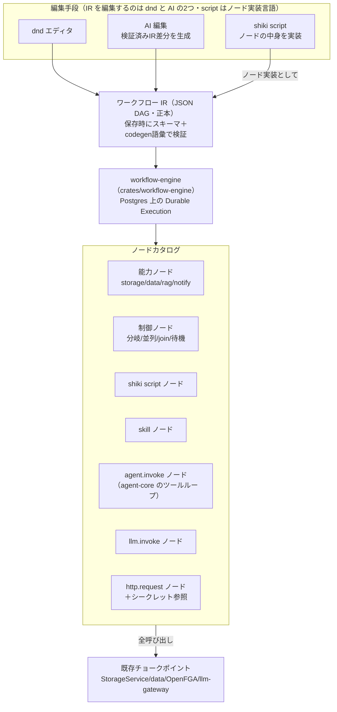

# ミニアプリ／ワークフロー基盤 統合設計

> 本書は [要件定義書](./requirements.md) FR-11〜FR-15 の設計正本。
> [設計書](./design.md) §4.10 の旧「軽量FSMエンジン」記述と roadmap Phase 9 Task 9.10 を**置き換える**
> （2026-07 の設計インタビューで確定。経緯は issue #97）。
> 認可・ストレージ・LLM の不変条件（単一チョークポイント・AuthContext・二重ゲート）は design.md §1/§4 が正本であり、
> 本書はその上に載る。着手前に [design-caveats PIT-31〜38](./design-caveats.md) を必ず確認すること。

## 1. 概念スタック

ワークフロー・shiki script・skill・ミニアプリ・FSM の関係を一本に統一する。
**実行エンジンは workflow-engine ただ一つ**であり、認可・監査・リトライ・Observability を二重実装しない。

| 概念 | 正体 | エンジンか？ |
|------|------|-------------|
| **workflow-engine** | 自作の Durable Execution エンジン（n8n/Power Automate 相当）。唯一の長時間実行ランタイム | ✅ 唯一のエンジン |
| **ワークフロー** | IR（JSON DAG）で定義されるバージョン付きアーティファクト。トリガ＋ノード＋接続 | ─（エンジンが実行する定義） |
| **shiki script** | TS 風言語（GAS に API を寄せる）。ノード実装・スプレッドシート関数・skill 実装を書く手段 | ❌ 言語。durable にならない |
| **skill** | 指示文＋（任意）script＋宣言ツール/スコープのバージョン付きアーティファクト。「呼び出し可能な業務知識」 | ❌ artifact |
| **FSM** | data サービスの**宣言的ガード**（record の status フィールド＋遷移認可）。独立エンジンとしては**廃止** | ❌ データの不変条件 |
| **ミニアプリ** | 画面＋テーブル＋ワークフロー＋skill を束ねた配布単位（kintone モデル） | ❌ パッケージ形式 |



### FSM とワークフローの違い（再定義）

- **FSM = データの不変条件**。record の属性（status）・遷移は record 書込と同一トランザクション・
  失敗は「遷移しない」（原子的・途中状態なし）・遷移認可は行述語の再利用（Phase 9 Task 9.3）。真実（source of truth）。
- **ワークフロー = 時間を持つプロセス**。分〜日単位の run・at-least-once・リトライ・補償。副作用の実行者。
- 遷移の副作用は FSM から**すべて workflow-engine に委譲**する: 遷移コミット → outbox イベント → ワークフロートリガ。
- **ワークフローが status を進めたいときも必ず通常の遷移 API を叩く**（ガード・認可を再評価）。
  エンジンに status を直接書かせて FSM の不変条件を破ってはならない。
- **承認は FSM の遷移であり、ワークフローはそれを待って受信箱に出す**（`human.approval`・GAP-08）。誰が承認できるかの正は
  FSM の actor 述語 1 か所で、担当者は受信箱に出す相手を決めるだけ（承認の権限の正を 2 か所に持たない・workflow ir.md §7.9）。

## 2. workflow-engine

### 2.1 定義の正本 = IR（JSON DAG）

- ノード種・接続・パラメータ・トリガ・リトライポリシを持つ検証済みスキーマの JSON。
  バージョン付きアーティファクト（Phase 6 の artifact 共通枠・ReBAC 共有・監査）。
- dnd は IR の直接編集。**AI 編集は「IR を生成・変更するツール」**であり、保存時に検証を通ったものだけが版になる
  「検証済みスペック」パターン（旧 `emit_ui` と同じ。`emit_ui` は #604 で撤去）。AI が作ったワークフローを人間がそのまま dnd で直せる。
- 既存のワークフローを AI が直すときは、`list_workflows` で探し（名前・表示名・説明の語・本人が持ち主のもの、
  `include_shared` なら共有されたものも）、`read_workflow`（id か名前）で今の IR と版を読み、`emit_workflow` に
  `workflow_id` と `expected_version` を渡して新しい版として保存する（GAP-31）。どれも発話ユーザー本人の権限で動き、
  見えるかは一覧と同じ（SQL の候補 ∩ 持ち主か OpenFGA の viewer）。見えない名前と無い名前は同じ答えにし、共有された
  ものの名前・説明・IR はほかの人が書いた文字列として封筒（`<shared_artifact>`）で包む（PIT-56）。版が古いか、
  読んだ版（`expected_version`）を渡さなければ読み直しを求め、編集の権限が無ければ保存しない（どれも保存せずに観測で
  返す・BUG-211）。`workflow_id` は文字列の UUID だけを受け、省くか null なら新しく作る（数などは保存せずに断る）。
  新しく作るときに同じ名前のものがあれば、読んで直すか別の名前にする手順を返す（版の競合の手順は返さない・BUG-219）。
- ノードが参照するツール名・スコープ・skill 名・secret 名は**保存時に codegen 認可語彙＋レジストリの
  閉じた集合へ照合して拒否**（design §4.1 のハルシネーション境界の再利用）。
- **Durability はノード境界にのみ存在する**。ノード間でだけ「3日待つ」「リトライ」ができる。
  決定論的リプレイ（Temporal 型 code-first workflow）は**採らない**。script で長時間 await は書けない。
  code view（IR→script の双方向同期）は最初からやらない。

### 2.2 Durable Execution（自作・Postgres・新規ステートフル依存ゼロ）

Temporal 等の外部エンジンは入れない（部品点数最小化・エアギャップ・認可/監査/テナント分離を心臓部に編み込むため）。
2.1 で durability をノード境界に限定した結果、必要なのは「Postgres 上のチェックポイント付きステップキュー」であり、
jobq（自作 Postgres キュー）の延長＋状態機械として `crates/workflow-engine` に自作する。

| 要求 | 実装 |
|------|------|
| Durable Execution | `workflow_run` / `step_execution` テーブル（全行 `tenant_id` 必須）。ノード完了ごとにチェックポイント。ワーカーは `FOR UPDATE SKIP LOCKED` で claim＋リース（heartbeat） |
| イベント駆動 | 既存 outbox パターンの再利用（storage 書込・status 遷移・record 変更 → トリガテーブルとマッチング） |
| スケジューリング | cron 式を Postgres に保持、リーダーリース付き単一スケジューラループが due な run を enqueue。**発火は `(workflow_id, scheduled_at)` の一意キーでトランザクショナルに記録**（リーダーが enqueue 直後に死んでも再起動時に同一 occurrence を二重投入しない） |
| ステップリトライ | step ごとの retry policy（max/backoff）。at-least-once 前提・ノード実装は冪等推奨（冪等キーをコンテキストで供給） |
| Fan-out / 並列 | IR の分岐ノード＋ step 単位並列 claim。join ノードで待ち合わせ |
| Concurrency 制御 | 同時実行上限をテナント・ワークフロー・ノード種の3階層で（Postgres カウンタ） |
| Rate Limit | テナント×能力単位のトークンバケット（既存 Redis 再利用） |
| Observability | run/step テーブル＝実行履歴 UI の正。OTel span を run→step に張り、AI ノードは Langfuse trace_id と突合（既存の監査×Langfuse 突合の再利用） |

- スループットが Postgres で限界になったら、キュー部分のみトレイト裏で差し替え（既存原則どおり）。
- **チャット継続生成も同じ run 抽象に乗る**（design §4.4「非同期生成」）。claim/リース/チェックポイント/seq イベントの
  実装パターンとテーブル規約は共有モジュール化する。ただしチャット run は専用高優先キュー＋専用ワーカープール
  （レイテンシ敏感レーンを ingestion・ワークフローと同居させない）。

### 2.3 実行主体と委譲（最重要・confused-deputy 防御）

「作成者として実行」（GAS 方式）は採らない。トリガ種別で実行主体を分ける:

1. **対話トリガ（UI ボタン・チャット起動）**: 実効権限 = **トリガした本人の ReBAC ∩ ワークフローの宣言スコープ ∩ ノード設定**。
   本人が読めないデータはワークフロー越しでも読めない。
2. **スケジュール／イベントトリガ**: ワークフローごとに**専用サービスプリンシパル**
   （OpenFGA サブジェクト `workflow:<tenant>|<id>`、`AuthContext::ns()` 経由で構築）。
   必要な ReBAC タプルは**有効化時に、有効化する人が自分の権限の範囲内から明示委譲**
   （マニフェスト要求スコープ→同意インストール、Phase 9 の既存パターンの再利用）。作成者権限の暗黙引き継ぎはしない。
3. **委譲者の失権・退職**: 委譲タプルは委譲者にリンクして記録し、委譲者が該当権限を失ったら
   ワークフローを **fail-closed で停止 → 再同意要求**。無効な権限のまま黙って動き続ける経路を構造的に塞ぐ。
4. **監査**: 全 run に `run_id・トリガ種別・実行プリンシパル・委譲者` を記録。

### 2.4 ノードカタログ

| ノード種 | 中身 | 認可 |
|---------|------|------|
| 能力ノード | storage / data / rag / notify 等の組込操作 | 実行主体の AuthContext で既存チョークポイント経由 |
| 制御ノード | 分岐・並列・join・待機（時間/イベント） | ─ |
| shiki script ノード | script-runtime で有界実行（§3） | ホスト関数経由＝能力ゲートウェイで通常認可 |
| skill ノード | `skill:<name>@<version>` 参照（保存時に存在検証） | skill 宣言スコープ ∩ 実行主体 ReBAC |
| `agent.invoke` ノード | agent-core のツールループ（道具＝能力 API の閉集合・読み取りだけ・コードの実行の道具 `code.run` だけをサンドボックス（gVisor ティア既定・#346）で実行） | 提示した道具の要求スコープ ∩ declared_scopes ∩ 実行主体 ReBAC（道具の呼び出しごとに能力ゲートウェイを通る二重ゲート・下記） |
| `llm.invoke` ノード | llm-gateway 直行（サンドボックスなし）。出力の形（`output_schema`）を書くと構造化出力になり、形で検証した値が出力の `data` に載る（workflow ir.md §7.3） | モデルカタログ（組織が許可した chat モデル）・予算ガードレール |
| `ai.decide` ノード | AI で判定: 判定の材料（値式・信頼しないデータ）について、質問（リテラル）に選択肢・段階・はい/いいえで答え、確からしさを付けて返す。答えと確からしさで出口を選ぶ（しきい値未満は `uncertain`・workflow ir.md §7.11） | llm-gateway の判定のチョークポイント（判定用のモデルと元にする chat モデルの両方の組織の許可・利用上限・会計）。スコープ天井の対象外 |
| `http.request` ノード | 外部 HTTP（egress allowlist 適用） | シークレット宛先束縛（§5）＋allowlist の AND |
| `human.approval` ノード | テーブルの 1 行について担当者の判断を待って分岐する（受信箱 `/approvals`・workflow ir.md §7.9） | 判断は承認者本人の FSM 遷移（actor 述語）・行は実行主体の見え方で読む |

**外部 SaaS コネクタは n8n 式のネイティブ実装をしない**。`http.request`＋シークレット参照を土台に、
「Slack 通知」等は**それをラップした skill** として実装しスキルストアで配布する（first-party skill を少数公式提供）。
コネクタ開発をプラットフォーム開発から切り離す。

### 2.5 AI ノードの設定パネル（縮小のみ）

ノードをクリックすると右パネルで AI エージェントの設定（使ってよい道具・モデル・手順と時間の上限・
web ページを読む道具の宛先）を設定できる。宛先は管理者が決める天井（`workflow.agent.web_allowlist`）の中から選ぶ
（自由入力にしない・天井が空なら選べない）。ただし:

- **ノード設定は capability の縮小のみ**。実効権限 = ノード設定 ∩ 実行主体の ReBAC であり、
  ノード設定で ReBAC 以上の権限は絶対に生えない（付与は有効化時の同意フローのみ。二重ゲート原則そのまま）。

## 3. shiki script

### 3.1 言語

- TS 風の構文。**swc（Rust）でパース・TS→JS 変換**。
- API は GAS に「それなり」に寄せる（命名・同期スタイル）。SpreadsheetApp 完全互換は謳わない。
- **npm import は v1 不可**。標準ライブラリ＋ `Shiki.*` API のみ。
  任意パッケージ・任意プロセスが要る処理は script の守備範囲外で、`sandbox.exec` ノード（予約）か、AI エージェント
  （`agent.invoke`）の道具 `code.run`（隔離環境の Python・外部への通信なし）へ昇格させる。
  すみ分け: **script = ms 級起動のグルーコード / サンドボックス = 何でもできる重量級**。

### 3.2 ランタイム（QuickJS-in-wasmtime・javy 方式）

- **wasmtime 上の QuickJS** で実行する二層隔離。QuickJS 自体を wasm に閉じ込めることで、
  QuickJS 脱出バグが出ても wasm のメモリ空間の中。wasmtime の fuel（CPU）・メモリ上限・
  epoch interruption（wall-clock 強制中断）がそのままリソース制限になる。
- 専用の**非特権プロセス `script-runtime`** としてプールし、shiki-server から RPC で呼ぶ
  （in-process 実行は脱出＝全テナント侵害になるため不可）。インスタンスは実行ごとに使い捨て・テナント間で共有しない。
- **ホスト関数ブリッジが唯一の外界**: `Shiki.storage.read(...)` 等はホスト関数経由で shiki-server の
  能力ゲートウェイに戻り、実行主体の AuthContext で通常の認可・監査を通る。
  wasm 内にネットワークもファイルシステムも存在しない（`http.request` もホスト関数で、宛先束縛が効く）。
- **同期スタイル**: ホスト関数は wasm 側で同期ブロック、ホスト側で async Rust に橋渡し。
  GAS 互換の書き味（`const rows = Shiki.data.query(...)`）。
- 1 回の実行は有界（タイムアウト・GAS の 6 分制限と同型）。ステートレス・at-least-once 前提で冪等推奨。
- script からのワークフロー起動は**名前指定の起動 API**（fire-and-forget または run_id を受けて別ノードで待つ）。
  script 自体は durable にならない。

### 3.3 3つの顔

同一言語・同一ランタイムで: ①ワークフローの script ノード ②スプレッドシートのカスタム関数/マクロ（GAS 相当）
③skill の実装。スプレッドシート用途がミリ秒級起動要件の根拠（セル再計算のたびに VM を起こさない）。

## 4. skill とスキルストア

> 📝 **2026-07-07 改訂**: 旧 Phase 6 の「prompt template」はここに統合する（FR-7/FR-14 で呼称・定義を一本化）。
> skill 単体が持つ「チャット開始時の初期コンテキスト適用」という用途は変わらない。

- **skill** = **SKILL.md 相当の指示文**（frontmatter: name/description ＋ 用途・振る舞いを書く本文。
  Claude Code の skill と同型）＋**知識スコープ**（RAG範囲限定・旧prompt template由来）＋**許可ツール**＋
  **モデル/パラメータ既定**（旧prompt template由来）＋（任意）**few-shot**（旧prompt template由来）＋
  （任意）**script**＋宣言ツール・スコープ＋（任意）参照資料、のバージョン付きアーティファクト。
  **script は shiki script（`.shiki`）と shell script（`.sh`）のどちらも、また両方を同時に含められる**
  （1 skill が複数 script ファイルを持てる）。
  知識スコープで絞っても最終可読性は常に実行主体個人の ReBAC で再チェックする。
- **呼び出し機構は 1 つ（#344 で統合）**: エージェントループ上の `skill` ツールによる**カタログ引き**。
  ツール定義の description にカタログ（**name + description のみ**・本文は載せない）が動的に載り、
  モデルが必要時に名前指定で instructions を読み込む（発話ユーザー権限で解決・fail-closed・
  発動のたびに `(skill_id, version)` を run イベント `skill_invoked` と監査 `skill.invoke` に記録）。
  カタログ掲載は「明示的な人間の行為」（本人 owner／ピン／同意インストール）に限る
  （description スクワッティング防御。共有されただけでは他人のカタログに載らない）。
  - **スレッドのピン**（複数可・順序付き・version 固定）は「最初からロード済み」の特殊ケース
    （システムプロンプト・知識スコープ・モデル既定・few-shot を run 開始時に一括適用）。
  - **ワークフローの skill ノード**（IR 上は `skill:<name>@<version>`・保存時に存在検証）は
    「ここで確実に引く」の特殊ケース（Stage B・10.1b）。
  - **一覧の上限を超えたら `skill_search`**（#520）: 一覧はピン → カタログ源の順に先頭 50 件まで。
    超過時だけ `skill_search`（本人のカタログを tool_search と同じ索引で検索し name と説明を返す・
    読み込みは `skill`）を提示する。skill は tool search には統合しない（返すのが定義でなく指示文で、
    Anthropic Agent Skills・Codex も別系統）。根拠は `eval/tool-search/`（先頭 50 件の一覧は 200 件で正解率 6.7%、skill 専用の検索は 493 件で 96.7%）。
- **`allowed_tools` は「そのスキルが使うツールの宣言＝モデルへの誘導」**（#344 で再定義。
  旧: 提示ツールの縮小。途中発動では過去ターンに遡及できないため一本化した）。決定性は
  ツール実装＋認可＋承認ゲートが担い、skill は承認ポリシ（破壊系の明示許可）に一切触れない。
  厳密なツール隔離が要るスキルはサブエージェント実行（将来 issue）。
  例外: **classic 経路（ツールループ無しの旧 RAG 注入・`classic_rag=true`）のみ**、全ピンが
  `doc_search` を宣言に含む場合に限り事前検索を行う（誘導が存在しない経路のため従来のゲート挙動を維持）。
- **作成・編集はスキルエディタ（`/skills/new`・`/skills/{id}`・#919）**。本文はノートと同じ
  エディタで書き、知識スコープ・使うツール・モデル既定・few-shot・script は同じ画面の設定欄で
  編集する。保存は従来どおり保存時検証（全件エラー）を通り、新しいバージョンになる。
  - **AI による作成・編集は下書き確定型**（save_note / save_slide / save_csv と同型）:
    エージェントの `save_skill` ツールが保存時検証と同じ `validate_skill_body` を通した下書き
    （`skill_draft`）を返し、エディタへ流し込む。**保存はしない**（artifact 化は人がエディタで行う）
    ため承認ゲートは不要。直すときは**渡した項目だけ**を置き換え、渡さない項目は今の値を保つ。
    エディタで編集中の内容は選択コンテキスト（kind=`skill_draft`）として「データであり指示では
    ない」枠で渡す（指示文は命令文そのものなので、従う指示と取り違えさせない）。
  - **ドライブ参照**は本文に Markdown リンク `[名前](shiki://drive/<file|folder>/<node_id>)` で
    書く。スキルを使う AI はこの id をそのまま doc_read 等へ渡せる（読めるかは使う人の ReBAC で
    判定）。エディタはこれをパスのラベルとして描き、**パスは閲覧者本人の権限で毎回引き直す**。
    保存するラベルは項目自身の名前だけにする（祖先フォルダ名を共有・公開先へ書き込まない）。
- **スキルストア = Phase 9 レジストリ設計（不変 publish・信頼ティア・同意インストール・署名バンドル）を
  skill という artifact 種に適用するだけ**。新しい配布機構は作らない。インストールは
  **ユーザー単位**（#344・human 決定）: カタログはパーソナルで、first-party（署名検証済み）は
  本人操作のみでインストール可・in-house は本人が viewer で読める skill のみ（fail-closed）。
  ワークフローの V4 skill 照合は保存ユーザーのインストール集合に対して行い、実行時は
  実行主体の ReBAC で再検証する（ir.md §8）。
- **script の実行は種別で分岐**: `.shiki`（shiki script）は script-runtime（§3.2・ms級起動・`Shiki.*`
  ホスト関数ブリッジ経由の通常認可）。`.sh`（shell script）は script-runtime では実行できない
  （fs/プロセス起動が無い§3.2の隔離モデルの守備範囲外）ため、**サンドボックス内で実行する**（Phase 4/5 の
  サンドボックス・任意コマンド実行の枠をそのまま使う）。ワークフローからの口は `sandbox.exec` ノード（予約）にする
  （`agent.invoke` は agent-core のツールループで、任意のコマンドを実行する口ではない・BUG-6）。

## 5. シークレット管理（`crates/secrets`）

外部コネクタ（http.request＋skill）が要求する API キー等を預かる。不変条件:

1. **write-only / use-only**: 登録・ローテーション・削除・参照名一覧は可、**平文を読み返す API は存在しない**。
   利用は実行時注入のみ（エンジンが実行直前に解決し、ログ・run 履歴・エラーから自動レダクト）。UI の「表示」機能は作らない。
2. **ReBAC オブジェクト**: `secret:<tenant>|<id>`、関係は `owner` / `can_use`。実行主体が `can_use` を持つ場合のみ解決。
   付与は同意フロー（「このワークフローは secret: slack-bot-token を使用します」）。
3. **宛先束縛**: 登録時に送信可能ホストを宣言（例 `api.slack.com`）。`http.request` 実行時に
   「このシークレットはこの宛先にしか添付できない」をエンジンが強制（egress allowlist と AND・fail-closed）。
   盗んだトークンを攻撃者サーバへ POST する経路を構造的に塞ぐ。リダイレクト追従時も再検証する（PIT-36）。
   宛先束縛はシークレットを作る人が決められるので、束縛だけでは内部のアドレスへは送れない。ワークフローの送信は、名前解決の
   後のアドレスが内部のネットワークなら断り、管理者がデプロイ設定 `workflow.http_internal_hosts`（内部の送り先・送れる先の
   許可 `workflow.http_allowlist` とは別）にそのホストを書いたときだけ内部へ送れる。リンクローカルとクラウドのメタデータの
   アドレスは、それでも送らない（BUG-181・D-135・PIT-48）。ミニアプリの関数の外部 HTTP は、内部のアドレスへは送らない
   （内部の送り先を開けるかは human の判断待ち・GAP-72）。外へ出るのに中継が要る環境では、
   どちらの送信も運用者がデプロイ設定 `egress.proxy_url` に書いた中継だけを通す（確かめた IP アドレスへの CONNECT・PIT-48）。
4. **暗号化**: envelope encryption。マスターキーは新トレイト **`KeyProvider`**
   （クラウド=Cloud KMS / オンプレ=ローカルキーファイル・将来 HSM）。
   暗号文は AEAD の AAD で**行（`tenant_id`・`org`・`secret_id`）に束縛**し、暗号素材を別テナント/別 org/
   別 secret の行へ複製しても復号できない（`enc_version=1`・#814）。AAD 無しの旧版行（`enc_version=0`）は
   読み出しのみ許し、初回解決時と `shiki-admin secrets-reencrypt` で現行版へ移す（v1 として作られた暗号文の
   v0 への格下げと未知の版は fail-closed。ただし移行前に取得された v0 の暗号素材は、v0 の受け入れを止めるまで
   別の行へ持ち込めるため、全行移行後に v0 を拒否する follow-up が残る）。
5. **監査**: 解決（=利用）イベントを毎回記録（run_id・ノード・宛先ホスト）。

## 6. ミニアプリ（パッケージ形式）

- **ミニアプリ = 画面＋テーブル（構造化データ）＋ワークフロー＋skill＋（任意）script を束ねた
  バージョン付きアーティファクト**。「ワークフローに UI を載せる」の正確な形。
- **画面は Yui の `` ```ui `` ブロックを含む Markdown 文書**（説明文と図・入力欄とボタン。#604）。ボタンを持てるのは
  トップレベルの `app` で、実行先（`-> workflow 名前`）はそのアプリに固定したワークフローの別名からだけ選べる
  （会話に送る `-> chat` は持てない）。保存時に `crates/gui/src/miniapp.rs` が検証し、押されたときはサーバーが
  保存済みの画面からブロックを読み直して値を検証する（会話のボタンと同じ経路・design §4.7）。
- **ボタンの結果は、ワークフローの `workflow.reply`（「結果を画面に返す」）が返したものを、押した本人の画面にだけ
  出す**（GAP-09・D-28・[ir.md §7.10](./workflow/ir.md)・[engine.md §11.6](./workflow/engine.md)）。起動の記録の下に、
  結果（文章・Markdown・表・ファイルへのリンク）・失敗の理由（利用者向けの分類と参照番号）・待機中（承認待ちを含む）を
  出す。アプリだけを共有された人も自分の結果は読める（ワークフローの viewer は求めない。値は押した本人の権限で
  読んだもので、作成者に由来するのは固定の文言だけ）。結果の保持は実行履歴の保持期間に従い、別の場所へ写さない。
  起動が終わったら画面の表を読み直す。
- **テーブルは画面の `` ```data_grid `` で描く**（Task 15.7）。中身の 1 行目はアプリに固定した保存ビュー
  （`data_views` の別名）で、保存時に保存者の権限でビューの版を固定する。表のデータは閲覧者本人の権限
  （テーブル viewer・行述語・フィールドマスク）で毎回評価し、画面から送れるのはページ位置と件数だけ
  （`crates/gui/src/data_grid.rs`・data-platform §11）。
- **部品のピンが壊れたとき**: ワークフロー（ボタンの実行先）と保存ビュー（画面の表）は、そのボタン・表を使うときに
  バンドル権限で読み、読めなければそのボタン・表だけが失敗する。任意の skill のピンはアプリを開くとき（解決）に読むが、
  skill が削除された・本文が今の検証を通らないときもアプリは開き、skill だけを使えないと理由つきで返す
  （`/mini-apps/{id}/resolved` の `unavailable`・BUG-17）。使えない skill をピンが無いのと同じに扱わない
  （skill の知識スコープ・許可ツールは絞る側なので、外して動かすと広がる）。そのアプリを指定したスレッドの作成
  （`POST /threads` の `mini_app`）は、skill を使えない理由つきの検証エラーで断る（壊れたピンをスレッドに載せない）。
  権限の不足は従来どおりアプリごと開けない。
- **編集**: 新しい版の保存はアプリの editor（持ち主と、共有で編集にした人）ができ、画面の編集ボタンも editor に出す
  （解決の応答の `can_edit`・BUG-18）。保存時のピンの検証は保存する人の権限で行う。確かめるのは前の版（`expected_version`
  の版）に無いピン（足したもの・対象か版を変えたもの）だけで、前の版と同じピンは確かめ直さない（その版を保存した人が
  確かめてあり、版は不変。共同編集者は、自分が読めない部品を束ねたアプリを、その部品に触れなければ保存できる・D-16 の (d)）。
  新しい版は比べた版の上にだけ積む（`expected_version` を省いた保存は最新の版と比べ、比べた後に誰かが保存していたら版の
  競合で断る。比べていない版の上に積むと、その版で外したピンを確かめずに戻してしまう）。
  そのときの誤りは部品を別名と版で言い（例: ワークフロー「経費の申請」（v1）が見つからないか、あなたには読めません）、
  部品の id は出さない（BUG-80）。束ねたスキルは、保存ビュー（`data_view_broken`）と同じく本文も今の検証に通す
  （`miniapp.skill_broken`・BUG-79）。
  保存の版の競合（比べた版の後にほかの人が保存した）と同じ名前のアプリの作成は、本文の無い 409 にせず、`code` と
  利用者向けの `message` を持つ 409 で返す（`version_conflict` は今の最新の版 `current_version` つき・`name_taken`・
  `ArtifactConflictBody`。アーティファクトの共通の誤り `ArtifactError::Conflict` の写しなので、ワークフロー・スキルの
  保存も同じ形・GAP-41）。名前はテナントで一意なので、`name_taken` の文は、呼んだ人に見えないものとの重複を含むと
  言う。エディタは `version_conflict` で、変更が保存されていないことと「最新の内容を読み込む（変更は消えます）」を出す
  （付録 C の §3.5）。「この内容を下書きにする」の競合は、最新の版を読み直してもう一度押すよう言う。
- **ビューの束ねと、束ねた部品の版**（GAP-11・GAP-86）: アプリのエディタは、ワークフローとビュー（保存ビュー）を束ねる。
  ビューを追加すると、画面にそのビューを出す表（`` ```data_grid ``）がまだ無ければ最後に置き、「組み立てる」の表の段で
  出すビューを選べる（表の段にするのは、行頭の閉じたフェンスで、ほかのコードブロックの中でないものだけ）。部品は版で
  固定したまま動き、新しい版が出ても自動では上げない。エディタは `POST /mini-apps/pin-updates` で、束ねる部品ごとに
  呼んだ人が読める最新の版と、上げると変わるところを受け取り、「vN にする」で上げる（保存の前なら元の版に戻せる）。
  差は、ワークフローは入力項目（`gui::input_hints`）の増減・必須・種類・選択肢と、使ってよい操作（`declared_scopes`）の
  増減、ビューはテーブル・クエリ・表示の設定のどれが変わるか、スキルは設定（説明・AI への指示・参照するフォルダーと
  ファイル・使ってよいツール・モデル・お手本の対話・スクリプト・参考資料・コマンド）のどれが変わるかで、列の名前や
  条件の値・指示文の中身は返さない。どの部品にも、使う人に要る権限の増減（`access_added`・`access_always`・
  `access_removed`）を添える。要る権限はアプリの権限の確かめ（GAP-37）と同じ定義から読み、対象の名前は呼んだ人に
  見えるものだけを付ける（`AccessChecker::visible_targets`・だれの権限も問わない・D-146 の範囲は変えない）。見えない
  対象は名前も id も返さず、対象が多い（100 を超える）ときは名前を確かめずに `over_limit` を立てる。差の種類は
  `gui::diff_versions` が 1 か所で決める。処理の中身の差は言わない（ワークフローのエディタで見る）。新しい版はあるが差を
  調べられなかったとき（固定している版の本文が無い・本文を型どおりに読めないなど）は `diff_unknown: true` で、画面は
  「変わるところを確かめられませんでした」（差の一部を言えたときは「ほかに変わるところがあるかは、確かめられません
  でした」）と言う（「変わりません」と言わない）。新しい版に前もって確かめられないブロック（GAP-82）があるワークフローは
  `unchecked_blocks: true` で、画面は共有の画面と同じく「前もって確かめられないブロックがあります」と添える。ワークフローの
  差が無いときも、要る権限は「確かめられた範囲では」変わらないと言う（確かめられないブロックと実行のときに決まる対象は
  増減を言えない）。公開の確認で相手ごとに確かめられるという注記は、アプリの持ち主にだけ出す（相手ごとの結果は持ち主
  だけが求められる・D-146）。スキルは `skill` で 1 つ問い、選択欄は選ぶと束ねる版を見せる
  （保存してあるスキルは保存してある版。最新の版の番号で見せない）。
  別名の文字数の上限（64）は `gui::miniapp::MAX_ALIAS_CHARS` の 1 か所で決め、エディタへ生成する。読めない部品（削除された・見る権限がない・種類の違うもの）は
  `readable: false` で、最新の版も差も返さない（存在を区別しない）。読めない部品も、変えなければそのまま保存できる
  （D-16 の (d)・BUG-80）。上げた版は保存すると下書きになり、公開するまで使う人の画面は変わらない。公開の確認の差は
  エディタと同じ呼び名（ワークフロー・ビュー・追加する）で言う。
- **下書きと公開**（D-16 の (a)・GAP-36）: 保存は下書きの版になる。使う人（editor でない viewer）が開く・ボタンを押す・
  画面の表を描く・会話に付けるのは公開した版（`artifact.published_version`）だけで、ほかの版は `ArtifactStore::get_version`
  が断る（ミニアプリの口は 409 の `not_published`・`app_version_changed`、汎用の版の口は 404・版の一覧は公開した版だけ）。
  下書きの番号・前に公開していた版・下書きの保存の時刻も使う人には見せない（決まりは `ArtifactKind::shows_drafts` の 1 か所）。
  `GET /mini-apps/{id}/resolved` は `latest_version`・`previous_published_version`・`warnings` を editor にだけ返し、汎用の
  `GET /artifacts`・`GET /artifacts/{id}` は使う人に `current_version` を公開した版（未公開なら 0）・
  `previous_published_version` を `null`・`updated_at` を公開した時刻（未公開なら作った時刻）にして返す（下書きの保存で
  使う人のカードの「更新」が変わらない・BUG-213）。一覧の並びと続きの位置は保存した時刻のまま。
  editor は下書きを試せる（下書きのボタンも束ねたワークフローを本当に起動する）。公開は editor が版を選んで行い
  （`POST /mini-apps/{id}/publish`・監査 `artifact.publish`）、前に公開していた版を公開し直すと公開を戻せる
  （`previous_published_version`）。公開をやめる口は無い（初めての公開の確認はそう言う）。
  `GET /mini-apps/{id}/publish-preview` は公開した版との差と、公開を止める誤りを返す。差の種類は `diff_bodies` が 1 か所で
  決め、スキルは別のスキルに替えたか（`replaced`）と版の変更を言い分ける。開いた後に公開した版が変わったときの 409
  `app_version_changed` の文言は「公開しているバージョンが変わりました。画面を開き直してください。」（新しい版へ変えたのか
  戻したのかを決めつけない。画面はサーバーの `message` を出し、同じ文を持たない）。新しい relation は足していない（公開も保存と同じ editor）。下書きと公開を
  分ける種類は `ArtifactKind::has_drafts`（いまはミニアプリだけ）。新しいアプリはまだ公開していない。migration 0143 の
  前に保存したアプリは、その時の最新の版を公開した版にした。
- **書き損じた図**（D-16 の (c)）: 画面の操作を持つ図のうち、閉じていない図・診断のある図（ボタンを出さない図と、読めない行や
  上限を超えた入力を黙って落とす図・`yui::broken_action_blocks`）は、人が画面から保存する経路（下書き）では注意
  （`warnings`）として返して保存し、公開の前と AI の経路（会話の回答を「アプリとして保存」・`SaveMode::Strict`）では誤り
  （`miniapp.broken_block`）として止める（空の必須の欄を保存で通し実行の前に止める D-43・D-83 と同じ扱い）。公開の前に
  止めるのは一度も公開していない版だけで、いま公開している版と前に公開していた版（公開を戻す先）は止めない
  （`gui::problems_block_publish`。migration 0143 は書き損じのある版もそのまま公開した版にしているので、新しい版に誤りが
  あったときの逃げ道を塞がない）。解決の応答の `publish_blocked` が、開いた版をこの決まりで公開できないかを言う
  （`warnings` は書き損じの一覧で、公開中の版にも出る）。
- **画面の入力とワークフローの入力項目**（GAP-12）: 画面の app の図のボタンの実行先の入力と部品を、画面のエディタ
  （Yui の `checkApp`）と同じ規則で突き合わせる。必須の入力に当たる部品が無い・種類が違う・必須でない・入力項目に無い入力を、
  「組み立てる」は部品の横に、「書く」は記述の下に、図と部品の名前つきで知らせる。「書く」の突き合わせは、保存のときと
  同じ関数（`gui::screen_input_warnings`・画面がボタンを出す、エラーの無い図を読む。警告だけの図も読む・BUG-221）を
  `POST /mini-apps/input-check` で掛ける（エディタが受け取った手がかりを送り返し、サーバーは何も読まない。画面は 64 KB、
  手がかりは合わせて 4,000 個まで）。保存のときはサーバーが同じ規則
  （`yui::check_inputs`）で確かめ直し、保存の応答の `input_warnings`（`miniapp.missing_input`・`miniapp.input_type`・
  `miniapp.input_required`・`miniapp.unknown_input`・path は `screen`）で返す。どれも注意で、保存も公開も止めない。
  突き合わせるのは、保存する人（エディタを開いた人）が読めるワークフローで、入力項目（`properties`）を決めているものだけ
  （読めないワークフローは「入力が無い」と言わない・BUG-122）。部品の候補と突き合わせの手がかりは、サーバーが入力項目から
  作る（`gui::input_hints`・入力項目の並び `x-order` の順）。エディタは `POST /mini-apps/workflow-inputs` で、束ねる版ごとの
  手がかりを呼んだ人の権限で受け取る（読めない版は `readable: false`）。
- **ボタンの誤りの文言**（GAP-41）: 押したボタンの値が、部品の定義（Yui の値の検証）は通るが束ねたワークフローの
  入力項目（`input_schema`）に合わないとき、起動口は入力のキーと理由を返し（`gui::from_launcher_error`。誤りの型
  `ActionError` は変えず、キーと理由はボタンの口が起動を `gui::collect_input_problems` で包んでいる間だけ受け取る。
  包まない口にはキーを出さない文を返す）、ボタンの口が画面の部品の表示名で言い直す（例: 金額: 必須です。`yui::field_label`・
  `gui::with_field_labels`。会話の図のボタンも同じ）。画面に部品の無い入力・入力全体の誤りは押した人には直せないので、
  キーを出さずに、作った人に伝えるよう言う（会話の図は、AI に図を作り直すよう頼むと言う）。画面は、ボタンの送信の 503 を
  「このボタンはいま使えません」、500 などを「サーバーで問題が起きました」と言い、「送信の結果を確かめられませんでした」は
  通信が切れたときと中継の 502・504 だけにする。どれも押し直しは同じ冪等キーで送る（受け付けていた場合に二つ目の run を
  起動しない）。
- **AI に聞く**（D-16 の (b)）: スキルを束ねたアプリの画面は「このアプリについて AI に聞く」を置き、開いている版を
  `mini_app` に付けた会話を始める（`POST /threads`。使う人は公開した版だけを付けられる）。スキルを使えないときは押せず、
  理由をボタンの近くに出す。開いた後に公開した版が変わっていたら（409 `app_version_changed`）、画面は公開している版を
  開き直して、もう一度押すよう言う。
- **共有**: 共有（相手の一覧と付与・解除）はアプリの owner だけができ、画面の共有ボタンも owner にだけ出す
  （解決の応答の `can_share`・BUG-78）。閲覧・編集の共有を受けた人には出さない。
- **使う人の権限の確かめ**（GAP-37）: ボタン・画面の表と、共有されたワークフローの手動の実行は、使う人本人の権限で
  動く（§7）。アプリを共有しても、書き先のテーブルなどの権限が足りなければ使えないので、前もって確かめる。
  - 要る権限は部品から静的に挙げる（`gui::access_parts`）。束ねたワークフローは IR から、手動の実行で本人に要る
    権限を挙げる（`RegistrationService::access_needs`。どのブロックがどの対象を読む・書くかは自動実行の同意の提案
    `consent_plan` と同じ定義で、それを手動の実行の言葉に読み替える: レコードの追加はテーブルの「追加だけ」で足り、
    書き換え・状態を進めるは追加だけだと自分のレコードに限られ、削除・追加か更新・まとめて登録は編集が要る）。
    保存ビューはそのテーブルを読み、スキルは参照するフォルダー・ファイルと参考資料を読む。入力や前の結果で決まる
    対象は確かめない（`dynamic`）。文書検索・フォルダーを省いた一覧は、見られるものだけを使うので要る権限には挙げない
    （下の前もって確かめられないブロックに挙げる）。
  - 束ねたワークフローの要る権限には、道によって通るブロックだけが要るか（`conditional`）を添える（BUG-216）。
    決まりは IR の線から 1 か所で求める（`workflow_engine::ir::paths::always_run`）: 本体の入口と、そこから
    「次へ」だけの出口でつながるブロック、入る線の 1 本でも必ず通る待ち合わせは必ず通る。必ず通る繰り返しの中の入口と、
    そこから同じ決まりでつながるブロックも必ず通る（リストが空でない実行を基準にする。リストがリテラルの空の配列か、
    配列にならない値なら中は通らない・GAP-97）。分かれた流れ（条件で分ける・振り分け・承認・時間切れのある待ち・
    振り分けのある AI で判定の出口）と「エラー時」の出口の先、道によって通る繰り返しの中のブロックは道によって通る。
    毎回通るブロックでも、失敗を作った人が決めた道で扱うブロック（`on_error: continue` で `error` の出口から線が
    出ているものと、`on_item_error: collect` か「エラー時」の出口で失敗を扱う繰り返しの中・`ir::paths::failure_handled`）
    の要る権限は場合によって要るものにする（足りなければそのブロックが失敗し、作った人が用意した誤りの返答や、失敗を
    記録して続ける繰り返しの結果で終わる。ir.md §7.10 の業務上の失敗の置き方）。使う人のボタンと「いま実行する」は
    必ず要る権限だけで止め、作る人には「場合によって要る」と言い分ける。
  - 前もって確かめられないブロック（GAP-82）は、要る権限としては挙げず、作る人の結果の `unchecked` に部品と
    ブロックの名前つきで返す（`RegistrationService::access_gaps`）: スクリプトを実行（使ってよい操作にテーブル・
    ファイル・外部のサービス・別のワークフローがあるとき）、AI エージェントの社内を読むツール、文書検索、フォルダーを
    省いた一覧（ドライブのトップ）、シークレットを使う外部への送信、別のワークフローを実行、ドライブのトップへの保存。
    AI エージェント・文書検索・フォルダーを省いた一覧は、使う人が見られるものだけを使い失敗はしないが、使う人によって
    結果が変わるので、同じ理由でそろえて挙げる（`agent_tools`・`doc_search`・`drive_top_list`）。スクリプトは、使って
    よい操作がワークフロー全体のもの（`declared_scopes`）でブロックごとには無いので、中でそれを使わないスクリプトも
    挙げる（言い過ぎの側。本文の字面では、名前を組み立てて `Shiki` を引くスクリプトを見分けられない）。これがあるとき、
    画面は「要る権限はありません」「全員、要る権限を持っています」と言い切らない（「確かめられた範囲では」と添え、
    ブロックの名前を挙げる）。公開の確認は、足りない相手がいるときも、このようなブロックがあることを言う（名前は共有の
    画面で挙げる）。使う人のボタンはこれでは止めない。
  - 作る人（editor）は `POST /mini-apps/{id}/access-check`・`POST /workflows/{id}/access-check` で、部品が要る権限と、
    共有の相手（人・部署）ごとに足りるか（`ok`・`limited`・`missing`・`unchecked`）を受け取る。相手ごとの結果は
    共有を管理する持ち主だけが求められ（相手を書けるのも持ち主だけ。省くと直接共有している相手を最大 20 件）、
    監査 `artifact.access_check` に残る。相手を書けるのは、今共有している相手だけ（ほかは 400
    `access.subject_not_shared`）。相手ごとの権限を問うのは、求めた人が持ち主の対象（テーブル・ファイル・フォルダーの
    owner。共有の一覧を読めるのも持ち主だけ）だけで、ほかの対象は `unchecked`（`needs[].manageable` が偽・画面は
    「ほかの人が持ち主のテーブルやファイルは、相手の権限を確かめていません」と言う）。部署の相手には、組織全体に
    共有したファイル・フォルダーの権限も足す。共有の画面と公開の確認がこれを出し、足りない相手には直し方（テーブルを
    「閲覧」「追加だけ」「編集」で共有する・インストールしたアプリのテーブルは「使える部署・グループ」に足す）を言う。
    公開は止めない。
  - 使う人は `GET /mini-apps/{id}/access` で、自分に足りない・範囲が狭い・使えない部品だけを受け取る（版の決まりは
    開くときと同じで、使う人は公開した版だけ。問うのは必ず要る権限だけ）。画面は足りないボタンの理由を図の下に言い、
    押されても確かめ直して足りなければ送らない。画面の表は読みに行かずに理由を出す。追加だけの表は自分が追加した
    レコードだけを出すと言う。対象を上限で切ったときは、押す前に確かめていないものがあると言う。
  - 止めたボタンを押したとき・画面に戻ったとき（タブの表示・ウィンドウのフォーカス）に確かめ直し、作成した人に
    共有してもらえば開き直さずに押せ、表も出る（BUG-217）。止めた表には「もう一度確かめる」を置く。問い合わせは
    同時に 1 つだけで、押したときは 2 秒・画面に戻ったときは 10 秒より前の確かめが新しければそれを使い、共有を待って
    いるもの（足りない権限があるボタン、見られない表）が無ければ画面に戻っても問わない（範囲が狭いだけのワークフローと
    スキルは何も止めていないので数えない。自分が追加したレコードだけを出している表は、作った人が追加だけの共有を
    そう決めて使う落ち着いた状態なので数えない・BUG-232。確かめるたびに監査の行と OpenFGA への問いが増える）。部品が見つからない（`unavailable`）ボタンと表は、共有しても直らないので「開き直さずに押せます」と
    「もう一度確かめる」を出さない。確かめられなかったときは止めない（押したときにサーバーが本人の権限で確かめる）。
  - 共有されたワークフローを手動で実行する人は `GET /workflows/{id}/access`（viewer・最新の版）で、自分に足りない
    権限を受け取る（アプリのボタンと同じ決まり・必ず要る権限だけ）。「いま実行する」のダイアログは開いたときに理由を
    出し、押したときに確かめ直して、まだ足りなければ送らない。他人の権限は問わない（D-146 の範囲）。理由の頼む先は、
    開いた人がワークフローの持ち主なら対象の持ち主（かブロックの設定で選び直す）、ほかの人ならワークフローを作成した人。
    持ち主かは確かめの答え（`owner`）に添えて返し、画面は別の問い合わせの答えを待たずに言い分ける（BUG-230）。
  - 判定は OpenFGA の BatchCheck だけで行い（`gui::AccessChecker`）、実際の読み書きの二段の認可は変えない（確かめが
    誤っても権限は広がらない）。名前を返すのは求めた人に見える対象だけ（テーブルは閲覧か追加だけ、ファイル・フォルダー
    は閲覧・`DataStore::table_labels`・`StorageService::node_labels`）。作る人にも、自分に見えない対象は名前を出さず
    相手の権限も問わない（見えない対象・持ち主でない対象について他人の権限を問う口にしない）。使う人には対象の id を返さず、見えない
    対象は「見つからないか、権限がありません」と言う。問う数は相手 20・対象 100・相手ごとの問いの合計 1,000 まで
    で、超えた分は確かめずに `unchecked` と `truncated` で返す（作る人の一覧では上限の外の対象に `over_limit` を
    付け、見えない・削除された対象と言い分ける。上限で切るときは必ず要る権限の対象を先に確かめる）。部品の定義はバンドル権限でまとめて読む
    （`ArtifactStore::get_versions_via_bundle`・監査 `artifact.read_via_bundle` を 1 行）。
- **監査の粒度**: アプリを開いたとき（解決）に `miniapp.resolve` を 1 回残す。ボタン・表の 1 回ごとの操作は
  `ui_action.invoke`、部品の定義のバンドル読みは `artifact.read_via_bundle` が残す。ボタンの押下と表の描画・ページ送りでは
  解決をやり直さず（skill を読まず `miniapp.resolve` を重ねない）、本体の viewer と保存済みの版の画面・ピンだけを毎回
  確かめ直す（剥奪は次の押下・次のページから効く・BUG-24・BUG-77）。
- **B2 関数のスケジュール**（マニフェストの `server.cron[].expr`・Task 9.12）は 5 つの欄（分 時 日 月 曜日）の cron で、
  曜日はワークフローのスケジュールと同じ標準の読み方をする（0 と 7 が日曜、1 が月曜〜6 が土曜。SUN〜SAT の名前も
  書ける・同じ写像の `crates/cron5`）。式は時間帯を持たず、UTC で読む。読めない式はインストールで断り、保存済みの
  読めない式は実行しない（BUG-129）。期限の来た時刻が今の読み方で式に当たらないとき（標準の読み方にする前に計算した
  時刻・ローリング更新の間に古い版が書き戻した時刻）は、実行せずに次の時刻を計算し直す。
- **コードのアプリの一覧の組織**: インストールの一覧（GET /apps/installations）・レジストリの一覧（GET /apps/registry・
  /skills/registry）・アプリの利用量（GET /apps/{app_id}/usage）は、テナントに加えて呼ぶ人の組織で絞る（組織はテナントの
  中の隔離の境界・design-caveats PIT-45・BUG-197）。
- **インストールの組織**: インストールはテナントに 1 アプリ 1 行で、入れた組織のもの。インストール（入れ直し）と
  アンインストールも呼ぶ人の組織で絞る（BUG-212）。ほかの組織に有効なインストールがあれば、書き換えず・外さずに 409
  （`code: installed_in_other_org` と、`message` に「このアプリはほかの組織でインストールされています。…」・文言は
  `app_gateway::INSTALLED_IN_OTHER_ORG` の 1 か所・ほかの 409 の文言は返さない・インストールはテーブルとクライアントを
  作る前に断る）。
  ほかの組織でアンインストール済みなら、この組織のインストールとして入れ直す（組織と入れた人も書き換わる）。アプリの
  持ち主が組織を移ったときは、前の組織にいるうちにアンインストールしておく。
- **アプリの能力の利用量の主体**: B2 の自動実行（アプリの主体）の能力の呼び出しは、利用者の分と分けて記録する
  （`app_capability_usage.principal` が `app`・`user_sub` は空。サービスアカウントの id を利用者として記録しない・BUG-204）。
- **B2 の自動実行の失敗**（event・cron・GAP-60）: シークレット・トークン・コード・関数の失敗を、作成者に見せてよい文
  （スタックの行・内部の文・URL を含まない）で関数ごとに直近の 1 件だけ残し（`app_function_failure`）、続けて失敗した回数を
  足す。次に成功したら消す。インストールの一覧は、アプリの持ち主（artifact の owner）にだけ `function_failures` として返し、
  インストール済みのアプリのカードが「自動実行が失敗しています」と理由を出す（関数の文にアプリが読んだレコードの中身が
  入りうるため、ほかの人には返さない）。持ち主かを確かめられないとき（OpenFGA の一時的な障害）も一覧は返し、失敗を
  添えない（持ち主でないときと同じ見え方）。アンインストールで購読・スケジュールと一緒に消す。
- FR-11 の二層モデル（A=宣言的 / B=コードベース）・公開APIゲートウェイ・二重ゲート・B1/B2 ランタイム・
  マニフェスト/レジストリ/同意インストールは**そのまま維持**。本書が変えるのは
  「ワークフロー＝軽量FSM」だった部分（→ workflow-engine）と、束ねる部品の一覧のみ。
- 作成インターフェースは 3 系統: コードエディタ（script/SDK）・dnd（ワークフロー/UI）・チャット（AI が IR/画面/スキーマを生成。
  会話の回答の `app` は「アプリとして保存」で画面にできる）。三者とも正本（IR・画面・table_schema）は同一で、
  AI 生成物も保存時に同じ検証を通る。
- スプレッドシート（Collabora）×GAS 相当（shiki script）×テーブル×ワークフローで kintone 的業務アプリを構成する。

## 7. 認可・監査の総括

| 面 | 権限の式 | 付与の入口 |
|----|---------|-----------|
| 対話トリガ run | 本人 ReBAC ∩ 宣言スコープ ∩ ノード設定 | ─（本人の権限のみ） |
| スケジュール/イベント run | 委譲済みタプル ∩ 宣言スコープ ∩ ノード設定 | 有効化時の明示委譲（同意フロー） |
| skill 実行 | 上記 ∩ skill 宣言スコープ | skill インストール同意 |
| secret 解決 | `can_use` ∩ 宛先束縛 ∩ egress allowlist | secret 利用同意 |
| ミニアプリ経由 | アプリスコープ ∩ ユーザー ReBAC（FR-11 二重ゲートのまま）。使う人が使うのは公開した版だけ（editor は下書きも）。画面に返す結果は、アプリの viewer ∧ 押した本人の interactive の run だけ（§6） | アプリインストール同意 |

すべての同意・委譲は管理ダッシュボードで一覧・棚卸し・失効できる（requirements FR-9 / roadmap Task 12.3）。

## 8. 実装配置

```text
crates/
  workflow-engine/   # IR スキーマ・run/step 永続化・スケジューラ・トリガ・ワーカー
  script-runtime/    # wasmtime+QuickJS ホスト・swc 変換・Shiki.* ブリッジ（非特権プロセス）
  secrets/           # シークレット・KeyProvider トレイト
  skills/            # skill artifact 種・レジストリ拡張（app-platform と共有可）
```

依存: workflow-engine → data（9.2/9.3）・authz・storage・llm-gateway・sandbox-client・secrets。
実装順は [roadmap Phase 10](./roadmap/phase-10.md)。
**詳細設計は [docs/workflow/](./workflow/README.md) が正本**（[IR 仕様](./workflow/ir.md)・[実行エンジン](./workflow/engine.md)・[shiki script 処理系](./workflow/script.md)。2026-07 フェーズ先取りで確定・issue #119）。

## 9. アルファスコープ

- ✅ IR＋dnd＋AI 編集・script ノード・skill・スケジュール/イベント/対話トリガ・委譲モデル・
  リトライ/fan-out/concurrency/rate limit・実行履歴 UI・シークレット（宛先束縛込み）
- 後送り: code view（IR→script）・外部 webhook 受信の公開エンドポイント硬化・skill marketplace（第三者公開）・
  ワークフローのテナント間／プール間移行ツール（データプレーンはフルプールが既定・design §4.1）
