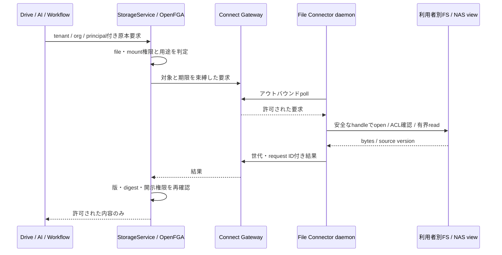

# Shiki Connect 設計

> 状態: 設計先行。製品実装は未マージ。最初の実装はファイルコネクターのみ。
> [共通基盤](./connect-ops-foundation.md) / [Ops](./shiki-ops.md) / [PoC検証記録](./connect-poc-evidence.md)。

## 1. 製品の境界

ConnectはShikiと顧客内の業務データ/システムを安全につなぐ基盤である。
Drive、RAG、AI、Workflowを社内へ拡張するが、端末/Platformの運用管理・更新・脆弱性管理はOpsが担当する。
将来のDB読取、承認付き社内API操作、登録済みジョブ、ソースイベントは別コネクターとして追加する。
ファイル操作を万能RPCや任意shellへ拡張しない。DBの行/列権限、API承認、ジョブ隔離は各adapterで別途設計する。

### 1.1 配置と既存基盤の再利用

- **Shiki側のConnect Gateway**: 接続登録・接続世代、能力一覧、有界な要求配送、イベント受領。業務認可の代替ではない。
- **Rust daemon**: 顧客内で常駐し、GatewayへアウトバウンドTLS接続。設定済みmountと利用者別view以外を触らない。
- **File Connector**: OS/共有方式固有の安全なhandle操作・ACL評価・範囲読取・変更検知。SMB/NFSは顧客内の接続で終端する。
- **既存StorageService**: 原本読取/変更の単一入口。OpenFGA、tenant/org/principal、監査、outboxを再利用する。
- **既存RAG**: outbox→parse/chunk/embed→Qdrant/Tantivy、pre-filter＋post-filter、引用。別の検索基盤を作らない。
- **既存llm-gateway / Workflow**: AI呼出し・会計と、イベントによる業務処理。Opsが業務主体に昇格する経路を作らない。

## 2. 認可とファイルアクセス

実効権限は利用者のfile/mount ReBAC、登録済みコネクター許可、利用者自身の接続先ACLの交差。
Gatewayで確定したAuthContextを端末まで束縛し、daemonが任意の利用者IDやrootを受け入れない。
NASの所有者資格情報で全社員の読取を代行しない。利用者別SMB session/NFS identityの対応は管理者承認の登録情報とする。
NFS AUTH_SYSは信頼するクライアントを前提とし、暗号学的な本人認証とは扱わない。

原本は移動せず、Shikiには外部ID・mount・source revision・索引版・digest・tombstone等を保持する。
原本blobの複製がなくても抽出本文/埋め込みはShiki側に保存される。SaaS配置ならこれも顧客外送信である。
ACLを確認できない、接続が切れた、原本と索引版/digestが違う場合、保存済み索引の本文・引用を返さない。
候補の絞込みと開示直前の再認可を両方行い、検索結果からの原本取得もStorageServiceを通す。
メタデータ/一覧のファイル名も認可対象とする。

パストラバーサル、symlink/reparse、hardlink、TOCTOUはOSごとにhandle基準で対策し、名前文字列のprefix検査だけに頼らない。
LinuxのPoCで使ったopenat2の保証をWindows/macOSや任意NASへ一般化しない。
読取時のmount内封じ込め・ACL・リンク/TOCTOU対策を保証できないadapterは、read-onlyでも有効化しない。
読取保証を満たし、書込みの保証だけが不足する場合に限りread-onlyへ縮退する。
原本取得は有界chunk/範囲とbackpressureを基本にする。公開stream APIのキャンセル/再開等は実装時に契約を定める。

### 2.1 AIと保存済み回答

検索/原本読取の許可と、外部LLMへ本文を送る許可は分ける（[送信規則](./connect-ops-foundation.md#4-外部送信の判定)）。
引用を持つ履歴/回答/SSEでは参照node・版・digest・現在のsourceアクセスを再検証し、不明なら依存する回答全体を伏せる。
既に配信したbytesやLLMへ送った内容は回収できない。PoCでは自動生成タイトル等、引用を持たない生成物は再認可できていない。
本番化では派生生成物の依存関係と削除/表示制御を設計し、対応していない経路を保護済みと表示しない。

## 3. 変更検知とローカル永続状態

daemonのredbはローカルディスクに置く。mount/環境/端末に束縛し、業務状態・未送信イベント・ACKをdurableにする。
初回scanと差分観測、再送を組み合わせる。watcherだけで完全追従を仮定せず、再scan/照合を持つ。
移動の安定ID・削除・権限変更の照合はソースごとに定義する。未完了scanで「見えなかった」を削除扱いにしない。
サーバー側は古いrevisionや重複を冪等に扱い、同revisionの別内容は拒否する。
外部参照メタデータ・版・監査・outboxは既存Postgresの同じtransactionに入れる。
redbとNASとサーバーの単一transaction、無条件のexactly-onceは保証しない。

切断中は原本操作を成功扱いにせず、観測イベントだけを容量/保持上限内で保存する。
再接続後に失効、世代、source revision、ACKを照合する。台帳消失/破損は自動リセットせず、再登録と整合性復旧を要求する。

## 4. 書込み契約

**通常の共有NASはread-onlyを既定とする。** 安全な書込みを有効にできるのは、ソース側の権限と単独writerを強制できる領域のみ。

| 方式 | 成立条件 | 保証/制約 |
| --- | --- | --- |
| 読取専用 | 利用者別ACL、現在の原本へ到達可能 | 書込み能力を広告しない |
| privateローカル管理領域 | 所有者・root/親/原本のprivate権限、外部writerなし | operation ID、期待版、永続台帳、原子的rename。PoCはLinux overlayfsで検証 |
| 管理下NAS領域 | ネイティブ利用者read-only、指定Connectブローカーだけが専用サービス資格情報で書く、均一読取ポリシー | 利用者file/mount editor ∩ 本人の原本読取許可に基づく管理者承認済み代理書込み |

NASの代理書込みは利用者のNAS書込みACLをそのまま委任する方式ではない。
個別POSIX ACL/Windows DACLの保存・継承、任意の直接編集とのCAS、分散failoverが必要な共有では、この方式を有効にしない。
登録時に管理者が共有/export制限を確認し、成立しない場合はwrite capabilityを拒否する。

期待content digest＋operation IDを引数に束縛し、別引数でのID再利用を拒否する。結果不明は同一要求で照会/再送する。
NASではprivate stageを完成・fsyncし、ローカルredbにpreparedを記録、原本を旧版退避、stageを公開、完了記録の順に進める。
退避と公開の間は原本パスが一時不在となる。途中bytesは公開しないが、old-or-newの原子的CASとは呼ばない。
旧原本は復旧用に保持し、削除は物理消去を意味しない。NASの電源断耐性・fsyncの実際の永続化は別途試験する。

PoC上限は1原本256 KiB、直下名のみ、1領域256操作、GCなし。これを製品の上限/SLOとして確定しない。
Driveでは通常blobアップロード/metadataだけのrename/deleteとの混同を防ぎ、外部マウントをofflineでも識別する。
UTF-8テキスト編集、競合時のdraft保持、同じ操作IDの再照会がPoC範囲。汎用Office共同編集とは区別する。

## 5. 本番化のフェーズと非目標

[COトラック](./roadmap/parallel-tracks.md#connect-ops-track)で契約を確定し、
read-onlyの縦スライス、OS/実NAS検証、限定書込み、将来adapterの順に評価する。PoCの実装をそのまま製品機能として昇格させない。

必須negative/障害試験は、他利用者/tenant/org/view、失効、危険なpath/リンク置換、TOCTOU、scan欠損、再送、台帳破損、容量枯渇、権限変更、同時編集、長期offline。
Windows/Linux/macOS、kernel SMB/NFS、物理NAS、DACL/NFSv4/Kerberos、実企業proxy/Firewall、大量・大容量・NAS負荷で受入れ基準を決める。
Ops agent経由の原本操作や、Ops運用者への業務データアクセス権付与は非目標であり、将来adapterにも引き継がない。
