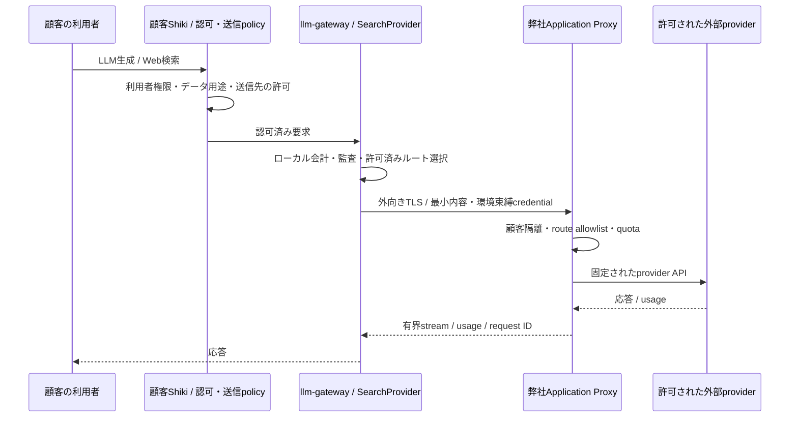
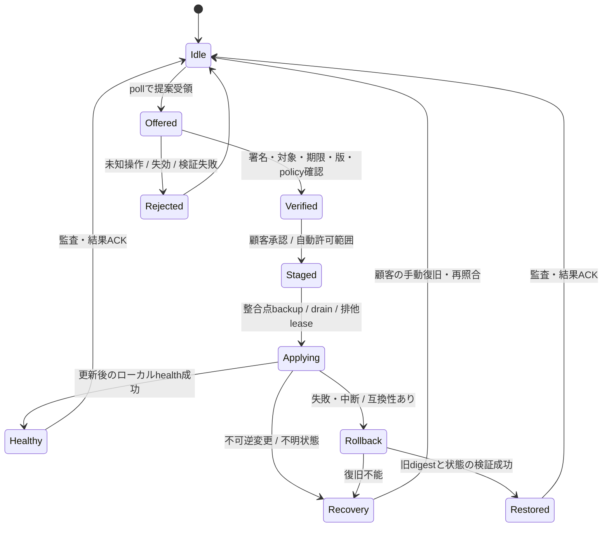

# Shiki Ops 設計

> 状態: 新機能の設計先行。**Opsは未実装・未検証**。Connect PoCの成功をOpsの検証結果として扱わない。
> [共通接続・送信ポリシー](./connect-ops-foundation.md) / [Connect](./shiki-connect.md)。

## 1. 役割と構成

OpsはオンプレShikiの運用・セキュリティ管理を支援する、顧客が任意に有効化する管理基盤である。
弊社の複数顧客管理コンソール、顧客内の非特権Ops agent、限定updater、LLM/Web proxy、署名済みrelease配布を構成要素とする。
顧客内のShiki認証・OpenFGA・StorageService・RAG・LLM会計を置き換えない。
SaaSのテナント運営コンソール（design §4.12）とは役割が異なる。UI部品は再利用できても、permissionとAPIを共有して万能管理者を作らない。

### 1.1 権限と特権分離

| 主体 | 許可されること | 持たせない権限 |
| --- | --- | --- |
| 顧客管理者 | Ops加入/失効、送信分類、更新window/承認、ローカル停止 | この権限だけで業務本文や監査本文を閲覧すること |
| 弊社の監視担当 | 割当顧客/環境の許可済み状態を見る | 顧客内file/SQL/shell、任意環境への横断操作 |
| 弊社の更新担当 | 許可済みreleaseの展開計画・時限proposal | 顧客承認の代行、任意URL/コマンド、release署名鍵 |
| Ops agent | ローカルの限定health/inventory、許可済み送信、proposalのpoll | 業務ストレージ資格情報、Connect token、root、Docker socket |
| updater | 承認された署名bundleを検証し限定資源を更新 | 遠隔shell/exec、任意ファイル書込、任意image・manifestの適用 |
| release署名者 | 審査済み成果物/manifestへ署名 | Ops顧客管理者の権限との同一化 |

顧客の登録鍵、releaseの信頼鍵、Opsログイン/サービスidentityを別管理にする。
弊社Opsアカウントが侵害されても、顧客送信設定を広げたり、署名なし更新を配ったりできない境界を置く。
ただし承認済み更新自体は特権的なコード配布であるため、署名者・配布・承認・監査を多重化し、無害とはみなさない。

k8sではnamespace/対象resource/verbを限定する。Pod exec、secret list、任意Pod作成、cluster-adminを通常agentに与えない。
compose配備でもDocker socketを渡さず、ローカルhelperが固定サービスの承認済みdigestだけを置換する。
root相当権限のあるhelperのIPCはOS peer identityと固定operation schemaで絞り、既存sandbox-orchestratorの権限を流用しない。
その具体的なRBAC/OS権限と配布形式は実装前レビューの対象とする。

## 2. 外部LLM・Web検索proxy

顧客Shikiの既存`LlmProvider` / `SearchProvider`のadapterとして、弊社の固定API proxyを選べるようにする。
通常agentのpoll経路へprompt/応答を混在させず、専用credential・帯域・timeoutを使う。

弊社proxyは任意のURLを取得するopen proxyにしない。接続先/redirect/DNS/IPの検証を実装し、内部/予約宛先へのSSRFを拒否する。
モデル/provider/処理地域・再委託・保持条件を顧客に明示する。Web検索語、URL、検索結果にも機密が入り得る。
本文logging/cache/学習利用は既定オフとし、顧客横断のprompt cacheを共有しない。必要なprovider処理と本文の永続保存は別の許可にする。
顧客内のLangfuse/監査正本はそのまま残し、proxy側は相関ID・版・route・集約usage等を最小保存する。
usageはidempotency keyで突合し、二重計上を避ける。生成開始後の無条件再送やprovider切替で重複実行を隠さない。

弊社proxy/認証/ネット障害では当該外部要求だけを失敗させる。
顧客が明示許可したローカルモデルfallbackは使用できるが、未許可providerへの迂回や、データの外部送信を増やす自動fallbackは禁止する。
エアギャップではproxy adapterを無効化し、外部への到達確認も行わない。

## 3. 監視・障害検知とセキュリティ状態

既存OTel/Grafanaスタックを顧客内の観測正本として再利用する（FR-10、Phase 8.5）。
Ops exporterは既存の全trace/logをそのまま転送せず、許可されたschemaの集約項目だけを取り出す。

- 稼働: health、heartbeat、コンポーネント版、集約CPU/RSS/ディスク、キュー圧迫、更新状態。ラベルの件数も有界にする。
- セキュリティ: 配布物SBOM/digestと署名済み脆弱性DB、依存版、証明書残期限、承認済み設定基準との適合性。評価は顧客内を基本とする。
- 収集しないもの: 文書/会話、prompt/completion、NASパス、検索語、raw SQL、秘密値、環境変数全体、raw設定ファイル、core dump。
- 状態判定: heartbeat欠損は「環境が停止した」と断定せず、通信断/最終観測時刻/期限切れを区別する。弊社表示はhealthy・unhealthy・unknown/staleを分ける。
- 脆弱性判定: feed/version/評価時刻を併記し、古いfeedや検査不能を「安全」と表示しない。自動的な設定変更/遮断/修復は初期範囲外。

ログの自由文から機密を完全除去できるとは仮定しない。外部log送信は既定オフ、明示した構造化フィールドのallowlist方式を採用する。
閾値/保持/送信容量/頻度は顧客設定とする。本文を含む診断bundleを通常Opsで取得しない。
必要なsupportアクセスはFR-9の顧客明示承認・時限・全操作監査・可視化に従う別設計とし、この経路で迂回しない。

## 4. ポーリング更新とロールバック

### 4.1 受信指示と顧客の最終決定

顧客側agentがpollし、弊社は署名されたproposal（環境、操作ID、対象release/digest、設定revision、期限、maintenance window）を返す。
顧客のローカルpolicyが自動更新を明示許可した範囲なら、その範囲内だけ自動承認できる。既定は通知/手動承認。
顧客はchannel、対象component、版の範囲、停止許容、window、canary、同時更新上限、rollback条件を指定できる。
弊社署名は顧客承認の代わりではなく、古い承認を新しいpayloadへ転用しない。
任意shell、任意URL、任意Helm values/manifestやsecret取得をproposalに含めない。

### 4.2 Supply chainと更新実行

manifestには固定artifact digest、署名、対象OS/arch/配備、protocol/DB/schema互換範囲、最低安全版、必要容量、変更内容、rollback可否を含める。
配布transportのTLSとartifact署名の両方を検証する。image tagや配布サーバーの応答だけを信頼しない。
署名検証鍵・失効/rotation metadataは顧客内に保持し、既知のrevisionとexpiryでrollback/freeze攻撃を検知する。
許可された旧版への復旧は互換性とsecurity floorを確認したrollback操作とし、古いmanifestの再生とは区別する。
オフラインで期限切れ/失効状態を更新できない場合は自動適用を拒否し、既存版を継続、顧客の信頼鍵更新/搬入手順へ移る。

検証と容量確保、backup、lease、drain、適用、health確認、完了をローカル永続台帳に記録する。
1環境/対象にactive updaterは1つ。lease/fencing、再起動時の照合と同じ操作IDのresumeを必要とし、プロセス再起動だけで再適用しない。
Connectの台帳・NAS原本・接続資格情報を更新helperの自由操作対象にしない。

### 4.3 データ互換性と障害時

Phase 8.11/8.12の整合点backup、expand/contract、互換matrixを前提にする。
Postgres・オブジェクト・OpenFGAの整合点とKeycloak realm/テナントレジストリの復旧契約を守り、Qdrant/Tantivyは派生索引として再構築可能にする。
単にcontainerを旧imageへ戻してDBや原本の内容も戻ったとみなさない。

- 自動rollbackは旧binaryが現行schema/dataと互換な場合に限定する。不可逆migrationは自動更新対象から外し、顧客承認の保守/復旧計画を要求する。
- imageだけでなく設定revision、schema進行、更新対象群、実際の稼働digestを照合する。途中停止・health不合格・監査記録不能を成功扱いにしない。
- 外向き接続が切れても、既に顧客が承認し、検証済み成果物・有効な期限・policyを満たす操作はローカルに完了/rollbackできる。期限超過の未開始指示は実行しない。
- Ops agent自身の更新も別supervisor/slotで回復可能にする。通信agentだけを更新制御の唯一の正本にしない。
- 署名bundleを手動搬入するエアギャップ更新にも同じ検証・互換性・backup・監査を適用する。オンライン向け省略経路を作らない。

## 5. 弊社側の複数顧客管理

弊社Control Planeでは顧客/環境/端末をサーバー管理の登録情報へ束縛する。
顧客内tenant_idと弊社の顧客/環境IDは別の識別体系であり、agentが申告したtenant_idだけを信用しない。
一覧・API・キュー・DB・object storage・集約・export・supportアクセスの全経路で顧客/環境を強制する。
顧客を跨ぐDB処理は明示した管理経路に限定し、顧客数ごとに物理table/indexを増やすことを既定にしない。

担当者は割当顧客/環境だけを見られ、監視閲覧・更新提案・承認・release署名・監査閲覧は分離する。
MFA、短命session、時限昇格、全操作監査、bulk操作の対象一覧/版固定と二者確認を要求する。
ロール名/関係schemaの具体形は実装時に定義し、既存の顧客`organization#admin`やSaaS運営権限を流用しない。
段階的rolloutはinternal環境→顧客が許可したcanary→段階展開とし、失敗率/通信断/unknownが閾値を超えれば自動拡大を停止する。

## 6. 独立稼働・導入解除と実装ゲート

Ops未加入/弊社停止/加入解除でも、ローカルユーザー認証、監査、Drive/RAG、ローカル推論、顧客内Connectが動く。
加入解除では外向きpoll/export、proxy credential、未開始proposalを停止・失効し、送信待ちデータを現在policyに従って処理する。
開始済み更新は勝手に放棄せずローカルに安全終結/手動復旧する。顧客内の更新履歴・監査を失わない。
弊社側の削除/保持期限と、顧客内の監査保持を区別し、バックアップを含む削除/解約手順を明示する。

[COトラック](./roadmap/parallel-tracks.md#connect-ops-track)の段階ごとに、以下を実環境で検証してから機能を昇格する。

| ゲート | 必須の検証 |
| --- | --- |
| 認証/分離 | 製品token混用、他顧客/環境、失効、古い世代、担当外閲覧・bulk操作を拒否 |
| データ送信 | secret/promptを含む敵対的ログ、許可撤回後のqueued送信、proxy迂回、顧客横断cacheを拒否 |
| 監視 | feed劣化・時計ずれ・欠測をunknownへ、送信先断・ディスク満杯でもローカルコア継続 |
| 更新 | 署名偽造・鍵rotation/失効・古いmanifest・別環境proposal・期限超過・同時updater・ENOSPCを拒否 |
| 復旧 | 各更新境界で強制終了/再起動、互換rollback、不可逆migration停止、backupの実restore |
| 配備 | compose/k8s、社内proxy/Firewall、長期offline、エアギャップの外部通信ゼロ、顧客群の同時復帰 |

Connect PoCはOpsのPKI、fleet隔離、telemetry分類、proxy、署名更新、rollbackを検証していない。
本書でSLO・自動更新の有効範囲・監査保全容量・対応OS/NASを保証済みとせず、各フェーズで実測と受入れ条件を確定する。
