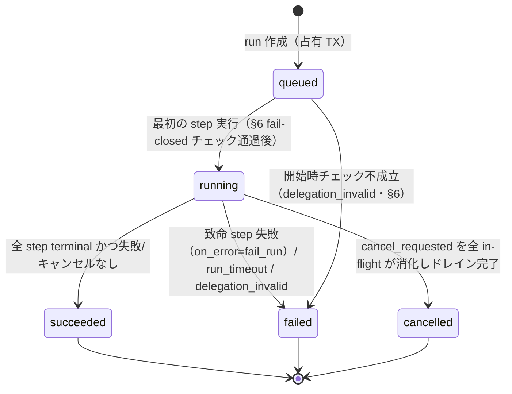
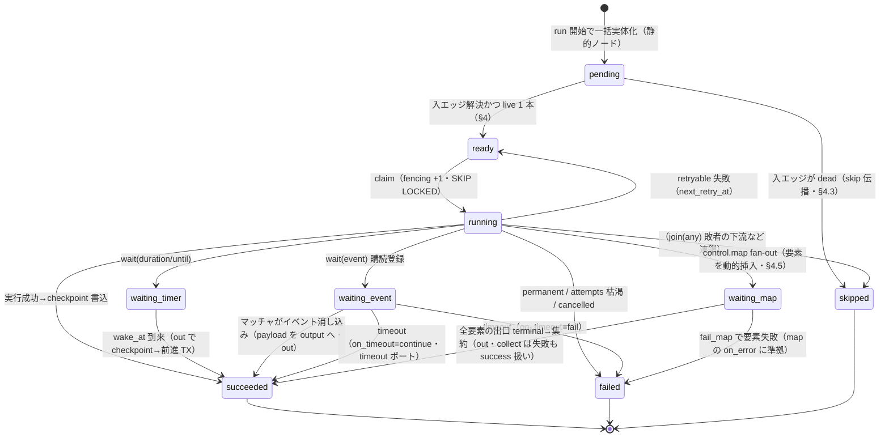
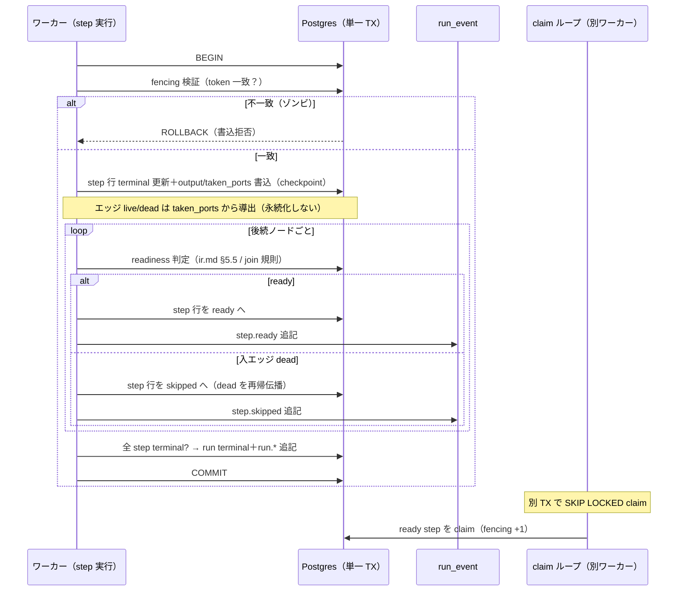
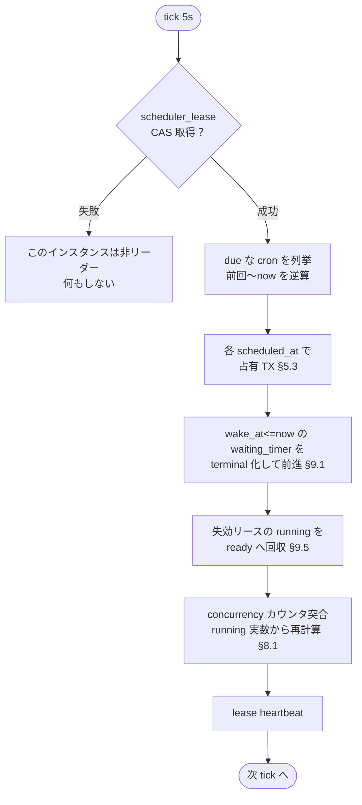

# workflow-engine 実行エンジン設計

> 本書は [miniapp-platform.md](../miniapp-platform.md) §2 の詳細設計。概念・スコープの正本は miniapp-platform.md。
> 認可・ストレージ・LLM の不変条件（単一チョークポイント・AuthContext・二重ゲート）は [design.md](../design.md) §1/§4 が正本であり、本書はその上に載る。
> 実装は roadmap [Phase 10](../roadmap/phase-10.md)（Task 10.2〜10.6・10.14）。着手前に [design-caveats](../design-caveats.md) PIT-31/34/35/36 を必ず確認すること。
>
> 本書が正を持つのは **実行時セマンティクス**（skip 伝播の実行・join 発火・リトライ・リース・スケジューラ・委譲強制）である。
> ワークフロー IR の定義・静的制約・保存時検証は [ir.md](./ir.md) が正、shiki script の実行系は [script.md](./script.md) が正であり、本書はそれらを参照して二重記述を避ける。用語は [README.md](./README.md) の用語集に一元化する。
> 本書の数値（上限・タイムアウト・プール数・周期）はすべて **初期値**であり、実装時にベンチ・運用で調整するコード上の設定値である。

---

## 1. 全体像

`crates/workflow-engine` は shiki-server の in-process サブシステムとして動く。外形は 3 つの協調する構成要素からなる。

- **ワーカープール**: ready な step を `FOR UPDATE SKIP LOCKED` で claim し、ノード実装を実行してチェックポイントを書き、DAG を前進させる（§4）。
- **リーダー選出スケジューラ**: 単一リースを CAS 取得したインスタンスだけが、cron 評価・タイマー起床・失効リースの回収 sweeper（§9.5）を回す（§5）。
- **トリガマッチャ**: 既存 outbox イベントを購読し、イベントトリガと `wait(event)` 購読を照合して run を起こす／step を起こす（§5）。

設計の骨子は「新規ステートフル依存ゼロ」である。永続化は Postgres、配信は既存 Redis の pub/sub のみを使う。Temporal 等の外部 Durable Execution エンジンは持ち込まない（部品点数最小化・エアギャップ・認可/監査/テナント分離を心臓部に編み込むため。miniapp-platform §2.2）。durability は **ノード境界にのみ存在**し、決定論的リプレイは採らない（§7 でこの帰結を明示する）。

### 1.1 レーン分離

ワークフロー用の jobq キューとワーカープールは、chat 生成（レイテンシ敏感な高優先レーン・design §4.4.1）および ingestion（バッチレーン）と **プールを共有しない**。ワークフローは分〜日単位のスループット重視レーンであり、レイテンシ敏感なチャット生成を同居させて head-of-line blocking を起こさないためである。共有するのは「実装パターン」（claim/リース/fencing/seq 追記/Redis 配信）であって「実行資源」ではない。

### 1.2 共有モジュール `crates/durable`（解決済み・実装済み）

chat の `generation_run`/`generation_event`（`migrations/0012_chat.sql`・`crates/chat/src/store/runs.rs`）は、claim・リース・fencing・seq イベント追記の先行実装である。workflow-engine はこの実装パターンに乗り、共通部分を新クレート `crates/durable`（パッケージ名 `shiki-durable`）へ切り出した（Task 10.0・human 承認済み・実装済み）。何を共有し、何を共有しないかを次表に定める。実装の詳細は [implementation.md](./implementation.md) §3 を参照。

| 関心事 | `crates/durable` へ切り出す（共有） | workflow-engine 側に残す（分離） |
|---|---|---|
| claim | `FOR UPDATE SKIP LOCKED` の claim プリミティブ | claim 対象クエリ（ready step の抽出条件・§4） |
| リース | リース取得＋heartbeat＋失効判定 | リース TTL の値・sweeper 起動周期 |
| fencing | claim ごとに `fencing_token` +1・追記/確定は fencing 一致時のみ通す（ゾンビワーカー書込拒否） | fencing を検証する具体的な TX 境界（§4.1） |
| 追記ログ | `(id, seq)` 単調 seq の exactly-once 追記 | `run_event` の kind 語彙・payload スキーマ（§3.3） |
| 配信 | Redis pub/sub への best-effort publish | チャンネル命名・SSE 合流プロトコル（§11） |
| **キュー** | ─（共有しない） | **専用 jobq キュー・専用ワーカープール・レーン優先度**（§1.1） |
| **状態機械** | ─（共有しない） | run/step の状態遷移・DAG 前進（§3・§4） |

chat run と workflow run は「同じ run 抽象」（design §4.4.1・miniapp-platform §2.2）に乗るが、キュー・レーン・優先度・状態機械は各ドメインが所有する。`durable` は耐久実行の下部構造のみを提供する。

---

## 2. テーブル

全テーブルは全行 `tenant_id text not null` を持ち、複合キーで tenant をスコープする（#91 規約踏襲）。以下は **DDL 風スケッチ**であり、実 migration は実装時に確定する。不変条件は各表の直後に箇条書きで置く。

### 2.1 一覧

| テーブル | 役割 | キー・要点 |
|---|---|---|
| `workflow_registration` | 有効化状態の正 | PK(tenant_id, workflow_id) |
| `workflow_trigger` | IR から実体化したトリガ | PK(tenant_id, trigger_id) |
| `schedule_occurrence` | スケジュール発火の冪等記録 | UNIQUE(tenant_id, workflow_id, trigger_id, scheduled_at) |
| `trigger_firing` | イベント発火の冪等記録 | UNIQUE(tenant_id, trigger_id, event_id) |
| `workflow_run` | run の正 | PK(tenant_id, run_id) |
| `step_execution` | step の正＝チェックポイント | PK(tenant_id, run_id, step_path) |
| `run_event` | 追記ログ（UI/SSE/監査の材料） | PK(tenant_id, run_id, seq) |
| `wait_subscription` | wait(event) の購読登録 | PK(tenant_id, run_id, step_path) |
| `workflow_approval` | 承認待ち（human.approval）の受信箱の台帳 | PK(tenant_id, approval_id)・UNIQUE(tenant_id, run_id, step_path) |
| `workflow_approval_assignee` | 承認を受信箱に出す相手（ユーザー・ロール） | PK(tenant_id, approval_id, kind, subject) |
| `workflow_approval_comment` | 判断に添えたコメント（遷移の後の rev の鍵） | PK(tenant_id, approval_id, rev) |
| `workflow_delegation` | 委譲の記録 | (tenant_id, workflow_id, delegator, scope, …) |
| `concurrency_counter` | 3 階層同時実行カウンタ | PK(tenant_id, scope_kind, scope_key) |
| `scheduler_lease` | リーダーリース | 単一行 CAS |
| `effect_journal` | チョークポイント側の冪等記録 | UNIQUE(tenant_id, idempotency_key) |
| `workflow_launch_skip` | 自動実行の起動を見送り続けていることの記録（作成者に見せる・GAP-67） | PK(tenant_id, workflow_id)・§10.6 |

### 2.2 DDL 風スケッチ

```sql
-- 有効化状態の正。run 開始時の fail-closed チェック（§6）の起点。
create table workflow_registration (
    tenant_id        text        not null,
    workflow_id      uuid        not null,
    -- enabled=通常 / disabled=停止 / suspended_reconsent=委譲失効で要再同意（§6）。
    status           text        not null
                     check (status in ('enabled', 'disabled', 'suspended_reconsent')),
    -- 有効化中の version（run はこれをピンして開始する・§10）。
    enabled_version  int         not null,
    -- 有効化時に委譲者が同意したスコープ集合（declared_scopes ⊆ これ を実行時に検証）。
    consented_scopes text[]      not null default '{}',
    updated_at       timestamptz not null default now(),
    primary key (tenant_id, workflow_id)
);

-- IR の triggers を enable 時に実体化。disable で発火停止。
create table workflow_trigger (
    tenant_id    text        not null,
    trigger_id   uuid        not null,
    workflow_id  uuid        not null,
    version      int         not null,          -- 実体化元 IR version
    kind         text        not null,          -- schedule | event | interactive
    source       text,                          -- event の source（storage.write 等）
    spec         jsonb       not null,          -- cron/tz/filter/scope（IR 由来）
    -- スケジュール評価済み watermark（この時刻までの occurrence は発火 or 破棄済み・§5.2）。
    -- catchup=none/skip で捨てた分もここを前進させて消化する（tick ごとの再発見を防ぐ）。
    last_planned_at timestamptz,
    enabled      boolean     not null default true,
    primary key (tenant_id, trigger_id)
);
-- マッチャの候補引き（イベント種→トリガ）。
create index workflow_trigger_match_idx on workflow_trigger (tenant_id, kind, source)
    where enabled;

-- スケジュール発火の冪等記録。占有（run 作成）と同一 TX で挿入する。
create table schedule_occurrence (
    tenant_id    text        not null,
    workflow_id  uuid        not null,
    trigger_id   uuid        not null,
    scheduled_at timestamptz not null,          -- cron が算出した論理発火時刻（tz 解決後の UTC）
    run_id       uuid,                          -- skip 溢れ時は null（記録のみ・再発火防止）
    created_at   timestamptz not null default now(),
    -- 同一発火の二重投入をキーで潰す（§5・PIT-31）。
    unique (tenant_id, workflow_id, trigger_id, scheduled_at)
);

-- イベント発火の冪等記録と結果。outbox イベント 1 件 × トリガ 1 本につき 1 行（最大 1 run）。
create table trigger_firing (
    tenant_id  text        not null,
    trigger_id uuid        not null,
    event_id   bigint      not null,            -- outbox イベントの id
    run_id     uuid,
    -- 結果: pending（起動の一時失敗で再試行待ち・新しい版の保存をまとめて待っている）/ fired / skipped（委譲の
    -- 不成立・多重度あふれ・無効化）/ suppressed_cycle / suppressed_depth（因果の鎖）/ dropped_queue_full /
    -- gave_up（再試行の打ち切り）/ coalesced（同じファイルの後の保存にまとめた・§5.4）。
    outcome         text not null default 'fired',
    attempts        int  not null default 0,
    next_attempt_at timestamptz,                -- pending の次の再試行（指数・最大 10 分間隔・5 回まで）・起動する時刻
    payload         jsonb,                      -- 再試行の材料（起動したら消す）
    cause_run_id    uuid,                       -- 再試行の材料（因果の鎖の由来）
    coalesce_key    text,                       -- まとめる単位（ファイルの id・新しい版の保存だけ）
    coalesce_since  timestamptz,                -- まとめ始めた保存の時刻（上限の起点）
    created_at timestamptz not null default now(),
    unique (tenant_id, trigger_id, event_id)
);

-- run の正。
create table workflow_run (
    tenant_id        text        not null,
    run_id           uuid        not null,
    workflow_id      uuid        not null,
    version          int         not null,      -- 開始時ピン（§10）
    trigger_kind     text        not null,      -- schedule | event | interactive
    trigger_id       uuid,
    -- 実行主体（§6）。interactive=本人 subject / schedule・event=workflow プリンシパル。
    principal        text        not null,
    delegator        text,                       -- schedule/event 時の委譲者（監査・棚卸し）
    status           text        not null default 'queued'
                     check (status in ('queued', 'running', 'succeeded', 'failed', 'cancelled')),
    input            jsonb       not null default '{}',  -- ≤256KB・超過は blob 参照（§12）
    cancel_requested boolean     not null default false,
    trace_id         text,                       -- OTel（run 作成時採番・§11）
    -- イベントトリガの run の発火元イベント。(trigger_id, trigger_event_id) の部分一意で、run の作成と
    -- firing の記録の間に落ちても再配送・再試行で run を二重に作らない（§5.4・PIT-31）。
    trigger_event_id bigint,
    -- 因果の鎖（祖先ワークフロー）と由来の run（§5.4）。workflow.start の子は親の鎖 ∪ {親} を引き継ぐ。
    trigger_chain    uuid[]      not null default '{}',
    cause_run_id     uuid,
    -- 結果を画面に返すノード（workflow.reply）の id（実行順＝トポロジカル順・同じ段なら IR 順）。読取口は
    -- ir_snapshot を開かずに reply の step だけを引く（§11.6）。
    reply_nodes      text[]      not null default '{}',
    -- すべてのノードの id の実行の順（本体のトポロジカル順・map の後ろに領域の中の順）。実行履歴の詳細が、
    -- 同じ時刻に書いた step をこの順で並べる（ir_snapshot を開かない・§11.3・BUG-117）。
    step_order       text[]      not null default '{}',
    started_at       timestamptz,
    finished_at      timestamptz,
    created_at       timestamptz not null default now(),
    primary key (tenant_id, run_id)
);

-- step の正＝チェックポイント。1 step 1 行（attempt 履歴は run_event へ）。
create table step_execution (
    tenant_id         text        not null,
    run_id            uuid        not null,
    -- 静的ノードは node_id。map 要素内は <map_id>[<index>].<node_id>（ネストは連結）。
    step_path         text        not null,
    node_id           text        not null,
    status            text        not null default 'pending'
                     check (status in ('pending', 'ready', 'running',
                                        'waiting_timer', 'waiting_event', 'waiting_map',
                                        'succeeded', 'failed', 'skipped', 'cancelled')),
    attempt           int         not null default 0,
    next_retry_at     timestamptz,               -- backoff / concurrency 順番待ちの再スケジュール
    wake_at           timestamptz,               -- waiting_timer の起床時刻（timer は本列を正とする）
    input             jsonb,                      -- step 固有入力: map 要素の each / map メタ（§4.5）
    -- リース: 保持ワーカーのみ単一ライタ。失効で別ワーカーが takeover。
    lease_owner       text,
    lease_expires_at  timestamptz,
    -- claim ごとに +1。追記/確定は一致時のみ（ゾンビ書込拒否）。
    fencing_token     bigint      not null default 0,
    output            jsonb,                      -- ≤256KB・超過は blob spill（§12）
    -- terminal 遷移で確定した「取られたポート」。エッジ状態はここから導出する（§4.1）。
    -- 成功: {out}/{true} 等。失敗＋on_error=continue: {error}。skipped/未処理失敗: {}。
    taken_ports       text[]      not null default '{}',
    error             jsonb,                      -- { code, message, retryable, node_id, attempt }
    -- attempt を含まない不変キー（§7）。wf:{tenant_id}:{run_id}:{step_path}。
    idempotency_key   text        not null,
    langfuse_trace_id text,                       -- AI ノードの Langfuse 突合（§11）
    updated_at        timestamptz not null default now(),
    primary key (tenant_id, run_id, step_path)
);
-- ready の claim 対象抽出。claim は **ready 専用**であり、リース失効 running は拾わない（§9.5）。
-- 1 本の OR で両方を拾うと partial index 2 本の BitmapOr になって index の並び順が失われ、
-- `ORDER BY next_retry_at LIMIT 1` が「候補全件を Sort してから 1 件」に退化する
-- （＝claim コストが実行待ち件数に比例する。実測 2,539 → 22 バッファ・#438）。
-- 全テナント横断ワーカー（既定）は next_retry_at 先頭、tenant シャーディングは tenant_id 先頭を使う。
create index step_ready_global_idx on step_execution (next_retry_at)
    where status = 'ready';
create index step_ready_idx on step_execution (tenant_id, next_retry_at)
    where status = 'ready';
-- 孤児回収 sweeper: リース失効の running を拾う。
create index step_lease_idx on step_execution (tenant_id, lease_expires_at)
    where status = 'running';

-- 追記ログ。chat generation_event と同型パターン（本表は #91 規約どおり tenant_id を持つ）。
-- 単一ライタ（fencing）で exactly-once。
create table run_event (
    tenant_id  text        not null,
    run_id     uuid        not null,
    seq        bigint      not null,             -- run ごと単調増加
    kind       text        not null,             -- run.started / step.ready / ...（§3.3）
    payload    jsonb       not null default '{}',
    created_at timestamptz not null default now(),
    primary key (tenant_id, run_id, seq),        -- 重複 seq の二重書込を拒否
    foreign key (tenant_id, run_id) references workflow_run (tenant_id, run_id)
);

-- wait の購読登録（timer / event）。マッチャ・スケジューラが消し込む。
create table wait_subscription (
    tenant_id  text        not null,
    run_id     uuid        not null,
    step_path  text        not null,
    kind       text        not null,             -- timer | event
    wake_at    timestamptz,                       -- timer の起床時刻
    timeout_at timestamptz,                       -- on_timeout の期限（§9）
    source     text,                              -- 購読イベント種
    -- { scope（テーブル/フォルダ束縛・record は停止時に解決済み）, filter（イベント以外の参照は束縛済み）,
    --   on_timeout, suspend_rev（行に束縛した data の wait の停止時の rev）,
    --   after_event_id（テーブル単位の data の wait の停止時の outbox の位置） }
    spec       jsonb       not null default '{}',
    fired      boolean     not null default false,
    -- 受付の突合（§9.2）を済ませた時刻。データ変更の wait は停止のたびに空にし、ほか（ファイルの保存の wait・
    -- 承認・timer）は作る時点で埋める。
    reconciled_at timestamptz,
    primary key (tenant_id, run_id, step_path)
);
create index wait_subscription_event_idx on wait_subscription (tenant_id, source)
    where kind = 'event' and not fired;
-- 受付の突合の走査（まだ突き合わせていないものだけ）。
create index wait_subscription_reconcile_idx on wait_subscription (created_at)
    where kind = 'event' and not fired and reconciled_at is null;
-- データ変更の wait の候補（テーブル・行の束縛）。
create index wait_subscription_record_idx on wait_subscription
    (tenant_id, source, (spec->'scope'->>'table'), (spec->'scope'->>'record'))
    where kind = 'event' and not fired;

-- 承認待ち（human.approval・§9.6）の受信箱の台帳。run と一緒に消える（判断の証跡は監査と data の revision）。
-- 担当者は「誰の受信箱に出すか」だけで、誰が承認できるかの正は FSM の actor 述語（OpenFGA の relation は増やさない）。
create table workflow_approval (
    tenant_id     text        not null,
    approval_id   uuid        not null,          -- step の冪等キーから決める（再実行・再開で同じ）
    org           text        not null,
    workflow_id   uuid        not null,
    run_id        uuid        not null,
    step_path     text        not null,
    node_id       text        not null,
    table_id      uuid        not null,
    record_id     uuid        not null,
    title         text        not null,           -- 1〜120 字のリテラル（行の値は写さない）
    instructions  text,                           -- 2000 字以内のリテラル
    show_fields   text[]      not null default '{}',
    decisions     jsonb       not null,           -- [{ kind, to, label, comment }]
    from_state    text        not null,           -- 停止時の行の状態
    suspend_rev   bigint      not null,           -- 停止時の行の rev（これ以下の遷移では起きない）
    status        text        not null default 'pending',
        -- pending | approved | rejected | returned | withdrawn | expired | cancelled
    deadline      timestamptz,
    decided_by    text, decided_at timestamptz, decided_to text, decided_rev bigint, comment text,
    reconciled_at timestamptz,                    -- 受付の突合を済ませた時刻
    created_at    timestamptz not null default now(),
    updated_at    timestamptz not null default now(),
    primary key (tenant_id, approval_id),
    unique (tenant_id, run_id, step_path),
    foreign key (tenant_id, run_id) references workflow_run (tenant_id, run_id) on delete cascade
);
create table workflow_approval_assignee (
    tenant_id text not null, approval_id uuid not null,
    kind text not null,                           -- user | role
    subject text not null,
    primary key (tenant_id, approval_id, kind, subject)
);
create table workflow_approval_comment (
    tenant_id text not null, approval_id uuid not null,
    rev bigint not null,                          -- 判断の遷移の後の rev
    author text not null, decision text not null, -- approve | reject | return
    body text not null,                           -- 2000 字以内
    created_at timestamptz not null default now(),
    primary key (tenant_id, approval_id, rev)
);

-- 委譲の記録。同意 UI・棚卸しの正（§6・§10）。
create table workflow_delegation (
    tenant_id     text        not null,
    workflow_id   uuid        not null,
    delegator     text        not null,          -- 委譲者 subject
    scope         text        not null,          -- 委譲した declared_scope の 1 要素
    fga_tuple_ref text        not null,          -- 書き込んだ FGA タプルの参照
    granted_at    timestamptz not null default now(),
    revoked_at    timestamptz,                    -- 棚卸しで失効検出時に打刻
    primary key (tenant_id, workflow_id, delegator, scope)
);

-- 3 階層同時実行カウンタ（§8）。
create table concurrency_counter (
    tenant_id  text   not null,
    scope_kind text   not null,                   -- tenant | workflow | node_kind
    scope_key  text   not null,                   -- 空 / workflow_id / node 種名
    current    int    not null default 0,
    limit_val  int    not null,
    primary key (tenant_id, scope_kind, scope_key)
);

-- リーダーリース（§5）。単一行 CAS。
create table scheduler_lease (
    id         int         primary key default 1 check (id = 1),
    owner      text,
    expires_at timestamptz
);

-- チョークポイント側の冪等記録（§7）。副作用と同一 TX で書く。
create table effect_journal (
    tenant_id       text        not null,
    -- 能力ノード = step 冪等キーそのまま。script/skill 実行内のホスト呼び出し =
    -- {step冪等キー}#c{実行内の効果的呼び出し連番}（§7.3）。
    idempotency_key text        not null,
    -- 操作の同一性検証: sha256(api名＋正規化パラメータ)。キー衝突かつ digest 不一致は
    -- permanent エラー（別操作の記録済み結果を黙って返さない・§7.3）。
    op_digest       text        not null,
    result_summary  jsonb       not null,          -- 再実行時に返す記録済み結果
    created_at      timestamptz not null default now(),
    unique (tenant_id, idempotency_key)
);
```

### 2.3 不変条件

- **全行 tenant_id・全クエリ tenant スコープ**: SaaS 共用プールで越境しない（Task 10.2 受け入れ条件）。
- **`run_event` は単一ライタ・exactly-once**: `(tenant_id, run_id, seq)` PK で重複 seq を潰し、fencing 一致ワーカーのみが追記する（chat と同型パターン。§2.1 の「全テーブル tenant スコープ」を本表も満たす）。
- **`step_execution` は step ごと 1 行**: attempt は列であり行を増やさない。attempt 履歴・遷移の連続は `run_event` に追記する。
- **占有は冪等記録の行ロックの下で**: `schedule_occurrence`/`trigger_firing` の UNIQUE 挿入・行ロックの下で run を起動する。run の作成は launcher の Tx で commit されるので、イベントトリガの run は `(trigger_id, trigger_event_id)` の部分一意で重複を防ぐ（再配送・再試行は既存の run を返す・§5.4・PIT-31）。
- **`effect_journal` は副作用と同一 TX**: チョークポイント側で「副作用の実行」と「journal 追記」を分離不能にする（§7）。
- **`step_path` 文法**: 静的ノードは `node_id`、map 要素内は `<map_id>[<index>].<node_id>`（ネストは連結。例 `map_files[3].parse`）。定義は ir.md §5.3 が正。
- **エッジ状態は永続化しない（導出値）**: エッジテーブルは持たない。「解決済み」= 源 step が terminal、
  `live` = `from_port ∈ 源 step の taken_ports`、`dead` = 解決済みかつ live でない。`taken_ports` は
  checkpoint と同一 TX で確定するため、クラッシュ後の再前進でも判定が揺れない（§4.1）。

---

## 3. run / step 状態機械

run と step の状態は `step_execution.status`・`workflow_run.status` に持ち、全遷移を `run_event` に追記する。UI・SSE はこの追記列をリプレイする（§11）。

### 3.1 run 状態機械



- 補助状態 `waiting`（in-flight step が全部 wait 中）は **表示用の導出値**であり、カラムに持たない（真実は step 側）。
  - 判定式: `status = running` ∧ `waiting_timer` か `waiting_event` の step がある ∧ `ready`・`running` の step が無い（多重度の数え方 §8.3 の「待機中の run」と同じ）。
  - 何を待っているか（`waiting_for`）: 保留中の承認の台帳（`workflow_approval.status = pending`）がある `waiting_event` の step があれば `approval`、`waiting_event` があれば `event`、`waiting_timer` だけなら `timer`。
  - 画面（ミニアプリ・会話の図のボタンの記録）は待機中を「実行中」と区別して出し、待機中だけなら読み直しの間隔を空ける（§11.6）。
  - 実行履歴の一覧と詳細も同じ式で `waiting_for` を返し、画面は「待機中（承認待ち）」のように実行中と分けて出す。待っている step にも同じ決め方の `waiting_for` を付ける（`waiting_event` に保留中の承認の台帳があれば `approval`、ほかの `waiting_event` は `event`、`waiting_timer` は `timer`・BUG-119）。
- `cancelling` も同様に導出であり、`cancel_requested = true ∧ status = running` の表示ラベルである。

### 3.2 step 状態機械



- `running → ready` の再試行は同一 attempt 系列であり、`next_retry_at` にバックオフ後の時刻を書いて claim 対象に戻す（§7）。
- concurrency 上限に阻まれた場合も `ready` のまま `next_retry_at` に小 backoff を書く（拒否ではなく順番待ち・§8）。

### 3.3 run_event の kind とリプレイ

遷移はすべて `run_event` に追記する。kind の初期集合は次のとおり（codegen 語彙化する。ir.md の語彙とは別レイヤ）。

`run.started` / `step.ready` / `step.started` / `step.succeeded` / `step.failed` / `step.retrying` / `step.skipped` / `step.waiting` / `step.woken` / `run.succeeded` / `run.failed` / `run.cancelled`。

UI・SSE は chat と同一のプロトコルでリプレイする（design §4.4.1・§11）: **①Redis 購読を開始 → ②`Last-Event-ID`(=seq) 以降を DB からリプレイ → ③ライブイベントと合流し seq で重複破棄**。先リプレイ→後購読は隙間を取り逃がすため禁止。

---

## 4. DAG 前進アルゴリズム

step の終端遷移（succeeded/failed）を起点に、DAG を **単一 TX** で一段前進させる。ready 化と claim は分離し、claim は別 TX の `SKIP LOCKED` で行う。

### 4.1 前進手順（単一 TX）

step 終端遷移時、保持ワーカーは以下を 1 つの Postgres TX で実行する。

1. **fencing 検証 → チェックポイント**: 自ワーカーの `fencing_token` が step 行と一致することを確認し（不一致ならゾンビとして中止）、step 行を terminal（succeeded/failed）へ更新し `output`/`error`/**`taken_ports`** を書き込む。**この checkpoint 書込が「実行済み」の唯一の真実**であり、これより後のクラッシュは再実行を招かない（§7 の順序固定）。
2. **出エッジのポート解決**: ノード種に応じて `taken_ports` を決める（手順 1 の checkpoint に含めて書く）。
   - 通常ノード成功 → `{out}`。失敗かつ `on_error=continue` → `{error}`。失敗かつ `fail_run` → `{}`（run を failed へ・手順 4）。
   - `control.branch` → 条件評価結果で `{true}` か `{false}`。`control.switch` → 一致 case ポート or `{default}`。
   - **エッジ状態は導出値であり永続化しない**（§2.3）: 各出エッジは `live`（`from_port ∈ taken_ports`）/ `dead`（解決済みかつ live でない）と判定される（定義は ir.md §5.5）。
3. **後続 readiness 判定 ＋ skip 連鎖**: 各後続ノードについて ir.md §5.5 の readiness 規則を評価する。
   - join 以外は入エッジ ≤1 なので「入エッジが解決し live 1 本」で `ready`。入エッジが dead なら `skipped` にし、その全出力ポートのエッジを dead にして **再帰的に dead を伝播**する。
   - join は §4.4 の規則（`all` は全入エッジ解決、`any` は初回 live）で ready/skipped/failed を決める。
4. **run 終了判定**: 全 step が terminal（succeeded/failed/skipped）になったら run を terminal（§4.5）にし、`run.*` を追記する。

ready 化された step 行は `ready` になるだけで、この TX では実行しない。実行は別ワーカーが `SKIP LOCKED` の claim TX で拾う（レーンとバックプレッシャは §8）。

### 4.2 シーケンス図（step 完了 → エッジ解決 → ready 化）



### 4.3 skip 伝播の擬似コード

```text
fn advance(tx, run, completed_step):
    assert completed_step.fencing == db_row.fencing        # ゾンビ拒否
    completed_step.taken_ports = resolve_ports(completed_step)   # 手順 2（ポート解決）
    write_checkpoint(tx, completed_step)                   # 手順 1（status/output/taken_ports を単一 UPDATE）

    # エッジ状態は永続化しない。判定は常に源 step 行から導出する:
    #   resolved(e) = terminal(step(e.from))
    #   live(e)     = e.from_port ∈ step(e.from).taken_ports
    #   dead(e)     = resolved(e) ∧ ¬live(e)      （skipped は taken_ports={} なので全出エッジ dead）

    frontier = successors(completed_step.node)
    while frontier not empty:                              # 手順 3（連鎖）
        node = frontier.pop()
        step = step_row(tx, run, path_of(node))
        if step.status != PENDING: continue                # 既に確定済みは触らない
        r = readiness(node, in_edges(node))                # ir.md §5.5 / join 規則（導出エッジ状態で評価）
        match r:
            READY:
                step.status = READY; emit(tx, "step.ready", step)
            SKIP:
                step.status = SKIPPED; step.taken_ports = {}   # 全出エッジが dead に導出される
                emit(tx, "step.skipped", step)
                frontier.extend(successors(node))          # dead を再帰伝播
            WAIT_JOIN:
                pass                                        # 未解決の join は待つ

    if all_terminal(tx, run):                              # 手順 4
        finalize_run(tx, run)                              # §4.5
```

### 4.4 join の発火

`control.join` は入エッジ集合で待ち合わせる（ir.md §5.4 が定義の正・ここは実行時の発火）。

- **`mode: all`（既定）**: 全入エッジが「解決」（live=完了 or dead）するまで待つ。全解決時に発火し、出力は `{ "<from_node_id>": <output or null(dead)>, ... }`。全入エッジ dead なら join 自体 `skipped`。
- **`mode: any`**: 最初の live 解決で **1 回だけ**発火。出力は `{ "winner": "<node_id>", "output": ... }`。残る分岐は完走するが、その下流で当該 join(any) は再発火しない（発火済みフラグを step 行で持つ）。全入エッジ dead なら `skipped`、全 live 失敗（fail_run でない場合）なら `failed`。

join の再発火防止と「初回 live」の判定は §4.1 手順 3 の readiness 評価内で行い、`any` の発火済み状態は checkpoint（step 行）に含める（クラッシュ後も二重発火しない）。

### 4.5 run 開始時の一括実体化と終了判定

- **開始時**: **`parent: null` の本体ノードのみ**を `pending` で一括実体化する（1 run 1 バルク INSERT）。UI が実行前に計画（本体 step とその関係）を表示できる。エントリ判定（入エッジ 0 → 全件 `ready`・静的並列・ir.md §5.1）も本体ノードのみを対象にする。
- **map 領域ノード（`parent` 付き）は開始時に実体化しない**。`each` コンテキストと `step_path` の `[index]` は要素が確定して初めて存在するため、`control.map` 実行時に要素ごと `<map_id>[<index>].<node_id>` で動的挿入する（領域の入口ノードがその時点で `ready` になる）。動的挿入も §4.1 の TX 内で行う。
  - **map ノードの保持状態 = `waiting_map`**（非 terminal・claim 対象外）。fan-out 時に map step を `waiting_map` にし、要素数・`on_item_error`・出口ノード id を `step_execution.input` の meta に格納する。各要素ノードの `input` に `{ "each": { "item", "index" } }` を載せる（冪等キーは step_path 依存で要素分離＝PIT-31）。要素数 0 は即集約する。領域にノードが無いのに要素がある map（保存は通るが有効化と起動の前に止める・ir.md §5.3）は、挿入せずに map の step を `empty_region`（設定の誤り・やり直さない・失敗の分類の表）で失敗させる（集約する出口が無く、待ち続けるため）。
  - **要素スコープの前進**: 前進 TX（§4.1・§4.3）は step_path のスコープ接頭辞（`<map>[i]` / ネスト `<m1>[i].<m2>[j]`）で要素を分離して readiness/skip を評価する（要素どうしを混同しない）。領域内ノードの失敗（`fail_run`）は**要素内 skip に留め**、グローバル cancel を発火しない（他要素を完走させる）。
  - **要素の中から見える出力**（`$from nodes.<id>.output` の解決・D-123）: 要素の step には、本体（静的）の step の出力と、自分の要素スコープの出力と、それを囲む外側の要素スコープの出力（`<m1>[i].<m2>[j]` の step には `<m1>[i]` の step の出力も）を見せる。ほかの要素の出力は見せず、DB からも読まない。保存時検証 V5 が領域内ノードの祖先に囲む map ノードの祖先を数えるのと同じ範囲（[ir.md](./ir.md) §5.3）。
  - **集約**: 全要素の**出口ノード**（領域内 out-edge 0・ちょうど 1 つ）が terminal になった時点で、最後の要素の前進 TX が `{ "items": […（入力順）], "errors": [{index, error}…] }` に束ね、map step を terminal 化して後続を前進させる。`on_item_error: collect` は失敗を errors に集約し map は `succeeded`（out）。`fail_map`（既定）は失敗要素があれば map を失敗（map の `on_error` に準拠: continue→error ポート／fail_run→run 失敗）。
- **終了判定**: 全 step が terminal になった時点で run を terminal 化する（§3.1）。run の最終 status は次の規則で決める:
  - `cancelled`: `cancel_requested` によるドレイン完了。
  - `failed`: ①`on_error=fail_run` の step 失敗（即 run fail 経路）②`run_timeout_sec` 超過 ③`delegation_invalid`、のいずれか。
  - `succeeded`: 上記以外。**`on_error=continue` で `error` ポートが解決された failed step は「処理済み失敗」であり、run の成否判定に含めない**（失敗はデータフローに変換済みのため。map の `on_item_error: collect` も同様）。

---

## 5. スケジューラ・トリガ

### 5.1 リーダーリース付き単一ループ

`scheduler_lease` を CAS 取得したインスタンスだけがスケジューラループを回す（tick 5s・初期値）。1 tick で以下を行う。

1. **due な cron の評価**: enable 中の schedule トリガについて、前回発火〜現在の間に来た論理発火時刻を cron から算出し、各 `scheduled_at` について占有 TX（§5.3）を実行する。
2. **due な waiting_timer の起床**: `wake_at <= now()` の `waiting_timer` step を **terminal 化（out）して前進 TX を実行**する（§9.1・ready に戻して wait を再実行させない）。
3. **waiting_event の期限処理**: `timeout_at <= now()` の `wait_subscription` を消し込み、`on_timeout` に従い terminal 化（timeout ポート）or failed にして前進する（§9.2）。

   2 と 3 は、承認の期限の回収（§9.6）と同じく、（期限, テナント, run, step）の順に続きの位置から読む（1 回 256 件・1 tick に
   16 回まで・残りは次の tick）。ピンした IR を読めない run の待ちは起こせずに残るが、続きの位置で飛ばすので、先頭に並んでも
   後ろの timer・timeout の回収を止めない（BUG-76。前は続きの位置が無く、先頭の 256 件が読めない run だと後ろが回収されなかった）。
4. **失効リースの回収（sweeper）**: `step_lease_idx` で `lease_expires_at < now()` の running step を拾い、`ready` へ戻す（§9.5）。ワーカーの claim は ready 専用なのでここが唯一の takeover 経路。
5. **concurrency カウンタの突合**: running の実数からカウンタを再計算する（§8.1）。**必ず sweeper の後**に置く——回収で running から外れた分をこの突合が回収するため、順序が逆だと 1 tick ぶん古い値が残る。
6. **リース heartbeat**: `scheduler_lease.expires_at` を延長。失効すれば別インスタンスが CAS で引き継ぐ。



### 5.2 misfire・catchup

cron の評価区間は `workflow_trigger.last_planned_at`（watermark）→ 現在時刻であり、tick ごとに watermark を
**評価済み時点まで前進させて同一 TX でコミット**する。発火した occurrence は `schedule_occurrence` に残り、
**捨てた occurrence も watermark の前進によって消化される**（記録し直さない）。watermark を持たないと
「前回発火〜現在」の逆算が停止期間の穴を tick / 再起動のたびに再発見してしまう。

スケジューラ停止中に生じた「穴」（misfire）は、この区間列挙の上で IR の `catchup` に従う（ir.md §6）。

- `skip`（既定）: 区間内の未発火のうち **直近 1 occurrence のみ**発火する（残りは watermark 前進で消化）。
- `none`: 区間内の最新 occurrence を、スケジューラが動き続けていた（前回の評価から `MAX_LIVE_TICK_GAP`＝5 分以内・
  重い tick ループやリーダー交代の待ちを含む）か、評価時刻から猶予（`ON_TIME_GRACE`＝60 秒）以内に来たものなら
  時刻どおりとして発火し、それ以外（停止中の穴）はすべて捨てる（watermark だけ前進させる）。区間をまるごと
  捨てると稼働中の発火まで捨ててしまう（#904）。
- DST の終わりで同じ壁時計の時刻が 2 回あるときは先の 1 回だけを occurrence とする（ir.md §6.1「二重時刻は先勝ち」・
  全 catchup 共通）。
- `all`（全部再生）は **v1 でやらない**（ir.md §6 で確定済み）。

### 5.3 占有 TX（冪等発火）

スケジュール発火の二重投入を構造的に防ぐため、以下を **単一 TX** で行う（Task 10.3・PIT-31）。

1. `schedule_occurrence` に UNIQUE(tenant_id, workflow_id, trigger_id, scheduled_at) で INSERT。**UNIQUE 衝突＝既発火**としてスキップ（何もせず COMMIT）。
2. `max_parallel_runs` 溢れ時は `on_trigger_overflow` に従い、`queue` なら run を `queued` のまま作成、`skip` なら run を作らず occurrence 記録のみ残す（再発火防止・§8）。
3. `workflow_run` を作成し、jobq へ enqueue。occurrence の時刻は run の行の `scheduled_at` に同じ Tx で書く（実行情報の予定の日時・
   ir.md §3.1・GAP-15。occurrence の `run_id` は run を作った後に書くので、ワーカーが最初の step を取る時点でも読めるよう run の行に持たせる）。
   起動口（`RunLauncher::launch`）へ渡す schedule の payload は `null` のまま（トレイトの約束を変えない）。予定の時刻は、発火が起動口を
   呼んでいる間だけ `scheduler::current_scheduled_at` で読め、起動口がそれを run の行に書く。

クラッシュ再起動時、UNIQUE により同一 `scheduled_at` は二度と投入されない（enqueue 直後に死んでも再起動で occurrence 衝突＝スキップ。Task 10.3 受け入れ条件）。

### 5.4 イベントトリガとマッチャ

イベントトリガは既存の `storage_event_outbox` 系 relay（outbox は書込と同一 Tx の耐久イベントログ兼 fan-out 点・design §4.3）を **購読者として拡張**する。マッチャは次の手順で動く。

> ⚠️ **前提: outbox の per-consumer fan-out 化**（roadmap Task P10-A0）。現状の outbox は単一 `processed_at` ack で、
> RAG relay（`crates/rag/src/pipeline/relay.rs`）が `claim`→enqueue→`mark_processed` と**破壊的に消費**している。
> workflow が 2 人目の購読者になると、先に処理した側が他方の分を消してイベントを取りこぼす。イベントトリガ着手前に
> **per-event × per-consumer の ack 台帳**（各コンシューマが未配送 outbox 行を claim→配送→delivery 追記）へ移行し、
> outbox を design §4.3 が謳う真の fan-out 点にする。**単純な単調 seq カーソルは並行書込で未コミットイベントを
> 飛び越すため採らない**（設計・受け入れ条件は roadmap Task P10-A0）。

1. `(tenant_id, source)` index（`workflow_trigger_match_idx`）で候補トリガを引く。
2. トリガの `scope` 束縛（対象テーブル・フォルダ id）に合致するか判定する。**フォルダ scope は祖先束縛**:
   トリガの folder が、イベント発生フォルダの**祖先**（`node_closure`・自分自身 depth 0 を含むので完全一致も包含）
   なら一致する。サブフォルダ配下の書込も親フォルダ束縛トリガで発火する。
3. `filter` の条件木（ir.md §3）を **イベントペイロードに対して**評価する（`$from trigger`＝ペイロード・
   fail-closed: 型不一致/不正 filter は発火しない）。同一マッチャが `wait_subscription`（wait(event)）も消し込む（§5.5）。
4. 合致したら `trigger_firing` に UNIQUE(tenant_id, trigger_id, event_id) で INSERT して行をロックし、run を起動して
   結果（`outcome`）を同じ行に残す（outbox イベント 1 件 × トリガ 1 本につき最大 1 run）。

**ファイル保存**（`storage.write`）は outbox の作成（op create）と新しい版の保存（op update・finalize の内容更新・
content_update・提案の採用・ワークスペースへの上書き）から写す。どの経路も outbox に保存した時点の `parent_id` を
載せ、上の 2 の祖先束縛はこれで照合する（BUG-28）。

1. フォルダの祖先束縛で候補のトリガを引き、filter を評価する（上の 1〜3）。
2. **workflow プリンシパル（有効化の委譲）が保存されたファイルを読めるか**を StorageService の viewer で確かめる
   （`wait(event)` の起床と同じ `SavedFileGate`・強整合の check と監査・D-50）。読めなければ発火も記録もしない。
   確かめられない一時障害はバッチを配り直す。
3. 因果の鎖（下のデータ変更の 4 と同じ・D-26）。run の中の storage.write・csv.write・csv.patch は run の印を
   outbox に載せるので、自分の保存・`workflow.start` の子の保存では起きない。
4. 作成はすぐ起動する。**新しい版の保存は同じファイルの続く保存を 1 回にまとめる**（D-38）: firing を `pending`
   （`next_attempt_at` = 起動する時刻・`coalesce_key` = ファイル）で待たせ、同じトリガ・同じファイルの後の保存が
   来たら、待っている前の firing を `coalesced` にして後の firing へ寄せる。起動する時刻は最後の保存から 60 秒
   （ノートの保存は編集中も最大 30 秒おきなので、その間隔より長くする）、ただしまとめ始めの保存から 10 分を上限とする。
   時刻が来たら起動の再試行と同じ経路で起動する（run 入力は最後の保存のペイロード・`trigger_event_id` は最後の
   イベント）。起動する時点にも 2 の閲覧の確認をやり直し、読めなければ起動せずに `skipped` にする（待つ間に委譲や
   フォルダの共有が外れたら、ファイルの id・書いた人を run 入力に載せない・BUG-50）。起動に一時失敗して再試行を
   待つ発火も同じ。因果の鎖による抑止はまとめる前に判定する（run 自身の保存が、待っている人の保存を押し流さない）。
   同じトリガ・同じファイルのまとめは advisory lock で直列にする。まとめたことは監査に残さない（後の保存で起動する）。

**起動の結果と再試行**（D-21）: `RunLauncher::launch` は発火元の `event_id` を受け、`Started(run_id)` /
`Skipped(理由)` / `Failed` を返す。見送り（委譲の不成立・`on_trigger_overflow = skip` の多重度あふれ・無効化）は
再試行しない。workflow プリンシパルが有効化した版の定義を読めない（`Forbidden`・オンにした後に認可だけが食い違った）のも、
何度起こしても同じなので委譲の不成立として見送り、警告は（テナント・ワークフロー・版）ごとにプロセスで 1 回だけ出す
（BUG-146。きっかけは止めない。自動実行をオンにし直せば直る）。有効化した版に実行の前に止める設定（必須の欄が空・
中にノードの無い繰り返し・`unattended_run_blockers`・D-43・D-83・D-85。結果を画面に返す `workflow.reply` の返す値の空は、
自動実行の結果がどの画面にも出ないので数えない・BUG-168）があるときも、委譲の確認の後で同じく理由の文を添えた
委譲の不成立として見送り、警告は版ごとに 1 回（確認より前に有効化した版を空のまま動かさない・BUG-51）。委譲の確認が
成り立たない見送り（オンにした人の権限が外れた・使ってよい操作が増えた）の警告も、同じく（理由・テナント・ワークフロー・版）
ごとに 1 回にする（BUG-170）。この 3 つの見送りは、起動口が理由を型で持っているところで記録し、作成者に見せる（§10.6・
GAP-67）。一時失敗（IR の取得・DB・OpenFGA）は `pending` にして指数で間隔を延ばして再試行し（10 秒〜最大 10 分・
5 回まで）、超えたら `gave_up` にして監査（`workflow.trigger.suppressed`・reason=gave_up）に残す。再試行で起動する
run も同じ `trigger_event_id` を持つので二重にならない。

**データ変更**（`data.record.created` / `data.record.updated` / `data.transition`・GAP-07）は data の outbox
（`data.record.changed` の create / update と `data.record.transitioned`）から写す。relay は tick（cron・timer・timeout）
とは別のループで回し、データ変更の照合が重くても期限の回収を遅らせない。

1. バッチの中のテーブルの集合で、候補のトリガ（`spec->'scope'->>'table'` の索引）と wait をテナントごとに 1 回ずつ
   引く。候補の無いイベントは data を読まずに配送済みにする。
2. 一括取込（CSV の取込・`data.bulk_upsert` の作成行と更新行）の行ではトリガを発火させない（private payload の
   `bulk` の真偽だけを data の `bulk_flags` で読む）。wait は起こす。
3. トリガは**委譲元**（テーブルの viewer をワークフローへ委譲した人）の見え方で変更を作る（§6.8 の主体と天井・
   data の `change_event_view`）。委譲が無ければ（`workflow_delegation` を先に引いて）OpenFGA を呼ばない。見えない行・
   読めない列だけの変更では発火せず、発火しなかったことも記録しない。権限の判定（Forbidden / NotFound）は
   「発火しない」として配送済みにし、一時的な障害だけバッチを配り直す。主体と見え方はバッチの中だけで覚える（PIT-18）。
4. **因果の鎖**: イベントを起こした書込が run のもの（outbox の非公開部の run の印・下の「run の書込の印」）なら、
   その run の `trigger_chain` ∪ {その run のワークフロー} を鎖とする。発火先のワークフローが鎖に含まれれば
   `suppressed_cycle`（自分の書込・循環）、鎖が 4 段を超えれば `suppressed_depth`。起動した run に鎖と `cause_run_id`
   を書く。`workflow.start`・`Shiki.workflow.*` の子の run は、作成と同じ Tx で親の鎖 ∪ {親のワークフロー} を引き継ぐ。
   wait の起床には抑止をかけない。ペイロードの `by_workflow` も同じ印で決める。ファイル保存のトリガも同じ鎖を
   使う（BUG-29）。

**run の書込の印**（BUG-44）: run の中の書込（ノード・`Shiki.*`・委譲元の権限での書込・run が始めた一括取込の
ワーカーが進める分）は、文脈（`AuthContext::origin_run`）に run を持つ。outbox の発行（storage の `emit_on` /
`emit_many_on`・data と storage のどちらの書込も通る）は、それを consumer 非公開部 `private_payload` の `origin_run`
に**必ず**載せる（run の書込でなければ `null`）。relay はこの印だけを読む（`write_origins`）。書込の trace_id からは
run を推しはからない（利用者の要求の trace_id も run の trace_id と同じ 32 桁 hex の形なので、名乗れば抑止を偽れる）。
`origin_run` のキーが無い行は、印を書く前の版が発行した行（移行の間・ローリングデプロイの古い版）だけで、その行に
限り従来どおり trace_id を run_id とみなし、実在する run のときだけ由来にする（実在しない run の id を
`cause_run_id` に残さない）。
5. **queued の上限**: 1 ワークフローの queued run が 1,000 件以上なら `dropped_queue_full` で捨てる。
6. 抑止・破棄は 1 件ずつ監査（`workflow.trigger.suppressed`・reason）に残す。
7. **再試行の起動の前の確かめ直し**（BUG-75・ファイル保存の BUG-50 と同じ）: 起動に一時失敗して `pending` で待った発火は、
   ペイロードに relay の時点の見え方を持っている。起動する時点に、3 と同じ主体（委譲元・委譲台帳を先に引く）で変更を
   作り直し（`change_event_view`）、作り直したペイロードがトリガの filter に合うときだけ、そのペイロードで起動する
   （読めなくなった列を run 入力に載せない・`record` は起動の時点の行）。見えない・委譲が無い・filter に合わないなら起動
   せずに `skipped`（再試行しない）、確かめられない一時障害は起動の一時失敗として再試行に回す。

配信の位置: workflow consumer は既存の配送台帳（順序に依存しない作り）のまま使い、data のストリームの `delivery_seq`
は使わない（delivery_seq はテーブルのストリーム用で保持 600 秒で GC される。トリガは at-least-once と一意キーで足り、
全体の順序は要らない。同じ行の順序は rev で表し、後続の処理は expected_rev で守る）。

### 5.5 wait_subscription の消し込み（同一マッチャ）

`wait(event)` の購読解決も **同じマッチャ**が行う。イベント到来時、`(tenant_id, source)` で `wait_subscription` を引き、`scope`＋`filter` に合致する購読について当該 step を **terminal 化（`succeeded`・out ポート・ペイロードを output に格納）して前進 TX を実行**する（購読行は消し込む・§9.2）。これによりトリガ発火と wait 解決が同一のイベント消費経路を通り、実装が二重化しない。

データ変更の wait はテーブル（と任意で行）の束縛で引き、**空の scope をワイルドカードにしない**。変更は run の
**実行主体**の見え方で作る（interactive は本人・schedule / event は委譲元・§6.8）。停止時の rev（`suspend_rev`）以下・
停止時の outbox の位置（`after_event_id`）以下のイベントは見ない（§9.2）。

### 5.6 filter 評価エラーは fail-closed

トリガ filter・wait filter の評価が `expr_type_error`（型不一致等・ir.md §3）になった場合は、**発火しない＋監査記録**とする（黙って発火するのは正しくないため fail-closed）。評価エラーは `run_event` ではなく監査ログ（該当トリガ id 付き）へ残す。

---

## 6. 実行主体・委譲の強制

本節は **PIT-34 の決定**（失権を検知できて初めて fail-closed が成立する）の実装であり、confused-deputy 防御の中核である。miniapp-platform §2.3 が上位方針の正。

### 6.1 principal の確定（run 作成時・決定）

run 作成時に principal を確定し `workflow_run` 行へ記録する。

- **interactive**: セッションの本人（subject）。以降の能力呼び出しは **毎回ライブの OpenFGA** に当たる。許可のキャッシュ・先読みをしないため、run 実行中に本人が権限を失えばその step から自然に落ちる。
- **schedule / event**: workflow プリンシパル `workflow:<tenant>|<id>`。`AuthContext::ns()` 経由で構築し、`authz::Namespace` に `workflow()` ビルダを追加する（Task 10.4）。
  - **AuthContext の principal 種別が必要**: 現行の `AuthContext::subject()` は `user:<tenant>|<id>` を構築するため、`workflow()` ビルダの追加だけでは能力呼び出しの check が workflow サブジェクトにならない（委譲タプルが一切照合されない）。principal に種別（user / workflow サービスプリンシパル）を導入し、schedule/event run の全 check・ListObjects が `workflow:<tenant>|<id>` サブジェクトで評価されるよう authz クレートを拡張する（Task 10.4a の実装要件）。

### 6.2 run 開始時チェック（必須・fail-closed・決定）

schedule/event run は **最初の step 実行前**に以下を検証する。1 つでも欠けたら run を `failed(reason=delegation_invalid)` にし、registration を `suspended_reconsent` へ遷移させる。

1. registration が `enabled`。
2. 委譲が有効: `workflow_delegation` の各 scope について、**委譲者が今も当該権限を持つか OpenFGA を check**（run 前の最低線・PIT-34）。
3. version の `declared_scopes ⊆ consented_scopes`。

interactive run はこのチェックを経ない（本人権限がライブに効くため）。

### 6.3 非同期棚卸しジョブ（二段目・決定）

run 前チェックだけでは「実行中 run の失権」を止められない。周期（初期値 5 分）＋ IdP 同期・退職イベント（SAAS.2 reconciliation）を契機に、全委譲を再評価する棚卸しジョブを回す。失効検出時:

1. workflow プリンシパルの FGA タプルを撤去する。
2. registration を `suspended_reconsent` へ。
3. **実行中 run はキャンセル**（`reason=delegation_revoked`・§9 のキャンセル経路）。

**SLA 宣言**:

- 失権 → 新規 run 停止: 次 run 開始時（即時・§6.2 のチェックで落ちる）。
- 失権 → 実行中 run 停止・タプル撤去: 最大「棚卸し周期＋実行中 step の残り時間」。

### 6.4 構造的 fail-closed の三段目

タプル撤去後は、in-flight の能力呼び出しも既存の能力ゲートウェイ（OpenFGA check）で自然に deny される。すなわち fail-closed は **①run 前チェック → ②棚卸しによる能動停止 → ③タプル撤去後の受動 deny** の三段構えで成立する。

### 6.5 スコープ交差の強制点（決定）

`NodeContext` に `scope_ceiling = declared_scopes ∩ ノード設定` を運ぶ。**skill 実行中（skill ノード・script 付き skill）はさらに skill の宣言スコープを交差**する: `scope_ceiling = declared_scopes ∩ ノード設定 ∩ skill宣言スコープ`（miniapp-platform §7 の表のとおり。広い declared_scopes を持つワークフローに狭い目的でインストールされた skill が、ワークフローの権限で任意の能力を呼べてはならない）。**能力ゲートウェイ（既存チョークポイント）側で「操作の要求スコープ ∈ scope_ceiling」を検証してから、通常の OpenFGA check** を行う（二重ゲート）。個別ノード実装に検査を書かせない。実効権限 = 実行主体 ReBAC ∩ scope_ceiling であり、ノード設定・skill 宣言はいずれも縮小のみ（拡大不能・miniapp-platform §2.5）。

**agent.invoke**（ir.md §7.4）は `scope_ceiling = declared_scopes ∩ 提示した道具の要求スコープ` で道具を提示する。ループ（api の agent-core）は道具の呼び出しを `AgentToolGateway`（エンジンの実装）へ中継するだけで権限を判断しない。ゲートウェイは script の `Shiki.*` と同じ一段目を通す: 提示した道具か（外れたら `invalid`・監査 reason=not_offered）→ scope 天井（外れたら `out_of_scope` の監査）→ 引数の上限（モデルが書く引数は敵対的入力）→ 宛先（web.fetch は `egress_allowlist ∩ workflow.agent.web_allowlist` を URL のホスト部の文字列で照合・外れたら監査 host_not_allowed）→ 監査（via=agent）→ NodePorts（`rag_search`・`storage_list`・`storage_read_window`・`doc_read`・`web_search`・`web_fetch`・`code_run`）→ 結果の上限。二段目（OpenFGA・二段 authz・存在秘匿）はポートの先のチョークポイントが担う。

**storage.read**（ir.md §7 の「PDF・Office の本文」・D-111）は NodePorts の `storage_read_document` で読む。文章のファイルは
`storage_read` と同じに中身を読み、文章でない種類は社内文書の検索が取り込んだ本文を `rag::SearchService::read_document_text` で
読む（原本は読み直さない）。字数の上限はエンジンが渡す（`STORAGE_READ_MAX_DOCUMENT_CHARS`）。二段目は StorageService の閲覧の判定と、
SearchService の可読集合での pre-filter の両方で、見えない・無いは同じ `not_found`。索引に本文が無い理由（取り込みの状態）は
`SearchService::index_state` が、内容のバージョンの履歴（`storage::CONTENT_VERSION_SQL`）・ノードのシステム領域の印・取り込みへ向かう
記録（outbox の未処理のイベント・`job_queue` の `rag_ingest`・`rag_ingest_job`）から決める。記録がどこにも無いファイルは待っても
取り込まれないので、待てば読めるとは言わない。取り込みの側も、古いジョブかどうかを `node.version` ではなく内容のバージョンと比べる
（名前の変更・移動は `node.version` を進めるが取り込み直さないので、`node.version` と比べると取り込みより先に名前を変えたファイルが
二度と取り込まれない）。script の `Shiki.storage.read` は `storage_read`（文章だけ）のまま。ポートの既定は `storage_read`（索引を
結線しない実装・テスト用）。

### 6.6 OpenFGA モデリング（解決済み・実装済み）

委譲 = 対象オブジェクトへの **通常 relation タプル**（subject = workflow プリンシパル）＋
`workflow_delegation` 行でのリンク管理で確定した（human 承認済み）。条件付きタプル等の新機構は
使わない。新しい relation 名は追加せず、既存 relation（folder/file の editor/viewer・secret の
can_use・artifact の viewer）に workflow subject 型を足す方式とし、粒度は `(scope, object_ref)`
ごとに `workflow_delegation` へ 1 行（`migrations/0017_workflow_registration.sql:55`、
PK `(tenant_id, workflow_id, delegator, scope, object_ref)`）。実装の詳細は
[implementation.md](./implementation.md) §2.1/§3 を参照。

### 6.7 監査

run 作成時に `run_id・trigger_kind・principal・delegator` を audit_log へ記録する（Task 10.4）。委譲の付与・失効も `workflow_delegation` の更新と同時に監査へ残す。

### 6.8 構造化データ（data）の実行主体（Task 15.7）

data の行述語（`row_policy`）・フィールドマスクは**ユーザーの属性**（本人 id・ロール・個別共有）で評価する。
workflow プリンシパルで評価すると本人系の述語が成り立たず、行がほぼ見えない（fail-closed だが使えない）。
そこで schedule / event run の data ノード・`Shiki.data.*` は次の 3 段で実行する（`crates/api/src/workflow_runtime/data_port.rs`）。

1. **委譲の確認**: ワークフロー主体が対象テーブルの `data_table` に viewer（読取）/ editor（書込）のタプルを
   持つこと（有効化時の委譲・既存の relation に workflow subject を足す方式のまま）。棚卸しでタプルを撤去すれば
   ここで受動的に落ちる（§6.4 の三段目）。
2. **委譲元ユーザーで実行**: `workflow_delegation` の有効な委譲元のうち、**その操作に足る relation を自ら委譲した**
   ユーザー（読取は viewer 以上・書込は editor / owner。該当が複数なら最後に付与したユーザー）の `AuthContext` で
   data を呼ぶ。該当が無ければ拒否する（他の委譲元のタプルで 1. を通っても、書込を委譲していないユーザーの権限では
   書かない・confused-deputy 防御）。行は委譲元の行述語で絞られ、マスク列も委譲元のもの。委譲元が今もテーブルの権限を持つかは
   data の入口が委譲元で問い直す（失権は即時に効く）。いまの値に足して書くブロック（足す数・`data.record.upsert`・GAP-16）は、
   足す元の値を書込の委譲元の見え方で読む（書き換えの入口に何も変えない更新を渡す・[ir.md](./ir.md) §7.12）。読取の委譲元が
   別の人だと、その人に読めない列を 0 から足して上書きしてしまうため。同じレコードを探す問い合わせは読取の主体で行い、
   見つけたレコードを書き換えられるかは書込の主体で判定する。
3. **辿ってよいテーブルの天井**: 入口のテーブルから結合・半結合・lookup / rollup・リンク値（表示名・対称列を含む）で
   辿る参照先も「委譲したテーブル」に限る。天井は **2. で選んだ委譲元本人が viewer 以上で委譲したテーブル**
   （`workflow_delegation` の有効な行・入口のテーブルを含む）で、併せてワークフロー主体のタプルも要求する（棚卸しの撤去を
   即時に効かせる）。他の委譲元が委譲したテーブルは、この委譲元の権限では辿らない。data へは `data::TableReach` として渡し
   （`DataStore::within_reach`）、天井の外は委譲元が読めないテーブルと同じ応答になる（結合・半結合は 403・lookup / rollup は null・
   リンク値は落とす。存在オラクルを作らない）。材料化した派生列は天井の外を辿るならフィルタ/ソート/集計に使えない（未材料化と同じ 400）。
   `data.bulk_upsert` は天井を取込（`data_bulk_import.reach`）に保存し、続きを進めるジョブのワーカーも同じ天井で検証する。

実効権限 = scope 天井（§6.5）∩ 委譲したテーブル ∩ 委譲元の ReBAC・行述語。委譲していないテーブルは、
委譲元が読めても読めない（委譲元の権限を丸ごと貸さない。入口だけでなく、リンクで辿る参照先も 3. で同じく絞る）。
書込の監査・リビジョンの主体は委譲元になる。

データ変更トリガ（§5.4）の**発火の判定とペイロード**も同じ 3 段の主体（委譲元・委譲したテーブルの天井）の見え方で作る
（`DataStore::change_event_view`）。委譲元に見えない行・読めない列の変更は、発火・ペイロード・記録のどこにも出ない。
wait(event) のデータ版は run の実行主体の見え方で起こす。

---

## 7. リトライ・冪等・at-least-once

本節は **PIT-31 の決定**であり、design-caveats PIT-31「実装前に決めること」①内部能力ノードの冪等キー強制 ②外部 http は exactly-once 非約束 ③completed 判定とチェックポイントの順序、への回答である。

### 7.1 順序固定（PIT-31 ③への回答）

step の処理順序を固定する: **ノード実行 → checkpoint 書込（output＋succeeded）→ 後続 ready 化**（§4.1 手順 1）。したがって重複が起きうる窓は「実行後・checkpoint 前」のクラッシュのみであり、これが at-least-once の唯一の重複窓である。checkpoint 後のクラッシュは、再 claim 時に step が既に terminal なので再実行されない。

### 7.2 冪等キー（PIT-31 ①への回答・基盤）

冪等キーは `wf:{tenant_id}:{run_id}:{step_path}` とし、**attempt を含めない**（リトライ・再 claim を跨いで不変）。`NodeContext` で全ノード実装に供給する。attempt を含めないことが「リトライしても副作用は 1 回」の前提である。

**LLM の会計（`llm_usage`）**も `(tenant_id, idempotency_key)` で重複を除く（`ON CONFLICT DO NOTHING`）。`llm.invoke` のポートは呼び出しの結果でキーを選ぶ（[ir.md](./ir.md) §7.3）。

- 使えた呼び出し: step の冪等キー。構造化出力の修復の呼び出しは `{step冪等キー}#c1`（§7.3 の呼び出し連番の流儀）。
- 使えなかった呼び出し（途中で切れた・構造化出力が上限で切れた・拒否された・形に合わない）で使用量のあるもの: `{step冪等キー}#f{uuid}`（呼び出しごとに一意）。失敗を step のキーで記録すると、step の再試行や失敗 run の再開で後から成功した分が重複除去で消えるため。払った額はそのまま残り、記録はプロセス内で 1 回なので二重にもならない。
- **既知の制約**: キーが attempt を含まないので、step の再試行・リース回収の再実行で「使えた呼び出し」が二度起きると、2 回目は重複除去され、`llm_usage` は実費より小さく見える（D-52 の H7。直すのは GAP-28）。`#f` の分は呼び出しごとに記録するのでこの制約に入らない。`agent.invoke` は attempt を会計キーの接頭辞に入れているので対象外。

### 7.3 内部能力ノードのチョークポイント強制 dedupe（PIT-31 ①への回答・本体）

内部能力ノード（storage 書込・data 書込・data.transition・notify・workflow.start）は、**チョークポイント側で強制 dedupe** する。

- 副作用の実行と同一 TX で `effect_journal` に UNIQUE(tenant_id, idempotency_key) で「実行済み＋結果要約」を記録する。
- 再実行は journal ヒットで **記録済み結果を返す**（no-op）。副作用は再び起きない。
- journal は TTL（初期値 run 保持期間と同じ・§12）で GC する。

**dedupe キーの粒度（1 step 複数副作用への対応）**:

- **エンジンが直接実行する能力ノード**（storage.write ノード等）= 1 step 1 副作用なので、step 冪等キー（§7.2）をそのまま使う。
- **llm.invoke の構造化出力の修復**（[ir.md](./ir.md) §7.3）は副作用ではないが、同じ step の 2 回目の LLM 呼び出しを 1 回目と重複除去しないよう、会計のキーを `{step冪等キー}#c1` にする（§7.2）。
- **script / skill 実行内のホスト呼び出し**は 1 step で複数の内部副作用を行い得るため、キーを
  `{step冪等キー}#c{実行内の効果的呼び出し連番}` にする（連番はエンジンワーカーが HostCall ごとに払い出す。
  読み取り系は連番を消費しない）。step キー単独だと 2 回目の `Shiki.data.create` が 1 回目の記録済み結果を
  返してしまい、実質「1 step 1 副作用」の隠れ制約が生える。
- **操作 digest 検証**: journal には `op_digest`（api 名＋正規化パラメータの sha256）を保存し、キー衝突かつ
  digest 不一致は **permanent エラー**にする。script は決定論を要求されない（`Date.now()` 可・script.md §2）ため、
  リトライで分岐が変わると同じ連番に別操作が来得る——そのとき**別操作の記録済み結果を黙って返す**のが最悪の
  静かな破壊であり、明示的失敗に変換する（副作用の順序を入力にのみ依存させる指針は script.md §7）。
- **同じ名前のファイルに番号を付ける書込**（`storage.write`・`csv.write` の `on_name_taken: add_number`・BUG-97・D-112・
  D-124）: 空いている名前はチョークポイント（StorageService）が書込と同じ TX の中で探す（名前の衝突だけを savepoint で
  巻き戻し、`名前 (2)`〜`名前 (50)` を試す）。番号の規則はドライブの新規作成と同じ 1 つ（`storage::numbered_name`）で、
  エンジンは写しを持たず、名前を変えて呼び直さない（扱いはポートの要求 `StorageWriteReq`・`CsvWriteReq` の
  `on_name_taken` で運ぶ）。予約と結果の記録は頼まれた書込 1 つ（`op_digest` は頼まれた名前で作る）で、再実行は前に
  付けた名前の記録済み結果を返す。`csv.write` の予約は step の外の TX のまま（§9.4 の回収窓）。上限まで埋まっていた
  ときの `name_taken` の文は、最後に試した名前を言うので、規則を持つポートの実装が組む。

- **予約を外す決まり**（BUG-188）: 予約を step の外の TX で取る種（data の書き込み・`csv.patch`・`csv.write`・
  `workflow.start`。script の `Shiki.workflow.start`・`Shiki.data.*` も）は、予約 → 書込 → 結果の記録を 1 つの手順
  （`nodes::capability::journaled`）で行う。ポートが副作用の無い誤り（`unavailable` 以外。拒否・検証・名前の衝突・
  見つからない・競合）を返したら予約を外す。これらのポートの書込は 1 つの TX で、`unavailable` 以外の誤りは書込の前か
  TX を巻き戻した後に返るので、外しても二重にならない。外さないと、原因を直して回収の猶予の内に再開した同じステップが
  `effect_in_progress` で待たされる。書込が済んだか分からない `unavailable`（commit の応答が届かない・DB の障害）は
  外さない。

これにより「ワーカー kill を挟むリトライで内部能力ノードの副作用が高々 1 回」という受け入れ条件を **構造的に**満たす。個別ノード実装に dedupe を書かせない（能力ゲートウェイの一点で効く）。

### 7.4 外部 http.request（PIT-31 ②への回答）

外部 `http.request` は exactly-once を **約束しない**（ノード契約・UI・実行履歴ドキュメントに明示）。エンジンが提供するのはオプトインの `Idempotency-Key: <冪等キー>` ヘッダ注入支援のみである。外部サービスがこのヘッダを解釈するかは外部の責任であり、エンジンは冪等性を代替しない。

相手の誤り（応答のステータスコード 400 以上）は、ノードの `fail_on_error_status` が true のときだけ step の失敗にする（BUG-99）。4xx（408・425・429 を除く）は `http_error_status`（permanent）、5xx と 408（Request Timeout）・425（Too Early）・429 は `http_retryable_status`（retryable）で、後者は §7.5 のリトライ分類（retryable）として試す回数の範囲でやり直す（並行上限の `rate_limited` とは別の code にする。あちらは attempt を消費しないので、相手の 429 に使うと送り直しが止まらない）。やり直すと同じ `Idempotency-Key` で相手に同じ内容がもう一度届く。

シークレット付き `http.request` の実行は **名前解決・コネクション確立・検証（allowlist ∩ 宛先束縛）をエンジン側で行い、検証済みコネクションにのみシークレットを注入**する（PIT-36 ③。ホスト名リテラル制約だけでは DNS rebinding — 検証後に解決先 IP が付け替わる — を塞げない）。`http.request` ノードと `Shiki.http.request` は同一実装を通る（script.md §6）。

- 宛先の名前の照合（allowlist ∩ 宛先束縛・URL のホスト部の文字）はエンジン（`nodes/capability_ai.rs`）が、名前解決の後のアドレスの確認と接続の固定は `NodePorts::http_send` の本番の実装（`api/src/workflow_runtime/http_egress.rs`）が行う（BUG-181）。シークレットの有無によらず、すべての送信に当てる。
  - 名前解決は送り口が 1 回だけ行い、確かめたアドレスにだけ接続する（HTTP の部品に名前を引き直させない）。環境のプロキシは使わない（`no_proxy`）。3xx は追わない。
  - 解決先に内部の IP が 1 つでもあれば応答ごと断る（公開と内部の混在も断る）。IP の分類は `sandbox_client::net_guard` が単一の正（web.fetch・ミニアプリ・サンドボックスと同じ表・PIT-48）。10 進・8 進の IPv4 や IPv4 を写した IPv6 も、URL を読んだ時点で IP にそろえてから分類する。
  - 管理者がデプロイ設定 `workflow.http_internal_hosts`（内部の送り先）にそのホストを書いたときだけ、内部の IP へ送れる（オンプレの社内システムを呼ぶ使い方・D-135）。書き方は `host` か `host:port`（ポートを書けばそのポートだけ）・`[IPv6]`・IP で、ワイルドカード・スキーム・パスは書けない（読めない項目があれば起動を止める）。送れる先の許可（`workflow.http_allowlist`）とは分ける: 許可は公開の SaaS を書く場所でもあり、そこに書いたホストまで内部へつながると、DNS を持つ人が解決先を内部へ向けるだけで内部の任意のポートへ届く（DNS リバインディング・PIT-48 の ②）。シークレットの宛先束縛だけでも送れない。内部の送り先に書いたホストは、公開と内部の混在した応答も通す（名前解決を信じる）ので、DNS を管理者が管理するホストだけを書く。リンクローカル（169.254.0.0/16・fe80::/10）とクラウドのメタデータのアドレスは、内部の送り先に書いても断る。
  - 断った送信は `destination_internal`・`destination_link_local`（permanent・失敗の分類は設定の誤り・再開しても同じ結果）で失敗にし、送り先のホストと理由を監査に残す。
  - その名前のアドレスが無い（NXDOMAIN・名前はあるがアドレスが無い）と分かった名前は `destination_not_found`（permanent・失敗の分類は設定の誤り・URL か DNS を直してから再開する）で失敗にし、試す回数を増やしたブロックでもやり直さない（BUG-202）。DNS に届かない・一時的に引けない・時間切れ・見分けられない失敗は、これまでどおり `unavailable`（retryable）。見分けは `sandbox_client::net_guard::SystemResolver` が、OS の名前解決（getaddrinfo）の誤りの文（標準ライブラリは誤りの番号を残さず、`gai_strerror` の C ロケールの文だけを返す）で行う（glibc・musl・macOS の EAI_NONAME・EAI_NODATA の文。ほかの文は見分けられないものとして `unavailable` のまま）。

### 7.5 リトライ分類

ノード実装はエラーを 3 分類して返す。

- `retryable`: attempt を消費し、backoff 後に再スケジュール。
- `permanent`: attempts 残があっても **即 failed**。
- `rate_limited`: **attempt を消費せず**遅延再スケジュール（§8 の rate limit 枯渇と接続）。
- `wait`: 待てば通る失敗（いまは PDF・Office の本文の取り込み待ち `index_pending` だけ・D-125・GAP-50）。**attempt を消費せず**、
  間隔を伸ばしながらやり直す（5 秒から始めて待った時間と同じだけ・1 回は最大 2 分）。待ち始めてから上限（30 分）を過ぎたら、
  その code で failed にする（attempts の残りは使わない）。待ち始めた時刻は `step_execution.wait_since`、いま待っている理由は
  `wait_code` に持つ（migration 0120）。ほかの理由のやり直しを挟んでも上限は最初に待ち始めた時刻から数え、step が terminal に
  なったとき・失敗 step から再開したとき（§11.4）に消す（再開は待ち直す）。手動の実行・自動実行のどちらにも効く。待つかどうかは
  code だけで決める（`retry::wait_policy` の 1 か所）ので、script の `Shiki.*` が同じ code を投げ返したときも同じに待つ。
  待っている step は、実行履歴の詳細で `waiting_for = index`（取り込みを待っている）になる（run は実行中のまま）。

backoff は exponential＋full jitter。`next_retry_at` に時刻を書き、ready 相当のスケジュールに乗せる（§3.2 の `running → ready`）。retry の既定は `max_attempts: 1`（リトライなし）であり、リトライは at-least-once を顕在化させる明示オプトインである（ir.md §4）。

### 7.6 受け入れ条件に使える不変条件

以下は Phase 10 の受け入れ条件へそのまま転記できる形の不変条件である。

- ワーカー kill を挟むリトライ試験で、内部能力ノード（storage/data/transition/notify/workflow.start）の外部から見える副作用が **高々 1 回**になる（`effect_journal` UNIQUE で担保）。
- 冪等キーは同一 `(run_id, step_path)` で全 attempt・全再 claim を通じて **不変**である（attempt を含まないことで担保）。
- script 実行内で複数の内部副作用を行う step のリトライ試験で、各呼び出しが呼び出し連番キーで独立に高々 1 回になり、リトライ間で操作内容が変わった場合（digest 不一致）は黙って別結果を返さず permanent エラーになる。
- checkpoint 済み（terminal）step は再 claim 時に **再実行されない**（§7.1 順序固定で担保）。
- `http.request` は exactly-once を約束せず、ノード契約・UI にその旨が明記される（構造ではなくドキュメントで担保）。
- `rate_limited` エラーは attempt を消費せず、step を失敗させず遅延させる（§8・Task 10.5 受け入れ条件）。
- 取り込み待ち（`wait`）は attempt を消費せず、待つ上限を過ぎたときだけ step を失敗させる（D-125）。

---

## 8. concurrency・rate limit・バックプレッシャ

### 8.1 3 階層 concurrency カウンタ

`concurrency_counter` を tenant / workflow / node_kind の 3 階層で持つ（上限は engine 設定＋IR の `policies`）。claim 直後に増分を試行する。

```text
UPDATE concurrency_counter SET current = current + 1
 WHERE tenant_id = $1 AND scope_kind = $2 AND scope_key = $3 AND current < limit_val
```

- 3 階層すべてで増分に成功したら step を実行する。
- いずれかで取れなければ step を **ready のまま**返し、`next_retry_at = now + backoff(小)` を書く（**拒否ではなく順番待ち**・Task 10.5 受け入れ条件）。
- terminal / wait 遷移で減分する。
- カウンタのリークは棚卸し（lease 失効 step の減分）で回収する（§9.5 の sweeper と同経路）。

### 8.2 rate limit

rate limit は既存の Redis トークンバケット（テナント × 能力）を再利用する。能力ゲートウェイの呼び出し口でトークンを消費し、枯渇時は `rate_limited` エラーを返す。これは §7.5 の分類に接続し、attempt 非消費の遅延再スケジュールになる（step を失敗させない・Task 10.5 受け入れ条件）。

**agent.invoke の同時実行**: agent.invoke の step は最大 3600 秒ワーカーのループを 1 本占有する。§8.1 のノード種の枠はワークフローごとなので、それだけでは同じプロセスの全テナントの step が止まり得る。そこでプロセス内の枠（`workflow.agent.max_concurrent`・未設定は run ワーカーの並行数の半分・最低 1）で抑え、取れなければ `concurrency_limited`（attempt 非消費の順番待ち・§7.5）を返す。枠は agent.invoke だけに掛かり、ほかの種類の step は進む。テナント単位の公平性は後続で入れる。

### 8.3 run 多重度・トリガ溢れ

run の多重度は `policies.concurrency.max_parallel_runs`（ir.md §2）で制御する。超過したトリガ発火は `on_trigger_overflow` に従う。

- `queue`（既定・バックプレッシャ）: run を `queued` のまま滞留させる。
- `skip`: run を作成しない。ただし occurrence/firing には記録済みなので **再発火しない**（§5.3）。

数えるのは `queued` と、実行中の `running`。**待機中の run（ready / running の step が無く、waiting_timer /
waiting_event の step で止まっている run）は数えない**（D-26・H10 (1)）。承認やイベントを何日も待つ run が枠を
占めて、新しい起動が queued のまま進まなくなるのを防ぐ。起床して上限を一時的に超えるのは許す。作成（create_run）と
promote は同じ述語で数える。

promote（scheduler tick・全テナント）は**ワークフローごとに誤りを閉じ込める**。1 つのワークフローの誤りは警告に
残して次のワークフローへ進み（次の tick で取り直す）、ほかのワークフロー・ほかのテナントの昇格を止めない。
ピンした IR（`ir_snapshot`）を**知っている版で**読めない queued run は待っても昇格できず先頭に居座るので、失敗の経路と
同じく残る step を cancelled にして `run.failed` を積み、`failed`（`fail_reason = internal`・失敗の分類は unknown）で
終わらせて先頭から外す。ただし `ir_version` がこのエンジンの知っている版（`MAX_IR_VERSION`）より新しい IR は失敗させず、
そのワークフローだけを見送って警告に残す（後ろの run も古い順を守って残る）。ローリングデプロイの途中で古い版のリーダーが
新しい版の IR を読めない（`WorkflowIr` は deny_unknown_fields）だけなので、新しい版のリーダーが次の tick で拾う（D-65）。
`ir_version` が書かれていない・整数でないものは新しい版とは扱わない。

---

## 9. wait・キャンセル・タイムアウト

### 9.1 wait(duration / until)

step を `waiting_timer` にし `wake_at` を書いてワーカーを解放する（リースも解放）。
起床は **`ready` に戻さない**——`ready` に戻すと wait ノードが再 claim・再実行され、相対 duration の wait を
もう一度登録してしまう（前進しない）。スケジューラが `wake_at <= now()` の step を
**直接 terminal 化（`succeeded`・`taken_ports = {out}`）して §4.1 の前進 TX を実行**する。

### 9.2 wait(event)

`wait_subscription` を登録して step を `waiting_event` にする。解決も §9.1 と同じく **step を直接 terminal 化**する:

- 停止時に filter のイベント以外の参照（`input`・`nodes.*`・`run`・`each`）をリテラルへ束縛して `spec` に保存する
  （起床の判定は届いたイベントしか解決しない・ir.md §7.5）。データ変更の wait は `scope.record` を解決し、行に束縛
  するならその行を実行主体の権限で読んで（data.get・scope 天井は data.read）rev を `suspend_rev` に、テーブル単位なら
  checkpoint の Tx の時点の outbox の最大 id を `after_event_id` に残す（停止より前の変更・自分の直前の書込では起きない）。
- **受付の突合**（データ変更の wait・BUG-42）: 停止の時点（rev・位置を読んだ時点）から購読の commit までに配送された
  変更は、relay から購読が見えないまま配送済みになる。承認の受付の突合（§9.6）と同じ形で、購読の commit の後に 1 回
  だけ（`wait_subscription.reconciled_at`・relay の tick）その変更を outbox から引き直し、relay と同じ照合（実行主体の
  見え方・filter・停止より後か）で配る。行に束縛した wait は、実行主体の権限で行を読み直していまの rev が
  `suspend_rev` より大きいときだけ、その行の `suspend_rev` より後の変更を引き直す。テーブル単位の wait は、
  `after_event_id` より後のそのテーブルの変更を 500 件まで引き直す（commit の後に配送された変更は relay が照合済みで、
  照合し直しても結果は変わらない）。一時障害は印を付けずに次の tick で突き合わせ直す。
  残る窓: ①テーブル単位の wait の、位置より前に採番されて checkpoint の後で commit した並行の書込（位置で除くので
  突合でも拾わない）。②突合までに outbox から GC された変更（突合は commit の直後の tick に走るので、ふつうは残っている）。
- イベント到来（マッチャ・§5.5）: `succeeded`・`taken_ports = {out}`・イベントペイロードを output に格納。
- `timeout_at` 超過・`on_timeout: continue`: `succeeded`・`taken_ports = {timeout}`（ir.md §5.2 の `wait` ポート）。
- `timeout_at` 超過・`on_timeout: fail`: `failed`。step は出力を書かずに `error.code = wait_timeout`〔retryable でない〕、run は
  `fail_reason = wait_timeout` になり、失敗の分類は時間切れ（承認の `approval_timeout` と同じ形・BUG-112）。

いずれも購読行を消し込み、§4.1 の前進 TX で後続を解決する。

### 9.3 キャンセル

キャンセルは API（本人 or 管理者・ReBAC）→ `workflow_run.cancel_requested = true` ＋ Redis pub/sub 通知で伝播する。ワーカーは **step 境界**および **長時間オペ内部**（LLM ストリーム読取・sandbox 実行・http）で検知する。sandbox は sandbox-client 経由で kill する。

実行中の step へは `NodeContext.cancel`（止める合図・`CancelSignal`）で伝える。ワーカーは heartbeat が **取り消し要求あり**（`Some(true)`）か **リースの喪失**（fencing 不一致＝`None`）を返したら合図を立てる（取り消しのときは止まるまでリースを延ばし続ける）。agent.invoke は手順の境界でこれを見て止まる（ポートは `workflow_run` を引かない）。リースを失った旧ワーカーの agent も止まるので、別のワーカーが同じ step を最初から走らせている間に費用を使い続けない。時間の上限は予算の期限で手順の境界に止め、止まらなければ猶予（30 秒）の後で打ち切る。

猶予（初期値 10s）後にリースを放棄し、当該 step を `failed(cancelled)`、未実行 step を `skipped`、run を `cancelled` にする。ドレイン完了で run terminal（§3.1）。

### 9.4 タイムアウト階層

step の `timeout_sec`（ノード種ごとに既定・上限あり・ir.md §7）は run の `run_timeout_sec`（既定 3 日・最大 30 日・ir.md §2）より内側にある。

- step timeout: retryable 扱い（policy 次第で再試行）。
  - ワーカーが、ノードの `timeout_sec`（省略・0 はノード種の既定）をノード種の上限で頭打ちにした時間でノードの実行を
    打ち切る（実行中のフューチャを捨て、止める合図 `NodeContext.cancel` も立てる）。step は `error.code = step_timeout`
    〔retryable〕で失敗し、§7.5 のリトライ分類どおり試す回数が残っていれば backoff 後にやり直す。失敗の分類は時間切れ。
  - 既定と上限はノードカタログの表（`vocab::step_timeout_limits`）が単一定義で、カタログ・打ち切り（`run::step_timeout`）・
    保存時の照合（V7）が同じ表を読む。上限を超える値で保存された版も、実行では上限で打ち切る。
  - 制御ノード（branch・switch・join・map・wait）は打ち切らない（wait と承認を待つ時間は params の期限と run timeout が
    決める）。`agent.invoke` は自分の作業時間の上限（`max_duration_sec`）で止まるので、それに猶予（120 秒）を足した
    時間より先に打ち切らない（ノードの上限を超えても）。
  - 打ち切りで捨てた実行の副作用は §7 の at-least-once の範囲（内部能力は effect_journal の予約の回収窓・外部 http は
    exactly-once を約束しない）。途中で切れた LLM の呼び出しの使用量は記録されないことがある。打ち切ったブロックは途中まで
    進んでいることがある（`data.bulk_upsert` はチャンクごとに commit するので、切れた時点までのチャンクは登録済みのまま失敗
    する。やり直すと同じ取込 ID で続きから進める）。
  - effect_journal の予約を step の外の Tx で取る種（data の書き込み〔`data.record.*`・`data.transition`・`data.bulk_upsert`〕・
    `csv.patch`・`csv.write`・`workflow.start`）は、副作用の途中で打ち切ると予約が結果の無いまま残る。回収の猶予
    （`RESERVATION_RECLAIM_SECS` = 300 秒）より前にやり直すと予約が「処理中」（`effect_in_progress`・retryable）を返し、
    試す回数を使い切って失敗する（効果が済んでいても）。そこで打ち切りのやり直しは、回収の猶予に 30 秒を足した時間より後に
    する（`run::step_timeout::retry_floor_after_timeout_sec`）。回収した予約はもう一度実行するので、打ち切りの前に済んで
    いた効果がもう一度起きることはある（回収窓の at-least-once・§7.3。`csv.write` の番号付けなら「名前 (2).csv」が増える）。
    書き込みと記録を 1 つの Tx にする `storage.write` は、打ち切りで両方が巻き戻るので待たない。
  - `script.run`・`skill.invoke` の script は `spawn_blocking` の中で走り、フューチャを捨てても止まらない。ワーカーは実行の前に
    時間の上限の期限を止める合図（`NodeContext.cancel`）に置き、script は wasm の epoch の期限を、wall-clock 上限と「step の
    期限＋1 秒」の短い方にする（打ち切りが先に起き、失敗の理由は時間の上限になる）。止める合図が立った後の `Shiki.*`
    呼び出しはホストが断る（`step_cancelled`・retryable でない。失敗にした step の外部への送信や書き込みが後から起き、
    やり直しと二重になるのを防ぐ・BUG-96）。打ち切った後もワーカーは本体が終わるまで（最大 60 秒）待ってから並行上限の枠と
    リースを返す（捨ててすぐ枠を返すと、動いている script の数を並行上限が縛らない）。待つのは打ち切りの時点で走っていた
    `Shiki.*` 呼び出しの残りだけで、60 秒を過ぎたら待たずに進める。
  - 打ち切りはフューチャを捨てるので、取り消しを考えていない後始末を飛ばすことがある。workflow のポートで commit の前に
    外部へ書くのは storage のファイルの作成（`storage.write`・`csv.write`。commit の前に owner・parent の FGA タプルを書き、
    commit に失敗したら外す）だけで、その間で捨てられると DB に無いファイルの id のタプルが残る。残ったタプルの id には
    DB の行が無いので、開けるファイルは無い（害は小さいが、掃除する仕組みも無い）。
  - 外部 API 呼び出し（`http.request`）の時間の上限を空欄にしたときは、応答を待つ時間の設定（`workflow.http_timeout_ms`・
    既定 30 秒）より先に打ち切らない（管理者が応答の待ちを延ばしたら上限の既定もそれに従う。作成者が書いた値はそのまま）。
- run timeout: run failed ＋ in-flight step をドレイン。

### 9.5 リース失効（ワーカー死）

リース失効した step は **sweeper が `ready` へ戻し**、それを別ワーカーが claim する（`fencing_token` +1）。

- **完了済み（terminal）step は再実行しない**（checkpoint が正・§7.1）。
- running のまま死んだ step は attempt そのままで re-run する（at-least-once・冪等キー不変）。

sweeper はスケジューラリーダーの tick が回し、`step_lease_idx` で失効 running を拾う。**ワーカーの claim は ready 専用**であり失効 running を拾わない（§2.2 の index コメント・#438）。concurrency カウンタの減分リークは同一 tick の `reconcile` が running の実数から再計算して回収するため、sweeper は reconcile より前に走らせる（§8.1）。

cancel 要求済み run の失効リースは sweeper の対象外とする。claim が cancel 要求済み run を除外する以上 ready に戻しても誰も拾えないため、`drain_cancel_requested`（§9.3）が `cancelled` へ回収する担当になる。

**`attempt` の会計**（実行履歴 UI が「N 回目」としてそのまま表示するため、running 中も現在値であること）:

1. claim が +1 する（実行を 1 つ始めた）。
2. 「この実行は試行として数えない」と決めた経路が、`ready` へ戻すのと**同一 UPDATE で** -1 する。該当は (a) 本節のリース失効回収＝ワーカーのクラッシュ、(b) `rate_limited` ＝並行上限の順番待ち（§8.2）。

### 9.6 承認待ち（human.approval・GAP-08）

承認は FSM で管理するテーブルの 1 行に束縛し、**判断は承認者本人の FSM 遷移**とする（ir.md §7.9）。エンジンはその行の
`data.transition` を wait(event) の一種として待つ。

- **停止**: 束縛した行を実行主体の権限で読み（`NodePorts::data_approval_target`＝data の `FsmStore::approval_target`。
  scope 天井は data.get と同じく data.read。いまの状態・rev・FSM でその状態から進める状態・読めるユーザー／部署の列の値を
  1 回で読む。data.get の出力には状態の列・FSM・列の種別が無いため）、いまの状態（`from_state`）と rev（`suspend_rev`）を
  残す。FSM にいまの状態から判断の行き先への遷移が無ければ `approval_not_decidable`（permanent）。
  担当者（行のユーザー・部署の列は実行主体に読めること）を解決し、空なら `approval_no_assignee`。checkpoint の **同じ Tx**
  で step を `waiting_event` にし、台帳・担当者・購読（`source = data.transition`・`spec = { scope: { table, record },
  suspend_rev, approval: { approval_id, record_id, choices, on_timeout } }`）を書く。再実行・再開は同じ承認 id を保留中へ
  戻して待ち直す。
- **起床**（relay・§5.5 と同じ候補）: その行の遷移で `rev > suspend_rev` のものだけを、実行主体の見え方で受け取る。遷移先が
  判断の状態ならその出口、それ以外は `withdrawn`。step の terminal 化と台帳の確定（`decided_by` は revision の `changed_by`）
  を**同じ Tx**で行う（`wake_step_and_advance` の前段・後段の間に台帳を書く）。台帳の行をロックしてから決める（判断 API の
  受付が行のロックを持っていれば、その commit を待つ）。判断 API が添えたコメントは、遷移の後の rev・遷移した人・判断の種別が
  一致するものだけを採る。テーブル画面・ミニアプリ・別のワークフローからの遷移でも同じ承認が決まる。
- **受付の突合**（relay の tick・`reconciled_at IS NULL` の保留中）: 購読の commit より前に起きて配送済みになった遷移を、
  実行主体の見え方で行を読み直して決める（いまの状態が `from_state` なら待ち続け、判断の状態ならその出口、それ以外・
  見えない（消えた）なら `withdrawn`）。承認の依頼の監査（`workflow.approval.request`）もここで書く。
- **実行主体の失権**（D-62）: 実行主体の委譲・テーブルの権限が停止の後に外れてテーブルを読めないとき（委譲が無い・data が
  テーブル単位で NotFound / Forbidden を返す。user 主体の run の本人や委譲元が ReBAC を失った場合を含み、テーブルの削除とは
  区別しない）は、判断の遷移も実行主体に見えず待っても決まらない。どの出口へ進めても後続が委譲なしで中途半端に走り、
  各チョークポイントの認可で失敗するだけなので、**出口へは進めずに run を失敗で終える**。step は出力を書かずに失敗し
  （`error.code = actor_unavailable`・retryable でない）、run は `failed`（`fail_reason = actor_unavailable`・失敗の分類は
  permission）、台帳は `cancelled`、決着の監査に `reason: actor_unavailable` を残す。受付の突合・判断の遷移を受けた relay
  （受信箱で判断されたのに run が期限まで待つ食い違いを作らない）・期限の 3 経路で同じに扱う。
- **行の削除**: outbox の削除を受けたら、実行主体の data.get が NotFound であることを確かめて `withdrawn` にする。
- **期限**: scheduler の tick が期限の来た承認を 1 件ずつ、実行主体がまだテーブルを読めるかを確かめてから決め、step の
  terminal 化と同じ Tx で台帳を `expired` にする（`on_timeout: continue` は `timeout` 出口・`fail` は run の失敗。失敗のときは
  step が出力を書かずに `error.code = approval_timeout`〔retryable でない〕、run が `fail_reason = approval_timeout` になり、
  失敗の分類は時間切れ・BUG-70）。読めなければ
  上の失権として run を失敗させる。承認の期限切れを決めるのはこの回収だけで、wait(event) の timeout の回収
  （`expire_due_waits`）は承認の購読を扱わない（確かめていない承認を `timeout` 出口へ進めない）。1 件の確かめ・確定が一時障害で
  終わったら、その承認だけを決めずに残して次の tick で確かめ直し、ほかの承認（ほかのテナントの分を含む）と wait(event) の
  timeout の回収は止めない。期限の来た承認は（期限, 承認 id）の順に続きの位置から読み、決められずに残った承認を同じ回収の
  中で読み直さない（1 回の回収で読む件数には上限があり、残りは次の tick）。受信箱は承認の期限と run の
  期限の早い方を過ぎたら出さず、判断 API は 409 で拒む。判断 API は、台帳の行をロックした Tx の中で**いまの時刻**で期限を
  確かめ直してから遷移し、遷移に成功した判断を台帳（`accepted`）に記録して同じ Tx で commit する。期限の回収は台帳の行を
  ロックしてから決めるので、受付の途中ならその commit を待ち、受け付けた判断があれば期限切れにせず、その判断で決める（承認の
  期限では、行は判断の状態・run は時間切れ、と分かれない・BUG-45）。受付が行を取る前に期限が過ぎていたら、遷移せずに 409 で
  拒む。run の期限（`run_timeout_sec`）の回収は run 全体を止めるので受け付けた判断を見ない。受付の確かめを通った後、遷移の
  commit までの間に run の期限が過ぎると、行は判断の状態・run は `run_timeout` の失敗・台帳は `cancelled` と分かれ得る。判断
  API の外（テーブル画面など）から期限ちょうどに遷移した場合は、run は時間切れへ進み行は判断の状態になり得る（後続の遷移が
  FSM で失敗して見える）。
- **取消**: run の失敗・取消（`cancel_remaining_steps`・ドレイン）と同じ Tx で保留中の台帳を `cancelled` にする。
- **受信箱**（`/approvals`）: 台帳で本人か所属ロール宛てで、run が実行中・step が待機中・期限前のものを引き、**行を承認者本人の
  権限で読み直して**、見える行で今の状態が `from_state` のものだけを出す（見えない行は件数にも数えない・出す列はマスク後）。
  所属ロールは、承認の担当のロール（1 件の取得・判断ならその承認の、一覧・件数なら保留中の承認の）を台帳から先に引き、
  そのうち本人が所属するものを BatchCheck で確かめる（台帳の候補が pre-filter・OpenFGA の判定が post-filter）。担当の
  ロール宛ての承認が無ければ OpenFGA に問わない。候補が 100 件を超えるときだけ OpenFGA の実効集合（ListObjects）で引き、
  応答が上限（1,000 件）に届いたら、集合に無い候補を本人が所属するか確かめて足す（確かめるのは 1,000 件まで・BUG-161）。
  行はテーブルごとに候補の id を 1 本のクエリで引く（`DataStore::filter_visible_records`・行述語は 1 件の読取と同じ合成）。
  件数は台帳の数えるのに要る列（承認・テーブル・行・停止時の状態）だけを引き、行が本人に見えるかと今の状態だけを確かめる
  （`DataStore::filter_visible_states`・見え方は一覧と同じ・行の中身・派生値・リンクの表示名を作らない・BUG-43）。
  一覧・件数は他人（IR の作者）が書いた台帳の候補を見える分へ絞るだけなので、見えないテーブルを Deny の監査に残さない
  （件数は 60 秒ごととフォーカス時に読まれる・本人が開いた 1 件は残す・BUG-43）。件数は結果を覚えない（判断や剥奪の
  直後に読み直しても、見えなくなった承認を数えず、新しい承認を数え漏れない）。
  判断 API は承認者本人の権限で `FsmStore::transition(expected_rev)` を呼ぶ（ワークフローの権限で遷移しない）。遷移の前に
  行がいまも `from_state` かを確かめ、違えば 409（判断の外で動いた行を、relay が取り下げる前の数秒に別の状態から判断の
  行き先へ進めさせない）。コメントは遷移の後の rev と作者の鍵で置き、置く → 遷移 → 失敗なら外す、を台帳の行のロックを
  持った 1 つの Tx で行う（遷移に成功した判断のコメントだけが commit される）。要求が取り消されても受付は最後まで走らせる
  （BUG-47）。受付は台帳の行のロックを持った接続のまま遷移でもう 1 本を使うので、同時に走る受付をプロセス内の枠（プールの
  上限の 4 分の 1・最低 1）に抑え、枠は接続を取る前に接続を持たずに待つ（3 秒で空かなければ 429・判断の受付でプールを
  使い切らない）。同じ承認の受付がこのプロセスで進んでいれば枠も接続も取らずに、別のプロセスの受付・起床が台帳の行を
  持っていれば `FOR UPDATE NOWAIT` で待たずに、409 `deciding` で返す。
- **決着の監査**: `workflow.approval.resolve`（起床・取り下げ・期限切れ・実行主体の失権・system）・`workflow.approval.decide`（判断 API・承認者）。
- 待機中の run は `max_parallel_runs` に数えない（§8.3）。

---

## 10. 有効化・同意フロー（UI 契約）

本節は §6 の委譲を UI 側から見た契約である。管理ダッシュボード（FR-9）はこのテーブル群（`workflow_registration`・`workflow_delegation`）を read する。

### 10.1 enable(version)

有効化時、以下を **単一論理操作**で行う。

1. IR の `declared_scopes` ＋ ノード由来の要求（skill 宣言スコープ・secret の `can_use`・イベント購読 scope）を **同意画面に列挙**する。
2. 有効化者が **自分の権限範囲内から**委譲する。範囲外のスコープが 1 つでも混じれば **全体を拒否**（fail-closed・部分委譲しない）。
3. FGA タプル書込 ＋ `workflow_delegation` 記録 ＋ `workflow_trigger` 実体化 ＋ `workflow_registration`（enabled_version・consented_scopes）更新。

同意の画面からの有効化（`POST /workflows/{id}/enable` の `consent: true`）は、委譲（grants）が空でも全面の同意し直しとして扱う。対象（テーブル・フォルダー）の無いワークフローは grants が空なので、§10.3 の軽量切替に落とすと、使ってよい操作が増えた版へいつまでも切り替えられなかった（BUG-102・D-90）。`consent` を付けない grants の空の enable は、これまでどおり §10.3 の軽量切替である。

### 10.2 disable

トリガを無効化する（`workflow_trigger.enabled = false`）。実行中 run は既定で完走させる（ポリシで即キャンセルも選べる・§9.3 経路）。

委譲は残す（取り消しを選ばなかったときの挙動。run 開始は status で fail-closed に止まる）。「権限も取り消す」（`POST /workflows/{id}/disable` の `revoke_delegations: true`・D-90）は、無効化と同じ Tx で委譲をすべて取り消す。

- 取り消しは §10.3 の再同意で外れた委譲の撤去と同じ経路を通る（FGA のタプルを先に撤去 → `workflow_delegation` の行を revoke）。`workflow_registration` の行は `FOR UPDATE` で取り、同時の有効化と取り違えない。
- 同じ Tx で、自動実行で動いている run（実行主体が `workflow`）の取り消しを求め、実行中でない step をその場でドレインする（§9.3 のキャンセル経路・保留中の承認の依頼も取り下げる・§10.4 の「実行中 run キャンセル」・BUG-131）。人が手で実行した run は本人の権限で動くので止めない。監査の `workflow.disable` に取り消した run の数を残す。
- `consented_scopes` も空にする。次の有効化は、使ってよい操作があれば軽量切替では通らず、同意が要る（委譲の無いまま動かさない）。
- ワークフローが自身の定義を読むタプル（`artifact#viewer`）は委譲ではないので残す。
- 監査は `workflow.disable` に加えて `workflow.delegation.revoke` を 1 行残し、取り消した委譲（委譲元・scope・対象・relation）を metadata に載せる。

### 10.3 新 version の enable（再同意）

- 全面の再同意は、委譲を grants の集合に置き換える。外れたかは (scope, 対象, relation) の組で見る（同じ対象の relation を狭めた〔editor → viewer〕ときも、前の広い委譲のタプルと台帳の行を外す・BUG-130）。タプルは (relation, 対象) ごとに 1 つなので、残す組が同じタプルを使っていれば撤去しない。
- 外した委譲（ほかの委譲元の行も含む）は、§10.2 の「権限も取り消す」と同じ `workflow.delegation.revoke` に理由 `reconsent` で 1 行残す（委譲元・scope・対象・relation）。`workflow.enable` には grants の件数しか載らないので、誰の、どの委譲が、誰の操作で外れたかを後から追えるようにする。
- 1 回の有効化の grants に、同じ (scope, 対象) で relation の違うものが並べば、タプルを書く前に全体を断る（API は `invalid_input` の 400）。台帳の一意キーは (委譲元, scope, 対象) なので、通すと台帳には後の relation の 1 行しか残らず、もう一方のタプルが台帳に載らないまま残って取り消しで外れない。同じ組の重なり（relation も同じ）は 1 つの委譲として通す。画面は scope ごとに relation を 1 つに決めて送る。
- scope 差分を表示する。
- **拡大がある場合のみ**再同意（新スコープの委譲）を要求する。
- **縮小のみ**なら差分同意なしで切替可能。
- declared_scopes が広がった新 version は、再同意が済むまで有効化済みワークフローを新版へ切替できない（fail-closed・ir.md §2 と対応）。

### 10.4 管理ダッシュボード

委譲一覧・棚卸し・失効操作（FR-9）はこのテーブル群を read/write する。失効操作は §6.3 の棚卸しジョブと同じ撤去経路（FGA タプル撤去 → suspended_reconsent → 実行中 run キャンセル）を手動発火する。

### 10.5 ワークフローの削除

ワークフロー（artifact の kind=workflow）を論理削除したら止める（BUG-128・D-105）。消したものが動き続け、承認者の受信箱に依頼が残り、承認すると続きが動く、を作らない。

1. 論理削除の UPDATE に掛けたトリガ（migration 0117）が、削除の経路を問わず同じ Tx の中で、`workflow_registration` を disabled にして `consented_scopes` を空にし、`workflow_trigger` を止め、動いている run（queued・running）に `cancel_requested` を付ける。印の付いた run は claim されず、その承認は受信箱に出ず判断も受け付けない。
2. 削除の API は commit の後に、§10.2 の「権限も取り消す」と同じ経路で委譲を取り消し、run をすべて（人が手で実行したものも）その場でドレインする（承認の依頼も取り下げる）。監査は `workflow.disable` と `workflow.delegation.revoke` に理由 `workflow_deleted` を残す。
3. API で外せなかった委譲（OpenFGA に届かなかったなど）は、scheduler の掃除（1 分ごと・system の主体で同じ監査）が取り消す。ドレインの取りこぼしは §9.3 の tick が回収する。掃除は、消したワークフローの queued・running で取り消しの印の無い run も拾って取り消す（定義を読んだ後で削除が commit され、run の INSERT がトリガと削除の後の取り消しより後に commit された手動の実行・再開）。掃除の監査は、自動実行の登録があったか run を取り消したなら `workflow.disable`、委譲を取り消したなら `workflow.delegation.revoke` を残す（どちらも理由 `workflow_deleted`）。
4. 定義が消えたワークフローへの発火（削除と重なった発火）は、一時障害として再試行せず見送る（`skipped`）。
5. 消したワークフローを戻す経路はいまは無い。戻すときも自動実行はオフのままで、オンにするには同意し直す（同意が空のため）。

### 10.6 自動実行の見送りを作成者に見せる（GAP-67）

自動実行（スケジュール・ファイルやテーブルの変更）の起動を、何度起こしても同じ結果になる理由で見送ったとき、登録は
`enabled` のまま残る。サーバーのログ（版ごとに 1 回）だけでは、作成者は自動化が止まったことに気づけず、変更をきっかけに
するものはその間の処理が欠ける。そこで見送りを記録し、ワークフローの画面に出す。

- 記録する理由（code）は 3 つ: 自動実行の主体が定義を読めない（`definition_unreadable`・BUG-146）、委譲の確認が成り立たない
  （`delegation_invalid`・BUG-170）、有効化した版に実行の前に止める設定がある（`not_ready`・BUG-51）。多重度あふれ
  （`on_trigger_overflow = skip`）と、有効化されていない・定義が消えた見送りは記録しない（作成者が選んだ扱いか、自動実行が
  オフ）。
- 起動口（`WorkflowRunLauncher`）が、ワークフローごとに 1 行（`workflow_launch_skip`・migration 0129）に、理由の code・
  作成者向けの文・見送った版・続けて見送った回数・最初と最後の時刻を書く。版か理由が変わったら数え直す。発火の行
  （`trigger_firing`・`schedule_occurrence`）には書かない（スケジューラが行ロックを持ったまま起動口を呼び、
  `RunLauncher::launch` の戻り値は理由を文でしか持たない）。記録できなくても見送りは変えない（一時障害にしない）。
- 消すとき: 自動実行が run を作れたとき、オンにし直したとき（§10.1・§10.3）、オフにしたとき（§10.2）。
- `GET /workflows/{id}/registration` は `launch_skip`（`code`・`message`・`fix`・`version`・`first_at`・`last_at`・`count`）を
  返す。いまオンにしている版の記録で、自動実行がオフでないものだけを返す（無ければ null）。読めるのはワークフローを
  見られる人だけ（同じ口の閲覧の確かめ）。`message`（理由）と `fix`（直し方）は作成者向けの決まった文で、委譲元の id・
  対象・内部の理由の文を含まない。`fix` は code から読むときに組む。
- `GET /workflows`（一覧）の要約は `launch_skipped`（真偽）を返す。登録の API の `launch_skip` と同じ条件
  （`launch_skip::CURRENT_SKIP`・1 か所に置く）で、一覧の 1 回の問い合わせの中で引く（理由と直し方は返さない）。
- 画面: 自動実行の状態に「自動実行を見送っています」を出す（押すと自動実行の設定を開く。PC はツールチップ、スマホは
  バッジの下に理由と直し方の文字）。自動実行の設定の先頭に、理由といつから何回見送ったかを出す。委譲の確認が成り立たない
  見送りは登録を `suspended_reconsent` にするので、自動実行の状態は「再同意が必要」のまま出る。ワークフローの一覧は、
  オンのまま見送り続けているものを「有効」ではなく「自動実行を見送り中」と出す（理由と直し方は、行を開いたワークフローの
  画面が出す）。

---

## 11. Observability・実行履歴

### 11.1 OTel

run 作成時に `trace_id` を採番し `workflow_run` 行へ記録する。span 階層は **run span → step span（attempt はイベント）→ 能力呼び出し span**（既存計装に接続）。監査 ↔ OTel ↔ Langfuse が `run_id`/`trace_id` で相関する（Task 10.14 受け入れ条件）。

### 11.2 AI ノードの Langfuse 突合

`llm.invoke`/`agent.invoke` は llm-gateway/agent-core の Langfuse `trace_id` を `step_execution.langfuse_trace_id` に保存し、UI で突合リンクを出す（既存の監査 × Langfuse 突合の再利用）。

agent.invoke の会計の利用元は `workflow`（自律版のループでも `agent` ではなく `workflow` として数える）。会計キーには attempt と nonce を入れる（`wf-agent:{run_id}:{step_path}:{attempt}:{nonce}`。リース回収では attempt が戻るので、step キーだけだと再実行の消費が重複排除されて過少に数えられる）。監査は step 1 件（`agent.invoke`・モデル・提示した道具・提示しなかった道具・停止理由・手順・道具の呼び出しの数。依頼の本文は載せない）と、道具の呼び出しごとに 1 件（via=agent）。

### 11.3 実行履歴 UI の正

実行履歴 UI の正 = `workflow_run`/`step_execution` テーブル ＋ `run_event`。入出力プレビューは `output`（spill 時は blob 参照・§12）を **シークレットレダクト済み**で表示する。**レダクトは記録時（保存前）に実施**し、表示時レダクトに頼らない（secrets の write-only 原則・miniapp-platform §5）。

実行の詳細の step は**実行の順**に並べる: 状態が変わった時刻（`updated_at`）の順にし、まだ実行していない step（`pending`・`ready`）は末尾に置く。1 つの前進の Tx（§4.1。ブロックの完了と、通らなかった後続の skip）で書いた step は同じ時刻になるので、その中は run の `step_order`（本体のトポロジカル順・同じ段なら IR 順・`control.map` の後ろに領域の中の順）で並べる。`step_order` は run の作成時に IR から決めて run に持たせ、読取口は ir_snapshot を開かない。`step_order` を持たない古い run は step_path の順になる（BUG-117）。

外部の応答に反射した secret の平文（GAP-09 の T0）は、`http.request` ノードと `Shiki.http.request` が step の出力・script へ返す前に `[REDACTED]` に置き換える（その呼び出しで解決した平文だけ）。**マスクは完全一致**で、平文のほかに登録するのは反射しやすい変形だけ: 前後の空白を落とした形・JSON の文字列としてエスケープした形（標準・`\/`・`\uXXXX`）・%エンコードした形（RFC 3986・`encodeURIComponent`・フォーム）。JSON の本文はキーも置き換え、テキストにする本文（JSON として読めない・1MB 超）は全体をマスクしてから 1MB に切る。ほかの符号化（base64・HTML の文字参照など）・平文の一部・4 文字未満の平文はマスクできない。

### 11.4 再実行操作（v1）

v1 は次の 2 つだけを提供する。step 単位の入力編集リプレイはやらない。

- **失敗 step からの再開**: 同一 run 内で failed step を `ready` に戻す。成功済み checkpoint は再利用する（再実行しない）。
- **run の再実行**: 新規 run（同一 input）を作成する。手動の実行で試したきっかけの内容（`trigger_payload`・D-93）も
  引き継ぐ（引き継がないと、新しい run の `$from trigger` が入力の値になる）。
- **再開を勧めるか**（BUG-132）: 実行履歴の詳細は、失敗した run に `resume`（`advice`・`offer`・`note`）を返す。再開は
  ピンした IR・run の入力・きっかけの内容・完了した step の結果をそのまま使うので、それだけで決まる失敗（`run/failure.rs`
  の `SAME_RESULT_CODES`: params の誤り・参照の解決・型・使ってよい操作の天井など）は再開しても同じ結果
  になる（`same_result`）。実行の期限で止めた run（`fail_reason = run_timeout`）は、再開が期限を延ばさないのですぐに止まる
  （`past_deadline`）。この 2 つでは画面は再開のボタンを出さず、理由と代わりの手段（設定か入力を直して実行し直す・同じ
  入力でもう一度実行）を出す。最初から実行し直すと前の実行で済んだ書き込みや送信ももう一度行われるので、文にそう書く。
  権限・データ・相手のサービスなど外の状態による失敗は直してから再開する（`fix_first`）。読めないファイル
  （`not_text_file`）もここに入る: 再開は同じファイルの最新のバージョンを読み直すので、ファイルを UTF-8 か Shift_JIS で
  保存し直せば通る。PDF・Office の本文の取り込みに失敗したもの・取り込みが届いていないもの（`index_failed`）と、取り込めない
  種類・取り込まない場所のもの（`not_indexable`）もここに入る（`index_failed` は、ファイルを編集できる人がドライブのメニューで
  取り込み直してから再開すると、取り込みが終わるまで待って読む・D-126。`not_indexable` は取り込み直しても変わらないと言う）。
  社内文書の検索が使えない環境の失敗（`search_disabled`・失敗の分類は environment）も、管理者が有効にしてから再開する（BUG-158）。
  この環境で構成されていない機能の失敗（`not_configured`・BUG-175）も同じ（管理者が構成してから再開する）。取り込みが終わっていないもの（`index_pending`）は、§7.5 の
  `wait` で上限（30 分）まで待っても終わらなかったときだけ失敗になる。一時的な問題で、そのまま再開できる（再開は待ち始め直して、同じファイルを
  読み直す・D-111・D-125）。一時障害・時間切れ（ブロック・承認・変更を待つ期限）・AI の答え・分類できない失敗はそのまま再開
  できる（`resume`）。
- **script の失敗の code**（D-121・BUG-136・BUG-137）: `script.run`・`skill.invoke` の script が捕まえずに投げ返した `Shiki.*` の誤りは、
  ホストが返した code・retryable・文のまま step の失敗にする（`out_of_scope` なら上のとおり `same_result`）。作成者の script が投げた誤り
  （`throw`・`Shiki.fail`・書き誤り）は `script_error`（設定の誤り・やり直さない）にし、`same_result` に数える（再開は同じ script を同じ
  入力で動かす。script が `Shiki.*` で読んだ値で投げたものは、値を直せば通ることもあるので、同じ入力でもう一度実行は勧める）。
  分け方は script.md §6.9。
- **再開の API も断る**（D-116・BUG-138）: `POST /workflows/{id}/runs/{run_id}/retry`（`mode = resume`）は、`same_result` と
  `past_deadline` の run を 409 で断り、`code` に `resume.advice` と同じ名前（`same_result`・`past_deadline`）、`message` に
  `resume.note` と同じ文を返す。判定は run 行のロックの中で、実行履歴の詳細と同じ code の決め方（`FAILURE_CODE_COLUMNS`・
  `failure_code`）と同じ単一定義（`resume_hint`）で行い、断った run の step は戻さない（失敗のまま）。期限を過ぎた run を戻すと、
  期限を延ばさないまま失敗した step が動き、書き込みが走ってからまた期限で止まりうるため。
- **同じ入力でもう一度実行を勧めるか**（BUG-132）: `resume.offer_rerun` で返す。run の再実行は失敗した run のバージョンに
  固定して新しく実行するので、そのバージョンの設定だけで決まる失敗（`run/failure.rs` の `PINNED_VERSION_CODES`: 知らない
  ブロック・未実装のブロック・使ってよい操作の天井）は、作成者が設定を直して新しいバージョンを保存した後でも同じ失敗を
  くり返す。このときは勧めず（`offer_rerun = false`）、画面はボタンを出さずにエディターを開くリンクを置き、設定を直して
  保存してから「実行」で実行し直すよう言う。前のブロックの結果で変わりうる `same_result`（参照の解決・型・params の値・
  件数の上限など）は勧める（ボタンがこの実行のバージョンの設定で動くことを文で言い、エディターを開くリンクも置く）。

**claim 済みで中断された step（失敗ドレインで `cancelled` になった `attempt > 0`）は、旧リースが切れるまでの猶予を置いてから `ready` に戻す。** 猶予 > `lease_secs` が不変条件（初期値は `lease_secs` ＋ 5 秒）。失敗直後の resume では旧ワーカーがまだ生きている可能性があり、別ワーカーが即座に再 claim すると**外部副作用が併走する**（checkpoint 自体は fencing が無害化するが、`http.request` 等は二度出る）。猶予は固定秒ではなく `lease_secs` から導出する — 固定値だと `lease_secs` を既定より大きく設定した構成で猶予がリースより短くなり、不変条件が破れる（#446）。

### 11.5 メトリクス

queue 滞留・step 実行時間・リトライ率・リース失効率・スケジューラ遅延を Prometheus に出す。

### 11.6 起動した本人への結果（workflow.reply・GAP-09）

ミニアプリの画面のボタン・会話の図のボタンで起動した run の結果を、押した本人の画面に返す（[ir.md](./ir.md) §7.10）。

- **正本は reply の step の `step_execution.output`**（executor が整形した節）。`miniapp_action_run`・`ui_action_run` へは写さない。実行履歴の保持期間（§12.2）にそのまま従い、run が GC で消えた後は状態だけが記録に残る（画面は「保持期間を過ぎたため、結果は表示できません」）。失敗した step からの再開・リース失効の再実行でも同じ step の行が上書きされるだけで二重にならない。
- **読取口** `RunOutcomeReader`:
  - `live_states(ctx, run_ids)`: 状態と `waiting_for`（§3.1）。`RunStatusReader` と同じく「状態だけ」で、呼び出し側が自分の境界で認可した run だけを渡す。
  - `own_outcomes(ctx, run_ids, with_reply)`: SQL で `principal = 本人 ∧ principal_kind = 'user' ∧ org = ctx.org ∧ trigger_kind = 'interactive'` の run だけを返す（呼び出し側が他人の run_id を渡しても空）。返すのは reply の節（実行順・10 節・32KB まで・超えた分は `omitted`）と失敗の理由だけで、他の step の出力・run の入力・IR は返さない。
- **二重の関門**: 呼び出し側（gui・chat）が「アプリの viewer（会話は閲覧者）∧ 押した本人（`invoked_by`）∧ org」を確かめ、読取口が上の条件で絞る。ワークフローの viewer は求めない（interactive の run の値は本人の ReBAC ∩ declared_scopes・secret は本人の can_use で読んだもので、作成者に由来するのは固定の文言だけ）。schedule・event の run、`workflow.start` の子、ワークフロー画面から起動した run の結果は出ない。
- **失敗の理由**: 読取のときに最初の未処理の失敗 step（`failed` ∧ `taken_ports` が空 ∧ map の要素ではない・`updated_at` の順）の `error.code` と run の `fail_reason`（`run_timeout` を優先）から、利用者向けの分類（permission・conflict・not_found・temporary・quota・timeout・configuration・environment・unknown）と文言を決め、参照番号（run_id の先頭 8 桁）を添える。map の要素の失敗で落ちた run は要素の側の code で分類する。生の `message` は返さない。終端で書き込まないので、再開した run に古い理由は残らない。一時障害・時間切れ・分類できない失敗の文言は押し直しを勧めない（押し直すと新しい冪等キーで別の run になる・PIT-31）。分類の表は `run/failure.rs` の 1 か所。environment は、この環境で使えない機能を使おうとした失敗（社内文書の検索が使えない環境で PDF・Office の本文を読もうとした `search_disabled`、この環境で構成されていない機能〔「AI で判定」・AI エージェントのツール・テーブル・社内文書の検索・CSV のブロック・シークレット・スクリプト〕の `not_configured`〔BUG-175〕）で、作成者でなく管理者に連絡するよう言う（BUG-158）。`not_configured` の step の文は、使えない機能を画面の名前で言う（例: この環境ではツール「Web 検索」を使えません。管理者に連絡してください。）。run 単位の理由（`run_timeout`・`approval_timeout`・`wait_timeout`・`actor_unavailable`）と、同じ値・同じ名前のファイルの失敗は、分類の文言より詳しい文言を同じ表に持つ。実行履歴の詳細（`GET /workflows/{id}/runs/{run_id}`）も、同じ code の決め方（`FAILURE_CODE_COLUMNS`・`failure_code`）と同じ表で組んだ `failure` を返し、画面はそれを出す（web に `fail_reason` の対応表を持たない・BUG-113）。`fail_reason` は古い画面の互換のために残す。
- **表示の無害化**: 結果の Markdown の中の ` ```ui `・` ```yui `・` ```data_grid ` は読取のとき（gui・chat）にすべて ` ```text ` へ書き換える（`yui::neutralize_fences`）。
- **会話**: 結果と失敗の理由は `invoked_by = 閲覧者` の行にだけ付け、次の回答の履歴（モデル）には状態の語だけを渡す。
- **応答の大きさ**: 一覧（`GET /mini-apps/{id}/runs`・スレッドのメッセージ）が結果を付けるのは、未確定の run と最新の終わった 1 件だけ（会話はメッセージごと）。他は `has_reply` を見て `GET /mini-apps/{id}/runs/{run_id}`・`GET /threads/{thread_id}/ui-runs/{run_id}` で読む（同じ関門）。
- **監査**: reply の生成は run_event（`step.succeeded`）に残る。本人が自分の結果を読む操作は監査しない（会話のツール結果を読む操作と同じ扱い）。

---

## 12. サイズ・保持

### 12.1 step output の spill

- `≤256KB` は `step_execution.output` に JSONB インライン。
- 超過は ObjectStore（`workflow-io/{tenant}/{run_id}/{step_path}`）へ spill し、参照を保存する。
- 上限 `32MB`（超過は step 失敗）。
- **spill は未実装**（#444 時点）。実装する際は §12.2 の GC への blob 削除追加を**同時に行う**こと。DB だけ消して blob が残ると、参照する行が無い＝発見手段の無い孤児が永久に溜まる。
- run の `input` も同型（≤256KB インライン・超過 blob 参照・§2.2）。

### 12.2 run 履歴の保持

- 保持期間はテナント設定 `tenant.workflow_retention_days`（初期値 90 日・範囲 1〜3650 日）。設定は `PUT /admin/tenants/{tenant_id}/workflow-retention`（provisioner トークン）。下限が 1 日でよいのは、`effect_journal` の削除条件が**所有 run 行の不在**であり、run 行は terminal になるまで消えないため（保持を `run_timeout_sec` の上限 30 日より短くしても実行中 run の副作用記録は消えない）。
- GC ジョブが `workflow_run`（`step_execution`・`run_event`・`wait_subscription` は FK の `ON DELETE CASCADE` で連動）と `effect_journal` を消す（§7.3 の journal TTL は run 保持期間と同じ）。spill blob は §12.1 のとおり未実装のため現時点では対象外。
- 同じジョブが ai.decide の決定キャッシュ（`llm_decision_cache`・[ir.md](./ir.md) §7.11）も消す。対象は期限切れの行・保持期間より前に書いた行・ワークフローの無い行（論理削除済み・テナントの消去で消えたもの）で、テナントごとに 2000 行ずつのバッチ。判定の答え（確率込み）は step の出力と同じく保持期間を超えて残さない。ワークフローの論理削除では、トリガが同じ TX の中でその行を消す（ここで拾うのは、削除と同時に走っていた run が後から書いた行など）。

- **GC の実行主体**: 専用の jobq ジョブ（キュー `workflow_gc`）。投入・消費の両方を `HistoryGcWorker`（step 実行のプールとは別タスク）が持つ。投入状態は `maintenance_schedule` に持ち、判定・投入・台帳更新を同一 TX ＋ `FOR UPDATE` で行って二重投入を潰すため、**全レプリカが無条件に呼んでよい**（スケジューラの単一リーダーである必要がない）。
- **GC は `workflow.enabled` から独立して起動する**（#448）。保持期間はプライバシー/コンプライアンス側の義務であり、「新規 run を受け付けるか」とは別の責務である。ワークフローランタイム（`spawn_workflow_runtime`）の中に置くと、過去にワークフローを使っていたデプロイが機能を無効化した瞬間に保持義務まで止まり、既存履歴が期限を過ぎても永久に残る。配線は `wiring::wire_workflow` の enabled ゲートの**手前**。
- **テナント横断の削除は公開しない**。`RunStore` の公開入口は対象テナントが引数に現れる `purge_tenant_history` だけで、横断版は `pub(crate)`（`HistoryGcWorker` 専用）。保守ジョブに `AuthContext` は載らない（実行主体が存在しない）ので、境界は可視性で担保する。
- **削除は必ずバッチ**（run は 50 件・journal は 2000 行ごとにコミット。run は CASCADE で子行が桁で増えるので小さく取る）。数百万行を 1 TX で消すと長時間のロックと巨大な WAL で本番が止まる。途中失敗しても消えた分は確定済みで、次回が続きから再開する（冪等）。
- **走査はテナント単位**（`workflow_run (tenant_id, finished_at)` の partial index）。全テナントを 1 クエリで舐めると、保持期間が最短のテナントに引きずられて長期保持テナントの履歴まで毎日走査する。
- **候補は `FOR UPDATE SKIP LOCKED` で固定する**。ロックしないと、候補を読んでから DELETE するまでの間に `resume_failed` が同じ run を再開でき、再開済みの run を消してしまう。
- **`effect_journal` は「期限切れ かつ 所有 run が消えている」ものだけ消す**。保持期間は run の生存期間より短く設定できるため、`created_at` だけで消すと実行中 run の副作用記録が先に消え、再開時に二重実行される（PIT-31）。
- `wait_subscription` は `(tenant_id, run_id)` の FK（`ON DELETE CASCADE`）で道連れにする。FK が無いと run 削除のたびに確実に孤児が残る。
- 運用手順（保持日数の変更・GC の状態確認・大規模 DB への index 事前作成）は `docs/guides/db-maintenance.md`。
- **保持期間の起算は run の terminal 時刻**。terminal でない run は保持期間を跨いでも GC 対象外。保持日数は 1 日まで縮められる（`run_timeout_sec` 最大 30 日より短くできる）ので既定 90 日のときだけ衝突しない、ではなく**条件として明示的に効かせる**。journal 側も所有 run 行の不在を条件にするので、衝突しても実行中 run の副作用記録は消えない（上記）。
