# ワークフローエンジン 実装マップ（用語集・設計解説・コード対応）

> 本書の位置づけ: [README.md](./README.md) が用語・概念の入口、[ir.md](./ir.md)/[engine.md](./engine.md)/[script.md](./script.md)
> が実装前（PR #120・2026-07-06）に書かれた設計の正本である。それらに対して本書は、
> **Phase 10 Stage A（issue #121・PR #126〜#153・全て main マージ済み）で実際に書かれたコード**に
> 用語・設計を接続する実装者向けドキュメントである。設計と実際のコードが食い違う場合は
> **コードを正**とし、確認できた差分は末尾 §8 に記録する（ドキュメントを陳腐化させないため）。
>
> 対象読者: 「ワークフローが動くとき、実際にどのファイルのどの関数が呼ばれるか」を知りたい実装者。
> 概念だけを知りたい場合は README.md §2/§4 で足りる。

## 1. 全体アーキテクチャ図



（D2 ソース: [assets/architecture.d2](./assets/architecture.d2)。shiki の配色トークン
`web/src/app/globals.css` の oklch 値を sRGB 変換して使用。）

図の読み方（色 = 凡例）:

- **緑（トリガー）**: クライアントの run 起動 API 呼び出し、または Postgres に積まれた
  スケジュール/イベントが起点になる。
- **navy（コアエンジン）**: `shiki-server`（`crates/api`）が起動する `WorkflowRunLauncher` /
  `WorkflowWorker` / `Scheduler` と、`crates/workflow-engine` の `CapabilityNodeExecutor`。
- **青（チョークポイント）**: `StorageService` / `SearchService`(RAG) / `LlmGateway` /
  `Sandbox` / `SecretStore`。ワークフロー専用の権限チェックは存在せず、既存チョークポイントに
  合流するだけである。
- **オレンジ（認可）**: OpenFGA。**ただし通るのは `storage`/`rag`/`secret` の3系統のみ**
  （`ProdNodePorts` が `AuthContext` を組んで渡す経路。`crates/api/src/workflow_runtime/ports.rs`
  の `storage_write`/`rag_search`/`resolve_secret`）。`llm.invoke`/`agent.invoke`/`http.request`
  は OpenFGA を経由せず、`scope_ceiling`・レート制限・宛先束縛（secret 経由の allowlist）・
  sandbox 制約でそれぞれ守られる（同ファイル `llm_invoke`/`agent_invoke`/`http_send` は
  `auth_ctx` を呼ばない）。図はこれらチョークポイントをまとめて描いているが、認可の掛かり方は
  一様ではない点に注意。
- **ピンク（script-runtime）**: QuickJS on wasmtime のエンジン自体は `crates/script-runtime` に
  gRPC over UDS サーバ実装（`server.rs`）を持つが、**Stage A の本番配線はこれを使っていない**。
  `build_prod_executor`（`crates/api/src/workflow_runtime/mod.rs:187`・`spawn_workflow_runtime` から呼ばれる）が
  `script_runtime::engine::ScriptEngine::new()` を **shiki-server プロセス内**で直接生成し、
  `node_script_run`（`crates/workflow-engine/src/nodes/script.rs:41-`・本体は `run_script_source:83-`）が `spawn_blocking` から
  `engine.run` を直接呼ぶ **in-process** 経路である。プロセス分離によるサンドボックス化は
  Stage A では未接続（設計どおりの「別プロセス・資格情報ゼロ」を実現するには gRPC 配線への
  切替えが必要）。
- **グレー（Postgres）**: 次章で詳述する。

> 上記の通り、この図はワークフロー設計全体のデータフローを示す概念図であり、
> 「OpenFGA が全チョークポイントに掛かる」「script-runtime がプロセス分離されている」という
> 細部は Stage A の実際の配線とは異なる（設計上の目標ではあるが未実装）。正確な認可範囲・
> プロセス境界は本節の注記と §5 のトレースを参照すること。

## 2. Postgres の役割

ワークフローエンジンは **新しいステートフル依存を一切追加していない**（README.md §6 FAQ Q1）。
キュー・リーダー選出・冪等記録・イベント配送——本来なら Redis／メッセージブローカー／
Temporal のようなオーケストレータを要求しそうな役割を、すべて Postgres の行ロックと
UNIQUE 制約だけで実装している。これは「部品点数を増やすとエアギャップ配布・認可・
テナント分離が壊れる」という設計判断（README.md §6 Q1）の直接の帰結である。

### 2.1 テーブル一覧と役割

| テーブル | migration | 役割 | 冪等/排他の仕組み |
|---|---|---|---|
| `workflow_run` | `0016_workflow_run.sql:9` | run の正。`trigger_kind`（interactive/schedule/event）・`principal`・開始時にピンした `ir_snapshot` を持つ。 | PK `(tenant_id, run_id)`。version は開始時に固定し、実行中の IR 編集の影響を受けない。 |
| `step_execution` | `0016_workflow_run.sql:47` | step の正＝**チェックポイントの粒度**。`status`/`attempt`/`next_retry_at`/`wake_at`/`lease_owner`/`lease_expires_at`/`fencing_token`/`output`/`taken_ports` を持つ。 | PK `(tenant_id, run_id, step_path)`。`idempotency_key` 列に `wf:{tenant_id}:{run_id}:{step_path}` を保持。 |
| `run_event` | `0016_workflow_run.sql:95` | run の追記ログ（監査・再生用）。 | PK `(tenant_id, run_id, seq)` で `seq` 単調増加を強制し追記を exactly-once に潰す。 |
| `effect_journal` | `0016_workflow_run.sql:109`（`0020` で `reserved_at` 追加） | **チョークポイント側**の冪等記録。副作用を「高々 1 回」にする（PIT-31）が、対象は **`workflow.start`（cross-TX・`nodes/capability.rs:162-183`）と `storage.write`（in-TX・`write_file_internal_idempotent`）の2つのみ**。`llm.invoke`/`agent.invoke`/`http.request` はこの journal を通らず at-least-once のまま（リース失効時に LLM 生成や sandbox 実行が再実行され得る）。 | PK `(tenant_id, idempotency_key)`。`result_summary` が NULL の間は「予約済み・実行中」を表す。 |
| `workflow_registration` | `0017_workflow_registration.sql:12` | ワークフローの有効化状態（enabled/disabled/suspended_reconsent）・同意済みスコープ集合。 | PK `(tenant_id, workflow_id)`。 |
| `workflow_trigger` | `0017:30` | IR から実体化したトリガ（schedule/event/interactive）。 | PK `(tenant_id, trigger_id)`。 |
| `workflow_delegation` | `0017:55` | 委譲台帳。`(delegator, scope, object_ref)` ごとに、どの FGA relation タプルを発行したかを記録。 | PK `(tenant_id, workflow_id, delegator, scope, object_ref)`。 |
| `schedule_occurrence` / `trigger_firing` / `scheduler_lease` | `0018_workflow_schedule.sql` | cron の 1 回の発火・イベントマッチの発火・リーダーリース。 | occurrence は PK `(tenant_id, workflow_id, trigger_id, scheduled_at)`（`0018:19`）で二重発火を防止。`trigger_id` まで含めるのは、同一 workflow に同時刻の schedule trigger が複数ある場合の発火/run 誤重複扱いを防ぐため。 |
| `concurrency_counter` / `wait_subscription` | `0019_workflow_concurrency.sql` | 同時実行数制御・wait(event) の購読（#178 で `control.wait` を実行・event は本表・timer は `step_execution.wake_at`）。 | — |
| `step_execution.status='waiting_map'` / `.input` | `0028_workflow_waiting_map.sql` | map の待機状態・要素ごと `each` / map メタ（#178 動的 fan-out）。 | — |
| `outbox_delivery` | `0021_outbox_delivery.sql:18` | 既存 `storage_event_outbox` への **2 人目のコンシューマ**を安全に追加するための配送台帳。 | PK `(consumer, event_id)`。 |
| `workflow_run.principal_kind` | `0022_workflow_principal_kind.sql` | run の実行主体種別（`user`/`workflow`）を列として追加。 | — |

### 2.2 「ワークキュー」としての Postgres — `FOR UPDATE SKIP LOCKED`

`WorkflowWorker` は外部キュー（SQS/Redis Streams 等）を使わず、`step_execution` テーブル自体を
ワークキューにしている。中心となるのは `RunStore::claim_ready_step`
（`crates/workflow-engine/src/run/store/claim.rs:136`・SQL は同ファイルの `claim_ready_sql!`）の 1 本の SQL（要約）:

```sql
UPDATE step_execution s SET status = 'running', lease_owner = $1,
       lease_expires_at = now() + ($2 || ' seconds')::interval,
       fencing_token = s.fencing_token + 1, attempt = s.attempt + 1,
       updated_at = now()
FROM (
    SELECT s2.tenant_id, s2.run_id, s2.step_path, r2.workflow_id, ...
      FROM step_execution s2
      JOIN workflow_run r2 ON r2.tenant_id = s2.tenant_id AND r2.run_id = s2.run_id
     WHERE s2.status = 'ready' AND s2.next_retry_at <= now()
       AND NOT r2.cancel_requested   -- テナント固定版は AND s2.tenant_id = $3
     ORDER BY s2.next_retry_at FOR UPDATE OF s2 SKIP LOCKED LIMIT 1
) picked
WHERE s.tenant_id = picked.tenant_id AND s.run_id = picked.run_id
  AND s.step_path = picked.step_path
RETURNING ...
```

`FOR UPDATE SKIP LOCKED` により、複数の `WorkflowWorker` インスタンス（並行数は
`WorkflowConfig.worker_concurrency`、`crates/api/src/workflow_runtime/mod.rs`）が同じ行を
取り合わない。**claim は ready 専用**で、リース失効した running step の回収（takeover）は
スケジューラ tick が呼ぶ sweeper `RunStore::reclaim_expired_leases`（`claim.rs:190`・engine.md §9.5）が
ready へ戻す（attempt -1・fencing +1 を同一 UPDATE で行う）。
（旧: claim の `WHERE ... OR (status='running' AND lease_expires_at < now())` で takeover を同じクエリに畳み込み、
専用スイーパーは不要としていた → 置換: #438 で claim を ready 専用にし sweeper を分離。`OR` だと partial index の
並び順が失われ claim コストが実行待ち件数に比例するため。根拠は `claim.rs` 冒頭コメント）
`fencing_token = s.fencing_token + 1`
は claim のたびに単調増加し、後続の書込みは「自分が claim した時点の fencing token と一致するか」
を検証してから通す（`crates/durable` の `fenced_finalize` と同型。README.md §6 Q1 が言う
「chat の generation_run 実装の延長」とはこの部分を指す）。

### 2.3 「ワーク分散の排他制御」としての Postgres — リーダーリース

cron tick とイベント relay は **単一インスタンスだけ**が回してよい（多重発火防止）。
これも専用の分散ロックサービス（etcd 等）を使わず、`scheduler_lease` テーブル 1 行への
CAS(compare-and-swap) UPSERT で実現する（`LeaderLease::acquire_or_renew`、
`crates/workflow-engine/src/scheduler/leader.rs:26-41`）:

```sql
INSERT INTO scheduler_lease (id, owner, expires_at)
VALUES (1, $1, now() + ($2 || ' seconds')::interval)
ON CONFLICT (id) DO UPDATE SET owner = $1, expires_at = now() + ($2 || ' seconds')::interval
WHERE scheduler_lease.owner = $1 OR scheduler_lease.expires_at < now()
RETURNING owner
```

`RETURNING owner` が自分の owner 名と一致すれば「自分がリーダー」。1 行の UPSERT が
アトミックに CAS を実現しており、複数の `shiki-server` プロセスが同時に起動していても
tick を実行するのは常に 1 プロセスだけになる。

### 2.4 「fan-out ポイント」としての Postgres — outbox の per-consumer 配送台帳

既存の `storage_event_outbox` は RAG relay が `processed_at` を立てて**破壊的に**消費する
単一コンシューマ設計だった。ワークフローのイベントトリガが 2 人目のコンシューマとして
同じ outbox を読むと、どちらかが `processed_at` を立てた瞬間にもう片方が取りこぼす。

この競合を避けるため、`outbox_delivery`（`migrations/0021_outbox_delivery.sql`）という
**配送台帳**を追加した。各コンシューマ（例: `"workflow"`）は自分がまだ配送していない行を
`NOT EXISTS` の反結合 + `FOR UPDATE SKIP LOCKED` で claim し、配送後に `outbox_delivery` へ
1 行追記する。存在性ベースの claim なので commit 順に依存せず、後から commit された小さい id の
行も次スキャンで拾える。関数群は `crates/storage/src/event/` 配下:
`delivery.rs` の `claim_undelivered`(32行)・`mark_delivered`(60行)・`register_consumer`(104行、初回登録時に
既存バックログを fast-forward。pool 版 `register_consumer_on_pool` は 141行)、`gc.rs` の `gc_delivered`(82行、
全コンシューマの配送が揃った行だけ GC)。
**生成側（emit_on）もRAG relay の `processed_at` 経路も一切変更していない** — 既存挙動を
温存したまま、Postgres の行ロックだけで fan-out を追加した。

### 2.5 「exactly-once の代替」としての Postgres — effect_journal

ステップ実行は **at-least-once**（クラッシュ→リース失効→再実行がありうる）。これを
「高々 1 回」まで引き上げるのが `effect_journal` テーブルと `capability/journal.rs` の
`JournalDecision`（`Proceed` / `AlreadyDone(結果)` / `InProgress` / `DigestMismatch`）だが、
**Stage A で実際にこの journal を通すのは `workflow.start`（cross-TX・`nodes/capability.rs:162-183`）
と `storage.write`（in-TX・`StorageService::write_file_internal_idempotent`）の2つのみ**。
`idempotency_key`（`wf:{tenant_id}:{run_id}:{step_path}`。`run/model.rs:108`）と `op_digest`
（`sha256(api名 + 正規化パラメータ)`。`journal.rs:42`）の組で `INSERT ... ON CONFLICT
(tenant_id, idempotency_key)` を行い、同一キーでの再実行は記録済み結果を no-op で返す。
`result_summary` が NULL のままの行は「予約済み・副作用実行中」を意味し、
`RESERVATION_RECLAIM_SECS = 300`（`journal.rs:14`）を過ぎても NULL なら別ワーカーが再取得して
よいとみなす。**`llm.invoke`/`agent.invoke`/`rag.search`/`http.request` はこの保護の対象外**で
at-least-once のまま（外部 `http.request` は `Idempotency-Key` ヘッダ注入支援のみの
best-effort、README.md §6 Q4）。リース失効直後の再実行では LLM 生成や sandbox 実行が
二重に走り得る点に注意。

### 2.6 横断規約

すべてのテーブルが `tenant_id` を PK 先頭に持つ複合キー（design.md #91 規約）。
これによりクロステナントの行ロック競合が起きず、`claim_ready_step` に
`tenant_scope: Option<&str>` を渡すとテナント単位でワーカーをシャーディングできる
（`run/store/claim.rs:136` の引数）。

## 3. 用語集（実装対応）

README.md §4 の用語集と同じ語を使う。ここでは各用語が **実際にどのコードにあるか** を付す。

| 用語 | 実装 |
|---|---|
| IR | `WorkflowIr` 構造体。`crates/workflow-engine/src/ir/mod.rs:25-52`（`ir_version, declared_scopes, triggers, nodes, edges, policies` 等）。 |
| run | `workflow_run` テーブル（`migrations/0016_workflow_run.sql:9`）。 |
| step / step_path | `step_execution` テーブル（同ファイル47行）。 |
| occurrence | `schedule_occurrence` テーブル（`migrations/0018_workflow_schedule.sql`）。 |
| 委譲（delegation） | `workflow_delegation` テーブル（`0017:55`）＋ fail-closed 検証 `delegation.rs::check_run_start`（`crates/workflow-engine/src/delegation.rs:265`）。呼び出しは `run/launcher.rs`。棚卸し `inventory`（同ファイル `:330`）は本番未配線（§7・#626）。 |
| 実行主体（principal） | `NodeContext.principal` / `principal_kind`（`run/mod.rs:33-58`）。`AuthContext::for_workflow`（`crates/authz/src/context.rs:93-106`）が schedule/event run 用の workflow プリンシパルを組む。`PrincipalKind{User, Workflow}` は同ファイル16-22行。 |
| 宣言スコープ（declared_scopes） | `WorkflowIr.declared_scopes`（`ir/mod.rs`）。 |
| scope_ceiling | `NodeContext.scope_ceiling`。ゲートは `CapabilityNodeExecutor::check_ceiling`（`nodes/exec.rs:111`、制御ノード早期returnの直後・能力ディスパッチの直前）。 |
| 冪等キー | `idempotency_key()`（`run/model.rs:108`、`wf:{tenant_id}:{run_id}:{step_path}`・attempt 非依存）。 |
| effect_journal | `effect_journal` テーブル（`0016:109`）＋ `capability/journal.rs`（`JournalDecision`・`op_digest`）。 |
| fencing token | `step_execution.fencing_token` 列。`claim_ready_step`（`run/store/claim.rs:136`）が claim のたびに +1（リース回収 `reclaim_expired_leases` も +1）。 |
| 能力ゲートウェイ | `CapabilityNodeExecutor`（`nodes/exec.rs:36` 構造体・283行〜 `impl NodeExecutor`）。処理順は「制御ノード早期return → `check_ceiling` → `rate_check`（`nodes/capability.rs:40`）→ `effect_journal` 予約 → `NodePorts` 呼出 → `audit.record`」。 |
| NodePorts / ProdNodePorts | トレイト定義は `nodes/ports.rs:159-`（`storage_write/storage_read/storage_list/rag_search/llm_invoke/agent_invoke/http_send/resolve_secret/workflow_start` の9メソッド）。実装は `crates/api/src/workflow_runtime/ports.rs:30`（`ProdNodePorts`）、`auth_ctx`（`workflow_runtime/auth.rs:7`）が interactive/schedule・event で `AuthContext::new` と `AuthContext::for_workflow` を分岐。 |
| script-runtime | `crates/script-runtime`（`ScriptEngine::run`、`engine.rs:173-180`）。能力呼び出しの gRPC 双方向ストリームは `server.rs:68`/`142-163`（`drive_stream`）。 |
| WorkflowRunLauncher | `run/launcher.rs`（`WorkflowRunLauncher`・`LauncherError`）。interactive API・スケジューラ・イベント relay が共有するrun作成の唯一の入口。 |
| WorkflowWorker | `run/worker.rs`（`WorkerConfig`・`WorkflowWorker`）。 |
| LeaderLease / SchedulerStore | `scheduler/leader.rs:10-51` / `scheduler/store.rs`, `scheduler/cron.rs`。 |
| outbox fan-out | `crates/storage/src/event.rs`（`claim_undelivered`/`mark_delivered`/`register_consumer`/`gc_delivered`）＋ `outbox_delivery` テーブル（`0021`）。 |
| `crates/durable` | `crates/durable/src/`（`claim.rs`/`events.rs`/`pubsub.rs`/`spec.rs`）。claim/リース/fencing/`append_event`/`RedisPubSub` をテーブル非依存プリミティブとして提供。chat の `generation_run` 実装（Task 3.11・#82）の抽出。 |

## 4. クレート構成

| クレート | 役割 | 主なファイル |
|---|---|---|
| `crates/workflow-engine` | IR 検証・run/step 状態機械・能力ゲートウェイ・スケジューラ・委譲検証 | `ir/`（IR型・検証）・`run/`（launcher/worker/store/model/graph/readiness）・`nodes/`（exec/ports/capability/http/script/resolver）・`scheduler/`（leader/store/cron）・`capability/`（journal）・`control/`（branch/switch純関数）・`delegation.rs`・`vocab.rs`・`concurrency.rs`・`ratelimit.rs`・`retry.rs` |
| `crates/api`（`workflow_runtime` サブモジュール） | shiki-server 起動時の結線（`spawn_workflow_runtime`）・`NodePorts` の本番実装・run 起動/履歴 API | `workflow_runtime/mod.rs`（`spawn_workflow_runtime:200`・`relay_events:313-366`・`WorkflowConfig`）・`workflow_runtime/ports.rs`（`ProdNodePorts`）・`routes/workflows/runs.rs`（`start_workflow_run:53`・`get_workflow_run:249`） |
| `crates/durable` | claim/リース/fencing/追記イベントログの共有プリミティブ（chat と workflow で共有・キュー/状態機械は共有しない） | `claim.rs`・`events.rs`・`pubsub.rs`・`spec.rs` |
| `crates/script-runtime` | shiki script の非特権実行環境（QuickJS on wasmtime）・gRPC over UDS | `engine.rs`・`compile.rs`・`frames.rs`・`host.rs`・`server.rs`・`guest/` |
| `crates/storage` | outbox・オブジェクト/構造化データ・StorageService（チョークポイント） | `event.rs`（outbox fan-out 関数群） |
| `crates/authz` | AuthContext・PrincipalKind・OpenFGA クライアント | `context.rs` |

## 5. 主要フローのトレース（コード引用付き）

「スケジュール実行が起動してから、能力ノードが 1 つチェックポイントされるまで」の実装トレース。
図§1 の navy/青/オレンジ/グレーの経路に対応する。

1. **cron tick**: `shiki-server` 起動時に `spawn_workflow_runtime`（`workflow_runtime/mod.rs:200`）が
   `LeaderLease`（`scheduler/leader.rs`）を持つループを detach タスクとして走らせる。
   `acquire_or_renew` が true を返したインスタンスだけが `tick_schedules` を実行する。
2. **占有 TX・冪等発火**: `schedule_occurrence` の PK `(tenant_id, workflow_id, trigger_id, scheduled_at)`
   制約で二重発火を防ぎつつ、`WorkflowRunLauncher` 経由で `workflow_run` を 1 行作る。
3. **SKIP LOCKED claim**: `WorkflowWorker`（`run/worker.rs:119` `claim_and_run_once`）が
   `RunStore::claim_ready_step`（`run/store/claim.rs:136`）を呼び、`step_execution` から ready な
   1 行を排他取得（§2.2）。
4. **NodeContext 構築**: `execute_and_advance`（`worker.rs:136-`）が claim 結果から
   `NodeContext`（`run/mod.rs:38-`。`principal`/`principal_kind`/`scope_ceiling`/`trigger`/
   `node_outputs` 等）を組む。
5. **能力ゲートウェイ**: `CapabilityNodeExecutor::execute`（`nodes/exec.rs:284-`）が
   制御ノードを早期return → `check_ceiling` → `rate_check` → `effect_journal` 予約
   （`Proceed` のときのみ副作用実行）→ `NodePorts` 経由でチョークポイント呼出 → `audit.record`。
6. **AuthContext 分岐（storage/rag/secret のみ）**: `ProdNodePorts::auth_ctx`
   （`workflow_runtime/auth.rs:7`）が `ec.principal_kind == "workflow"` なら
   `AuthContext::for_workflow`、そうでなければ `AuthContext::new(..PrincipalKind::User..)` を組み、
   `storage_write`/`rag_search`/`resolve_secret` がこれをチョークポイントへ渡す。チョークポイント
   内部で通常どおり OpenFGA check が走る（ワークフロー専用の認可経路はない）。**`llm_invoke`/
   `agent_invoke`/`http_send` は `auth_ctx` を呼ばず OpenFGA を経由しない**（§1 の注記のとおり
   scope_ceiling・レート制限・宛先束縛・sandbox 制約で守る）。
7. **checkpoint**: 結果（`output`/`taken_ports`）を `step_execution` に単一 TX で書き込み、
   `readiness.rs` の純関数が後続 step の ready/skip を判定する。

## 6. e2e テストの読み方

`crates/api/tests/workflow_nodes_it.rs`（864行）が本番 `CapabilityNodeExecutor` + `ProdNodePorts`
を実 Postgres + OpenFGA + RustFS に対して通す網羅テスト。`executor` ヘルパ（183行）が
`sandbox_client::FakeSandbox` と http allowlist を差し込んで本番 executor を組み立てる。

- `combined_pipeline_covers_many_node_types`（359行）: script → storage.write → storage.read →
  branch → {agent.invoke(FakeSandbox) / llm.invoke(stub)} → join → http.request（ローカル TCP
  サーバ・allowlist 127.0.0.1）→ storage.write という複合 DAG で dataflow・dead branch skip・
  agent の egress 遮断を確認。
- `switch_routes_to_list_or_llm`（473行）: switch ノードの list/llm ディスパッチ。
- `script_shiki_hostcalls_and_workflow_start_child`（530行）: script ノードから `Shiki.*` API と
  `workflow.start`（子ワークフロー起動）を呼ぶ経路。
- `rag_search_dispatch_denied_when_unconfigured`（589行）: `rag.search` は RAG 未構成環境では
  ディスパッチ/ゲートのみ検証（本体挙動は `crates/rag` 側が担保するため）。

## 7. 既知の未実装（Stage A・Stage B）

正直に「まだ動かないもの」を明示する（2026-10-17・main 329aba0 で突合。各項目の Issue を付記）。

- ~~**`control.map` / `control.wait` の durable 実行**~~ **#178 で実装済み**: wait は
  `waiting_timer`(=`step_execution.wake_at`)／`waiting_event`(=`wait_subscription`) へ遷移し、スケジューラ
  tick（`RunStore::{wake_due_timers, expire_due_waits, wake_event_waits}`）が「ready に戻さず直接 terminal 化」
  で起床する。map は `waiting_map`＋要素スコープ前進（`run/store/map_region.rs`）で動的 fan-out→集約
  （fail_map/collect）。`unsupported_stage_a`（map/wait 分）は撤去。
- ~~**`on_error=continue`（エラーポート）**: 未実装。~~ **#179 で実装済み**: 失敗（リトライ枯渇後）を
  `error` ポート（`taken_ports={error}`・output に `{error:{code,message,retryable,node_id,attempt}}`）へ
  変換し、out 出エッジは dead で skip 伝播。error 解決済み failed step は run 成否に数えない（engine.md §4.5）。
- ~~イベントトリガの scope は親フォルダ完全一致のみ（祖先束縛は未実装）。~~ **#178 で実装済み**:
  `node_closure` 祖先束縛（サブフォルダ配下の書込も親束縛トリガで発火）＋filter 評価（fail-closed）＋
  event ペイロードの `$from trigger` 透過（run 入力に載せる）。同一マッチャが wait(event) も消し込む。
- **委譲の棚卸しジョブ（engine.md §6.3 の PIT-34 二段目）** → #626: `DelegationStore::inventory`
  （`crates/workflow-engine/src/delegation.rs:330`）自体は実装済みだが、これを周期実行する
  runtime 配線が無い（呼び出しはテスト `delegation_it.rs` のみ。`spawn_workflow_runtime` の tick にも無い）。
  委譲の fail-closed 停止は run 開始時チェック（一段目・`check_run_start`）のみで機能し、委譲者失権を
  バックグラウンドで検知する二段目、§6.3 の実行中 run キャンセル、workflow プリンシパルの FGA タプル撤去
  （撤去経路は `inventory` 内のみ）はいずれも動いていない。したがって失権後も実行中 run は止まらない。
- **script-runtime のプロセス分離** → #685: `crates/script-runtime` は gRPC over UDS サーバを実装済みだが、
  本番配線（`build_prod_executor`・`workflow_runtime/mod.rs:187`）は `ScriptEngine::new()` を shiki-server
  プロセス内で直接呼ぶ in-process 経路のみ（§1 参照。ミニアプリ関数の `wiring_gateway.rs` も同様）。
  script.md が前提とする「非特権別プロセス・資格情報ゼロ」（INV-1）の隔離は未接続。
  あわせて PIT-35／script.md INV-7 の fuzz は `crates/script-runtime/fuzz` にターゲットがあるが CI で走らない → #686。
- **effect_journal の適用範囲**: `workflow.start` と `storage.write` のみ。`llm.invoke`/
  `agent.invoke`/`http.request` は at-least-once のままで、リース失効時に再実行され得る
  （§2.5・§3 参照）。
- **http.request の内部宛先（SSRF）** → #627: 宛先照合は URL ホスト部のリテラル一致のみ
  （`nodes/http.rs::check_destination`）で、送信 `ProdNodePorts::http_send`（`workflow_runtime/ports.rs`）は
  `net_guard` を通さず名前解決も reqwest 任せ（内部 IP を弾かない・接続先を固定しない・`no_proxy` なし）。
  egress allowlist（`WorkflowConfig.http_allowlist`）の既定は空で、その場合は secret の宛先束縛だけで宛先が決まり、
  束縛ホストの登録時検証（`secrets` の `normalize_hosts`）は内部宛先を拒否しない。`Shiki.http.request` も同じ経路。
  PIT-36 ③／PIT-48 の方針から外れている（コード読みで確認・実機未検証）。
- **Stage B の data 系・notify** → #687／#688／#689／#678: data.query／data.record.*／data.transition・notify.send
  ノードは `NodeType::available_stage_a` で閉じた予約語彙のまま。イベント relay（`relay_events`）は `event_type` 付きの
  data イベントを配送済みにして捨てる（`EventSource` で有効なのは `storage.write` のみ）。ワークフロー script の
  `Shiki.data.*`／`Shiki.notify.send` はゲストにもホストにも無い。notify の受け手（一覧 API・UI）も無い。
- **skill.invoke の残り** → #360／#359／#690: 実行時解決（`workflow_runtime/skill_port.rs`）が
  `allowed_scopes: None` を固定で返すため skill 宣言スコープとの ceiling 交差が効かない。委譲 run（workflow
  プリンシパル）は skill artifact の viewer を持たず解決に失敗する。`.sh` script はどこからも実行されない。
- **レート制限・並行カウンタ** → #361／#446: script の HostBridge（`Shiki.http.request`／`Shiki.workflow.start`）は
  `rate_check` を通らない。並行カウンタは予約主体を持たず、リース回収後に旧ワーカーが同じ予約を解放する二重解放が
  起こり得る（同一 tick の `reconcile` で回収）。#446 のもう一件（resume 猶予の `lease_secs` 導出）は #459 で解消済み。
- **履歴まわり** → #691／#448: step 出力の spill（engine.md §12.1）は未実装。履歴 GC は #459 で `workflow.enabled` から
  独立したが、長時間 GC の可視性タイムアウト延長と子行数基準のバッチ分割が残る。
- **secrets の KeyProvider** → #692: 実装は `LocalKeyFileProvider` のみで、Cloud KMS 版が無い。

## 8. 設計ドキュメントとの既知の差分（解決済み・反映済み）

README.md §8「human 承認待ちの提案」と engine.md §1.2/§6.6 に残っていた「提案」表記は、
Stage A 実装（2026-07-07）で**すべて解決済み**であることを確認し、2026-07-08 に本文へ反映した
（human 承認済み）。

1. **`crates/durable` の切り出しと名称** — 提案どおり切り出し、`crates/durable`
   （パッケージ名 `shiki-durable`）として実装済み（`Cargo.toml:119`）。README.md §8・
   engine.md §1.2 を「解決済み」に更新済み。
2. **OpenFGA relation モデリングの委譲** — 「既存 relation を再利用し、`workflow_delegation`
   テーブルでリンク管理する」案で確定・実装済み（`migrations/0017_workflow_registration.sql`
   冒頭コメント「human 承認」）。README.md §8・engine.md §6.6 を「解決済み」に更新済み。
3. **数値初期値** — `WorkflowConfig`（`workflow_runtime/mod.rs`）に
   `worker_concurrency`/`tick_secs`/`lease_secs`/`rate_capacity` 等の既定値が実装済み
   （`enabled: false` が既定で明示的な opt-in が必要）。README.md §8 を「解決済み」に更新済み。
