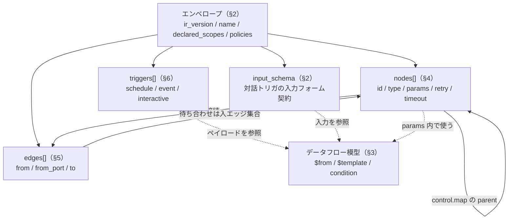
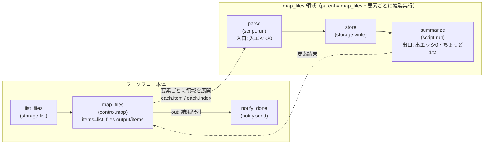

# ワークフロー IR 仕様

> 本書は [miniapp-platform.md](../miniapp-platform.md) §2.1 の詳細設計。概念・スコープの正本は [miniapp-platform.md](../miniapp-platform.md)。
> 認可・ストレージ・LLM の不変条件（単一チョークポイント・AuthContext・二重ゲート）は [design.md](../design.md) §1/§4 が正本であり、本書はその上に載る。
> 実装は [roadmap Phase 10](../roadmap/phase-10.md)（Task 10.1 が本書の主対象。10.5/10.6/10.10/10.12/10.13 が参照）。
> 着手前に [design-caveats](../design-caveats.md) の PIT-31（at-least-once 副作用）・PIT-34（委譲失効の検知）・PIT-35（script ホスト関数ブリッジ）・PIT-36（シークレット宛先束縛の迂回）を確認すること。
> 本書は IR の**定義と静的制約**の正本。実行時の振る舞い（skip 伝播の実行・join 発火・冪等・リトライ）は [engine.md](./engine.md)、script ノードのコンパイル・実行は [script.md](./script.md) が正本。用語は [README.md](./README.md) の用語集に一元化する。
> 本数値上限・タイムアウト・プール数はすべて**初期値**（実装時にベンチ・運用で調整。コード上は設定値）である。

---

## 1. 位置づけ

IR（Intermediate Representation）はワークフロー定義の**唯一の正本**であり、JSON で表現された有向非巡回グラフ（DAG）である。「トリガ＋ノード＋接続＋ポリシ」を宣言的に持つ。

- **IR を編集するのは dnd エディタと AI 編集の 2 つだけ**（[miniapp-platform.md](../miniapp-platform.md) §2.1）。shiki script は IR の編集手段では**ない**——ノードの中身を実装する言語であり、IR とは層が異なる（[script.md](./script.md) §1）。
- **code view（IR→script の双方向同期）はスコープ外**。IR とスクリプトを往復変換する経路は最初から作らない。IR は宣言的スペックのまま保つ。
- IR はバージョン付き artifact である（Phase 6 の artifact 共通枠を再利用: 不変 version・ReBAC 共有・監査）。artifact の `kind` は `workflow`。
- **保存時に検証パイプライン（§8）を通ったものだけが artifact version になる。検証を通らない IR は存在できない**。dnd 保存も AI 生成も同一の入口・同一のパイプラインを通る（generative UI の「検証済みスペック」パターンの再利用）。AI が生成した IR も人間が dnd でそのまま続きを編集できるのは、両者が同じ検証済みスペックを共有するからである。

IR が担う責務と、IR が担わない責務を明確に切り分ける。

| 担う（IR = 配線・定義） | 担わない（別の層） |
|---|---|
| ノードの配置・接続・パラメータの静的定義 | ノード内部のロジック（→ script ノード / [script.md](./script.md)） |
| トリガ・リトライ・タイムアウトの宣言 | 実行時の状態遷移・チェックポイント（→ [engine.md](./engine.md)） |
| 参照・条件・テンプレートの構造化記述 | 自由記述の式・計算（→ script ノードへ昇格・§3） |
| 保存時に静的検証可能な制約 | 実行時にしか分からない値の解決（→ [engine.md](./engine.md)） |

### 1.1 IR の構成要素関係図



---

## 2. エンベロープ

IR のトップレベルは以下の形を取る。

```jsonc
{
  "ir_version": 1,                  // IR スキーマ版（整数・単調増加）。未知の版は保存拒否（§9）
  "name": "expense-approval",       // ^[a-z][a-z0-9-]{0,63}$。tenant 内一意は artifact 層で担保
  "display_name": "経費承認フロー",  // 表示用
  "description": "経費申請の金額に応じて承認経路を分岐する",
  "declared_scopes": ["data.read", "data.write", "notify.send"],  // 宣言スコープ＝権限の天井。codegen 認可語彙
  "triggers": [ /* §6 */ ],
  "input_schema": { /* JSON Schema サブセット・省略可 */ },  // 対話トリガの入力フォーム契約
  "nodes": [ /* §4 */ ],
  "edges": [ /* §5 */ ],
  "policies": {                     // 省略時は全て既定値
    "run_timeout_sec": 259200,      // run 全体の上限（既定 3 日・最大 30 日）
    "concurrency": { "max_parallel_runs": 10 },  // このワークフローの run 同時実行（テナント/ノード種上限は engine 側設定）
    "on_trigger_overflow": "queue"  // 上限超過時: queue（既定・バックプレッシャ）| skip
  }
}
```

- **deny-unknown（全階層）**: 未知フィールドは全ての階層で保存拒否する。セキュリティ製品として未知の入力を黙殺しない（§8 V1）。この方針の帰結として、フィールド追加であっても `ir_version` を上げる（§9）。
- **`name`**: `^[a-z][a-z0-9-]{0,63}$`。tenant 内一意性の担保は artifact 層の責務であり、IR 検証はフォーマットのみを見る。
- **`declared_scopes`**: codegen 認可語彙の閉じた集合に照合する（§8 V3）。これは**権限の天井**であり、実効権限は次式で定まる（[miniapp-platform.md](../miniapp-platform.md) §7 の表そのまま）。

  ```
  実効権限 = トリガ由来の主体権限（実行主体の ReBAC） ∩ declared_scopes ∩ ノード設定
  ```

  **新バージョンで `declared_scopes` が広がった場合、有効化済みワークフローは再同意が済むまで新バージョンへ切替不可**（fail-closed。実行時の強制は [engine.md](./engine.md) §10 と対応）。縮小のみなら差分同意なしで切替可能。
- **`policies`**: 全て省略可。省略時は既定値。`run_timeout_sec` は run 全体の壁時計上限、`max_parallel_runs` はこのワークフロー単位の run 同時実行上限、`on_trigger_overflow` は上限超過時の挙動（`queue` はバックプレッシャで滞留、`skip` は run 作成を見送る。実行時の滞留・滞留解除の詳細は [engine.md](./engine.md) §8）。`max_parallel_runs` が数えるのは実行中の run で、**wait（時間・できごと）で止まっている run は数えない**（承認やイベントを何日も待つ run が枠を占めて、新しい起動が進まなくなるのを防ぐ。起床して上限を一時的に超えるのは許す・D-26）。
- **`input_schema`**: 対話トリガ（§6 `interactive`）の入力フォーム契約。JSON Schema のサブセット（型・必須・enum・range 程度。式・`$ref` 外部参照は持たない）。`llm.invoke` の `output_schema` は同じキーワードの集合に、構造化出力のための追加の制約（根は object・オブジェクトは閉じる・上限など）を課したもの（§7.3）。`format` は `date`（`YYYY-MM-DD` の実在する日付）だけを起動の前に検査し、ほかの値は注記として読み飛ばす（画面の日付の欄が送る形を、API・会話の図からの起動でも守らせる・BUG-35）。
  - **項目の並び（`x-order`）**: 注記 `"x-order": ["title", "amount"]`（`properties` のキーの配列）が、画面に並べる項目の順を持つ。IR は jsonb の列に保存されるので、`properties` のキーの順は保存して読み直すと辞書順に変わる（BUG-34・D-60）。画面（エディタの入力項目の表・実行のダイアログ・ミニアプリの部品の候補）は `x-order` に書かれたキーをその順に先に置き、書かれていないキーをその後ろに置く（無ければ今の順）。エディタの表は書き戻すたびに今の並びを `x-order` に書く。
  - 起動の検証は `x-order` を注記として読み飛ばす。形（文字列の配列・同じオブジェクトの `properties` のキーだけ・重なりなし。全部のキーを書かなくてよい）は保存時検証が全階層で確かめ、合わなければ `ir.schema_violation` で止める（path は `/input_schema/x-order/<i>`・§8 V1）。

---

## 3. データフロー模型（式言語を持たない・重要決定）

**IR に自由記述の式言語（JS 式・CEL 等）を導入しない。** パラメータは「リテラル＋参照＋テンプレート＋構造化条件」のみで組み立てる。複雑な変換・計算はすべて script ノードへ昇格させる（すみ分け: **IR = 配線 / script = ロジック**）。

この決定の理由（[README.md](./README.md) の FAQ にも載せる）:

1. AI 編集・dnd の両方が「スキーマ検証可能な構造化データ」を生成する設計である（検証済みスペック方式）。文字列に埋め込んだ式は、パーサ・エスケープ・インジェクションの面が生え、保存時検証の網羅性が落ちる。
2. 認可語彙・参照の静的検証（ハルシネーション境界）を式の内部まで貫徹するコストが高い。
3. 逃げ道が既にある——script ノードは ms 級起動なので、条件計算に使ってもコストが軽い（[script.md](./script.md) §4）。

却下案: CEL（構文が TS 系と乖離・依存追加）/ JS ミニ式（結局 QuickJS が要る → script ノードと二重化）。

パラメータ値として使える構造は 3 種——参照（`$from`）・テンプレート（`$template`）・構造化条件（`condition`）——である。以下順に定義する。

### 3.1 参照（`$from`）

パラメータ値の任意の位置に、リテラル JSON の代わりに参照オブジェクトを置ける。

```jsonc
{ "$from": "nodes.fetch_report.output", "path": "/items/0/name", "default": "untitled" }
```

- **source（`$from` の元）**:
  - `input` — run 入力（対話トリガの `input_schema` に沿う値）
  - `trigger` — トリガイベントのペイロード。手動の実行（`interactive`）では run の入力と同じ値になる（schedule のペイロードは `null`）。実行のダイアログ（`POST /workflows/{id}/runs` の `trigger`）では、ファイルやテーブルの変更をきっかけにするワークフローを試すために、きっかけの内容を入力と別に渡せる（項目のまとまりだけ・本人の権限で動くので、入力と同じく利用者が書いた値として扱う・D-93）
  - `nodes.<node_id>.output` — 他ノードの出力
  - `run` — 実行情報（読み取り専用・項目は vocab の `RUN_INFO_FIELDS` が正）: `date`（実行を始めた日・日本時間の `YYYY-MM-DD`）・`started_at`（実行を始めた日時・日本時間の RFC 3339）・`started_by`（実行した人）・`run_id`・`tenant_id`。日時は run を始めた時刻で決まり、同じ run の中ではやり直しても変わらない（ファイル名に差し込んでも冪等キーの照合が崩れない・D-97）。組織ごとのタイムゾーンの設定はまだ無いので日本時間で言う
    - `started_by` は、人が手動で実行した run（実行主体がユーザー。その run から `workflow.start` で始めた子の run を含む）の実行主体のユーザー ID で、テーブルのユーザーの列（`user_ref`）と比べられる（申請者の上長を承認者の表から引くなど・GAP-17・D-101）。schedule / event の run（ワークフロー主体）とミニアプリの自動化（サービスの主体）には人がいないので項目ごと入らず、参照すると `default` が無ければ `expr_resolve_error` で失敗する（黙って空の値で探さない）。入力項目で申請者を受け取る組み方は、実行する人が別の人の ID を入れて名乗れるので勧めない
  - `each` — **map 領域内のみ**。現在要素（`each.item` と `each.index`。§5.3）
- **`path`**: RFC 6901 JSON Pointer。省略時は source 全体を指す。
- **`default`**: 解決失敗（skipped ノードの出力・パス不在・null）時のフォールバック。**`default` がなく解決に失敗した場合、step は `expr_resolve_error` で失敗する**（黙って null を流さない）。実行時の解決アルゴリズムは [engine.md](./engine.md) §4。
  - **例外: 値式全体の null は値として通す。** パラメータの値（またはリテラルの object / array の要素）そのものが `$from` で、指した値が null のとき、`default` が無ければ null をそのまま渡す（項目を空にする書込などのため・D-35）。パスが無い・skipped ノードの出力は従来どおり失敗する。`$template` の差し込み（§3.2）の null は、空文字や `null` の文字を黙って埋め込まないよう `expr_resolve_error` で失敗する。
- **静的検証（§8 V5）**: `nodes.<id>` は**当該ノードの祖先**（DAG 上、いずれかのパスで先行するノード）でなければ保存拒否。**すべてのパスで先行するとは限らない**祖先（分岐の片側にしかいない等）を参照する場合は `default` 必須（そのパスが取られないと skipped になり解決失敗するため）。
- **`secrets.*` という source は存在しない**。シークレットは参照名でノード設定に書き、エンジンが実行直前に解決・注入する（§7 `http.request` / [script.md](./script.md) §6）。値がデータフローに乗る経路を構造的に作らない。

### 3.2 テンプレート（`$template`）

```jsonc
{ "$template": "{user} さんの経費申請（{amount} 円）が承認待ちです",
  "vars": {
    "user":   { "$from": "trigger", "path": "/record/applicant_name" },
    "amount": { "$from": "trigger", "path": "/record/amount" }
  } }
```

- **文字列組み立て専用**。`{name}` は `vars` のキーのみを参照できる（位置指定・ネスト・式は不可）。リテラルの `{` / `}` は `{{` / `}}` でエスケープする。
- 閉じの無い `{`（`a { b`）と対にならない `}` は文字のまま出す（エラーにしない）。`{name` の閉じ忘れは差し込んだつもりで差し込まれないので、閉じの無い `{` は保存時に警告する（`ir.template_unclosed_brace`・§8・D-37）。
- `vars` の値は参照（`$from`）またはリテラル。非文字列値は JSON 表現へ文字列化する（数値・bool はそのまま、object/array はコンパクト JSON）。
- 上限: `vars` の数 ≤ 50（§8 V7）。

### 3.3 構造化条件（`condition`）

`control.branch` ノード・イベントトリガの `filter`・`control.wait`（event）の `filter` で共通に使う条件木である。

```jsonc
{ "all": [
    { "op": "eq", "left": { "$from": "trigger", "path": "/record/status" }, "right": "submitted" },
    { "any": [
      { "op": "gte", "left": { "$from": "trigger", "path": "/record/amount" }, "right": 100000 },
      { "op": "eq",  "left": { "$from": "trigger", "path": "/record/category" }, "right": "travel" }
    ] }
] }
```

- **合成**: `all` / `any` / `not`（ネスト深さ最大 5・§8 V7）。ルートは合成（`all`/`any`/`not`）でも単一の op リーフでもよい。
- **op（閉じた集合）**: `eq` `neq` `lt` `lte` `gt` `gte` `in`（`right` = 配列リテラル）`contains`（string/array）`starts_with` `ends_with` `exists` `is_null` `matches`。
  - `matches`: 正規表現。**保存時にコンパイル検証する**（§8 V5）。Rust `regex` クレート（バックトラックなし）を用い、パターン長 ≤ 256。
- **意味論は data 側と共通の表に従う**（2 値論理・左辺は値の集合として見る・`1 = 1.0`。表は [query-optimizer.md §3.1](../data/query-optimizer.md)、固定は共通の表 `semantics_table.json` を workflow の評価器・data の参照評価器・実 SQL にかけるテスト）。型の扱いは演算子で分かれる（D-34）。
  - **大小比較（`lt` `lte` `gt` `gte`）だけが型厳密**: 左右が数値どうし・文字列どうしでない組（数値と文字列・真偽値・オブジェクトなど）は false へ黙って落とさず、`expr_type_error` として step / トリガ評価を失敗させる（監査に残る。固定値の「100」と数値の 100 を比べて分岐が黙って逆に流れるのを防ぐ）。数値は serde_json の数値（i64/u64/f64）間でのみ数値比較する。値なし（未解決・null）と左辺が配列（多値）の大小比較は偽（表のとおり・多値の大小比較は data では使えない）。
  - **それ以外の演算子の型違いは偽**（失敗にしない）: `eq`・`in` は型が違えば等しくない（`neq` は真）。`contains`・`starts_with`・`ends_with` は文字列でない要素を満たさない。`matches` は左右が文字列でなければ偽。
- **暗黙変換なし**。truthy / falsy の概念を持たない（bool 以外を条件位置に置けない）。
- トリガ filter の評価エラーの実行時の扱い（発火しない＋監査）は [engine.md](./engine.md) §5。

---

## 4. ノード

ノードは処理単位である。1 ノードが 1 step の実行に対応する（map 領域では要素数分の step に展開・§5.3）。

```jsonc
{
  "id": "notify_manager",           // ^[a-z][a-z0-9_]{0,63}$・ワークフロー内一意
  "type": "notify.send",            // 閉じたノードカタログ（codegen 語彙・§7）
  "label": "上長へ通知",             // 表示用・任意
  "parent": null,                    // map 領域内なら親 map ノード id（§5.3）。領域外は null
  "params": { /* ノード種ごとのスキーマ。codegen が正・§7 */ },
  "retry": {
    "max_attempts": 3,
    "backoff": { "kind": "exponential", "base_sec": 5, "max_sec": 300, "jitter": true }
  },
  "timeout_sec": 30,                 // ノード種ごとに既定・上限あり（§7 の表）
  "on_error": "fail_run",            // fail_run（既定）| continue（error ポートへ）
  "cache": { "ttl_sec": 86400 }      // 任意・結果の使い回し（いまは ai.decide だけ・§7.11）。既定は使わない
}
```

- **`id`**: `^[a-z][a-z0-9_]{0,63}$`。ワークフロー内一意（§8 V2）。参照（`nodes.<id>`）・エッジ・`step_path`（[engine.md](./engine.md) §2）の識別子になる。
- **`retry`** の既定は `max_attempts: 1`（リトライなし）。**リトライは at-least-once を顕在化させる行為**なので、明示オプトインとする（PIT-31 の思想）。attempt を跨いで冪等キーは不変であり、その供給と dedupe の詳細は [engine.md](./engine.md) §7。
  - `backoff.kind`: `exponential`（`base_sec`・`max_sec`・`jitter`）。full jitter の実行は [engine.md](./engine.md) §7。
- **`timeout_sec`**: ノード種ごとに既定値と上限がある（§7 の表。正はノードカタログの `timeout_default_sec`・`timeout_max_sec`）。1 未満と上限超過値は保存拒否（§8 V7・`ir.limit_exceeded`・path `/timeout_sec`）。`agent.invoke` は `max_duration_sec`（省略は 600 秒）より短くできない。打ち切らない種（制御ノード・予約語彙）に書いた値は読まない（保存も止めない）。step timeout の実行時の扱い（retryable か等）は [engine.md](./engine.md) §9.4（BUG-96）。
- **`cache`**（step 属性・§7.8 で予約したもの）: 結果の使い回し。書けるのはノードカタログの `step_cache` がある種だけで、いまは `ai.decide` の決定キャッシュ（§7.11）。ほかの種に書くと保存時に `ir.cache_unsupported`。`ttl_sec` は 60〜2,592,000 秒（1 分〜30 日・省略は 86,400 秒＝1 日・範囲の外は `ir.schema_violation`）。答えは実行履歴の保持期間を超えて残らない（保持期間が短ければそちらが上限・§7.11）。キーは書けない（種が決める）。省略が既定で、使い回さない。
- **`on_error`**:
  - `fail_run`（既定）: エラーで run 全体を failed にする。
  - `continue`: ノードは出力ポート `error` を持ち、エラーオブジェクトが `error` ポートの下流へ流れる。

  `continue` 時に error ポートへ流れる形:

  ```jsonc
  { "error": { "code": "...", "message": "...", "retryable": true, "node_id": "...", "attempt": 2 } }
  ```

---

## 5. エッジ・ポート・グラフ制約

### 5.1 エッジ

```jsonc
{ "from": "check_amount", "from_port": "true", "to": "notify_manager" }
```

- `from_port` 省略時は `"out"`。
- **to 側にはポートがない**。合流・待ち合わせは `control.join` の**入エッジ集合**で定義する（下記 §5.4）。
- **グラフ制約（保存時検証・§8 V2）**:
  - **DAG**（閉路拒否）。自己ループ拒否。多重エッジ（同一の from / from_port / to）拒否。
  - **join 以外のノードの入エッジは最大 1 本**。合流したければ必ず `control.join` を置く。ダイヤモンド合流の実行セマンティクスが曖昧化するのを型で排除する（重要決定）。
  - すべてのノードは、いずれかのエントリノード（入エッジ 0 本のノード）から到達可能でなければならない。孤立ノード拒否。
  - **エントリノード（入エッジ 0）は複数可**。run 開始時に全エントリノードが ready になる（静的並列。[engine.md](./engine.md) §4）。

### 5.2 ポートカタログ

| ノード種 | 出力ポート |
|---|---|
| 通常ノード | `out`（＋ `on_error: continue` 時 `error`） |
| `control.branch` | `true` / `false` |
| `control.switch` | 各 case 値ポート ＋ `default` |
| `control.join` | `out` |
| `control.map` | `out`（領域完了後・結果配列） |
| `control.wait`（event, `on_timeout: continue`） | `out` / `timeout` |
| `human.approval` | `approved` / `withdrawn` ＋ `rejected`（`reject` を指定したとき）・`returned`（`return` を指定したとき）・`timeout`（期限を決めて `on_timeout: continue` のとき）（§7.9） |
| `workflow.reply` | `out`（＋ `on_error: continue` 時 `error`）（§7.10） |
| `ai.decide` | `route` 無し＝`out`。`by: confidence`＝`out` / `uncertain`。`by: value`＝選択肢のキー（choice）か `true` / `false`（boolean）＋ `uncertain`（`out`・`default` は無い）（§7.11） |

- **ポートの決まり方はノードカタログの `port_rule` が単一定義**（`static`＝静的なポートだけ・`switch_cases`＝`cases[].port` と `default`・`approval_choices`＝`approved` / `withdrawn` に指定した判断と時間切れ・`decide_route`＝`route` から）。どの規則でも `on_error: continue` なら `error`、wait(event) で `on_timeout: continue` なら `timeout` が加わる。実際の集合は Rust の 1 つの関数（`workflow_engine::node_ports`）が params から導き、保存時検証 V2（§8）と検証 API（`POST /workflows/validate`）の応答の `node_ports`（ノード id → 出口の名前・表示の順）が同じ関数を使う。エディタはこの応答でハンドルを描き、導出を TS に書き写さない。カタログの `dynamic_ports` は互換のための印（switch と ai.decide で true）で、どう決まるかは `port_rule` を見る。
- params が契約に合わず出口を導けないノード（振り分けの質問が無い ai.decide など）は、V2 が出口を検査しない（V1 が報告する・同じ誤りを二重に出さない）。検証 API の `node_ports` にも載らない。
- ai.decide の出口は、出口に関わる項目（`route` と、その質問の種類・選択肢のキー）だけから導く。ほかの質問の誤り（書きかけの問い）・モデルの未選択・しきい値の範囲では導けなくしない（エディタが古い出口を今の出口として描き、利用者が無い出口へつながないように）。導けないのは、`route` の質問が無い・同じキーの質問が複数ある・段階（score）の質問・選択肢のキーが出口の名前にできない（形・予約名・重なり・件数）ときだけ。
- `control.switch` の case ポート名は params の `cases` で宣言する値と一致させる（保存時にポート存在検証・§8 V2）。
- `control.switch` の `value` が解決できない（`default` の無い `$from` のパスが無いなど・§3.1）ときは、`default` ポートへ流さず `expr_resolve_error` で失敗する。どの case にも一致しないのと、値が無いのを区別する（黙ってその他へ流さない・D-36）。「値が無ければその他へ」としたいときは、`$from` に `default` を書く（例: `{ "$from": "input", "path": "/kind", "default": "" }`）。

### 5.3 map 領域（動的 fan-out）

`control.map` は `items`（配列への参照）を受け、**領域（region）**を要素ごとに並列実行する。

- **領域** = `parent: "<map_id>"` を持つノード集合。制約（§8 V2）:
  - 領域内ノードのエッジは**同一領域内で閉じる**（領域跨ぎのエッジは保存拒否）。
  - 領域の**入口** = 領域内で入エッジ 0 本のノード（複数可）。
  - 領域の**出口** = 領域内で出エッジ 0 本のノード**ちょうど 1 つ**（出口の出力が要素結果になる）。
  - map の**ネスト可・最大深さ 2**。
- **`params`**:

  ```jsonc
  { "items": { "$from": "nodes.list_files.output", "path": "/items" },
    "max_concurrency": 10,           // 領域の要素並列度（初期値 10）
    "on_item_error": "fail_map" }    // fail_map（既定）| collect
  ```

  - `fail_map`（既定）: 1 要素の失敗（リトライ枯渇後）で map ノード自体が失敗する（`on_error` に準拠）。実行中の他要素は完走させる。
  - `collect`: 失敗要素は `{ "error": ... }` として結果配列に混ぜ、map は成功扱いにする。
- **map 出力**:

  ```jsonc
  { "items": [ /* 要素結果…（入力順） */ ], "errors": [ { "index": 3, "error": { /* … */ } } ] }
  ```

- **fan-out 上限**: 要素数 ≤ 1000（初期値）。超過は step 失敗・`fanout_limit_exceeded`。
- 領域内ノードから現在要素を参照するには `each`（`each.item` / `each.index`・§3.1）を使う。`step_path` 上の map 要素表現は [engine.md](./engine.md) §2。

#### map 領域の構造例



### 5.4 join

`control.join` は複数入エッジの待ち合わせ点である。

- **`params`**: `{ "mode": "all" | "any" }`（既定 `all`）。
- **`all`**: 全入エッジが「解決」するまで待つ。解決 = 生きて完了（live）または死んだ（dead・§5.5）。
  - 出力: `{ "<from_node_id>": <output or null(dead)>, ... }`
  - 全入エッジが dead なら join 自体が skipped。
- **`any`**: 最初の live 解決で発火（1 回だけ）。
  - 出力: `{ "winner": "<node_id>", "output": ... }`
  - 残る分岐は完走するが、その下流で join(any) は再発火しない。全 dead なら skipped。全 live が失敗（`fail_run` でない場合）なら failed。
- join の**発火判定の実行時セマンティクス**（どの遷移でどう ready 化するか）は [engine.md](./engine.md) §4 が正本。本節は静的定義（出力形・mode の意味）を規定する。

### 5.5 skip 伝播（静的定義）

skip 伝播の**実行アルゴリズム**（どの TX でどう dead を伝播させるか）は [engine.md](./engine.md) §4 が正本。本節はエッジ状態と skipped の**定義**のみ規定する。

- **エッジ状態**: `pending` → `live`（源が成功しポートが取られた）/ `dead`（源が skipped、または源は完了したが当該ポートが取られなかった、または源が失敗して `error` 以外のポート）。
- ノードは「入エッジがすべて解決し、かつ live が 1 本以上」で ready になる（join 以外は入エッジ ≤ 1 なのでこの規則は自明）。入エッジが（唯一の 1 本が、または join なら全てが）dead ならノードは `skipped` になり、その全出力ポートのエッジが dead になる（連鎖）。
- run の終了判定: 全ノードが terminal（succeeded / failed / skipped）になったら run terminal（実行時判定は [engine.md](./engine.md) §4）。

---

## 6. トリガ

```jsonc
[
  { "id": "t_sched", "kind": "schedule", "cron": "0 9 * * MON", "tz": "Asia/Tokyo", "catchup": "skip" },
  { "id": "t_event", "kind": "event", "source": "data.transition",
    "filter": { "cmp": { "left": { "$from": "trigger", "path": "/to" }, "op": "eq", "right": "approved" } },
    "scope": { "table": "8c8a6f6e-2ab7-4a44-a815-9a2b53c4e9a1" } },
  { "id": "t_manual", "kind": "interactive" }
]
```

- トリガは `nodes` とは別セクションに置く（dnd 上は擬似ノードとして描画する）。ペイロードは `{ "$from": "trigger" }` で参照する。
- 複数トリガ間でペイロード形が異なる場合は、`default` または `control.branch` で吸収する（保存時に警告・§8）。

### 6.1 `schedule`

- cron 5 フィールド ＋ `tz` 必須（IANA タイムゾーン名）。
- **曜日は標準の読み方**: 0 と 7 が日曜、1 が月曜〜6 が土曜。名前（`SUN`〜`SAT`・大小文字は問わない）も書け、数・範囲（`1-5`・`MON-FRI`）・列挙・刻み（`*/2`・`1-5/2`。始まりだけの `1/2` は 7 まで）を混ぜてよい。範囲の逆転（`5-1`・`SAT-SUN`）・8 以上・`L` や `#` は保存時に `ir.bad_schedule`（BUG-95）。日と曜日の両方を指定したときは**両方に合う日**だけに動く（標準の cron の「どちらか」とは違う）。
- 保存時の検証・発火・エディタの「次の実行」（`POST /workflows/schedule-preview`）は同じ関数（`workflow_engine::scheduler::cron`）で読む。エディタは曜日を名前で書く。
- **DST**: 「存在しない時刻はスキップ・二重時刻は先勝ち」。
- **`catchup`**:
  - `skip`（既定）: 停止中の未発火は直近 1 回だけ発火する。
  - `none`: 停止中の未発火は捨てる（稼働中の時刻どおりの発火はする。判定は engine.md §5.2）。
  - **`all`（全部再生）は v1 でやらない**。
- misfire（停止中の穴）の埋め方の実行時挙動は [engine.md](./engine.md) §5。

### 6.2 `event`

- **`source`** は閉じた集合 `storage.write` / `data.record.created` / `data.record.updated` / `data.transition`（既存 outbox イベント種に対応）。将来追加は codegen 語彙で行う。加えて `event.custom`（`event.publish` ノードが発行するカスタムイベント）と `webhook.received`（外部システムからの webhook 受信・署名検証とレート制限は受信エンドポイント側で設計）を**予約済み**（§7.8・Stage A では保存不可）。
- **`scope`** で対象（テーブル・フォルダ）を**必須束縛**する。全イベント購読を許さない。フォルダ / テーブル id は保存時に存在検証する（§8 V4）。形は source ごとに決まる（§8 V3）:
  - `storage.write`: `{ "folder": "<uuid>" }`（祖先束縛・配下のフォルダの保存でも起きる）。
  - データ変更の 3 種: `{ "table": "<uuid リテラル（小文字・ハイフンつき）>" }` だけ。`$from`・空・他のキーは拒否する。保存ビュー単位の scope は v1 では入れない（同じ絞り込みは `filter` で書く）。
- データ変更のトリガは `declared_scopes` に `data.read` が要る（保存の入口で補う）。有効化者はトリガのフォルダ・テーブルの viewer であること（有効化時に確かめる）。
- `filter`（条件木・§3.3）でペイロードを絞る。filter 評価エラーの実行時扱い（発火しない＋監査）は [engine.md](./engine.md) §5。
- **ペイロード**（run 入力・`$from trigger`）の形は source ごとに決まり、**語彙のカタログ（`EVENT_CATALOG` の `payload_fields`・`crates/workflow-engine/src/vocab/event_catalog.rs`）が正**（エディタの参照の候補と AI の説明文も同じ表から作る・D-47）:
  - `storage.write`: `{ file_id, version, op（create | update）, kind（"file"）, parent_id, size, actor, blob_sha256 }`。ファイル名・content_type は載せない（`storage.read` の出力から取る）。`parent_id` は保存した時点の親フォルダ（作成でも新しい版でも載る）。
  - データ変更: `{ source, table_id, record_id, rev, change（create | update | transition）, from, to（状態が変わったときだけ・ほかは null）, changed（変わった列の参照名）, changes（列ごとの { old, new }）, actor, by_workflow（ワークフローの書込による変更か）, occurred_at, record（今の行）, truncated }`。値は**有効化者（委譲元）の見え方**で作る: 委譲元に見えない行の変更・読めない列だけの更新では発火しない（記録もしない）。読めない列は `changed`・`changes`・`record` に載らない。64KB を超えると `record` と `changes` を落として `truncated: true`。
- `storage.write` は**ファイルの作成**（op `create`）と**新しい版の保存**（op `update`: 利用者のアップロード・内容の更新（Office・ノートの保存・`csv.patch`）・提案の採用・上書き）で起きる。削除・移動・名前の変更・版の復元・フォルダの作成では起きない。新しい版の保存は**同じファイルの続く保存を 1 回にまとめる**: 同じトリガ・同じファイルの保存が 60 秒途切れてから、最後の版のペイロードで 1 回だけ起動する（保存が途切れなくても、まとめ始めから 10 分で起動する・D-38）。作成はまとめずにすぐ起動する。発火の時点で workflow プリンシパル（有効化の委譲）が保存されたファイルを読めなければ発火しない（記録もしない・D-50）。まとめて待たせた発火も、起動する時点で読めなくなっていれば起動しない（BUG-50）。このワークフロー自身の保存とその子（`workflow.start`）の保存では発火しない（下のデータ変更と同じ因果の鎖・D-26）。
- データ変更のトリガは次では発火しない（[engine.md](./engine.md) §5.4）: 一括取込（CSV の取込・`data.bulk_upsert` の作成行と更新行）、このワークフロー自身の書込とその子（`workflow.start`）の書込（因果の鎖）、鎖が 4 段を超える連鎖、queued の run が 1,000 件以上あるとき。状態の変更は行の更新でもあるので、同じテーブルに `data.record.updated` と `data.transition` を置くと 1 回の遷移で 2 回起動する（保存時に警告 `ir.overlapping_data_triggers`）。
- filter の例: 遷移先 `/to eq "approved"`・変更した列 `/changed eq "amount"`（配列の eq は「含む」）・変更前後の値 `/changes/amount/new gte 100000`・今の値 `/record/data/category`・人の操作だけ `/by_workflow eq false`。

### 6.3 `interactive`

- UI ボタン・チャットからの起動。エンベロープ直下の `input_schema`（§2）が入力フォーム契約になる。

### 6.4 実行主体

実行主体はトリガ種別で決まる（[miniapp-platform.md](../miniapp-platform.md) §2.3 のまま。強制は [engine.md](./engine.md) §6）:

| トリガ種 | 実行主体 |
|---|---|
| `interactive` | トリガした本人 |
| `schedule` / `event` | workflow プリンシパル（`workflow:<tenant>|<id>`）＋有効化時の明示委譲 |

---

## 7. ノードカタログ v1（params の正は codegen）

**ノード params のスキーマは Rust 型定義から codegen（JSON Schema ＋ TS 型）するのが正**であり、本表は**設計仕様**として用途・冪等性区分・スコープ・timeout を規定する（右パネル UI の契約は codegen 型が駆動する・Task 10.6/10.12）。

**冪等性区分**:
- `engine-dedup` — 内部チョークポイントが冪等キーで重複排除し、副作用が高々 1 回になる（実行の詳細は [engine.md](./engine.md) §7）。
- `best-effort` — 外部副作用。exactly-once を約束しない（UI とドキュメントに明示する）。
- `pure` — 副作用なし。

| type | 区分 | 概要 | 冪等性 | timeout 既定/最大 |
|---|---|---|---|---|
| `storage.read` | 能力 | 文章のファイルを読む（≤ 10MB。PDF・Office・画像などの種類〔MIME か拡張子〕と、UTF-8 でない中身は `not_text_file` で失敗・BUG-101。結果に読んだ中身のバージョン `version` を載せる・D-96） | pure | 30s / 120s |
| `storage.write` | 能力 | 新しいファイルの保存（既存のファイルは書き換えず、新しいバージョンも足さない。同じ名前があれば `on_name_taken` に従い、省略・`fail` は `name_taken` で失敗、`add_number` は「名前 (2).md」〜「名前 (50).md」の空いている名前で保存する。`content_type` を省くと拡張子〔.txt・.md・.csv・.json・.html〕から決め、決まらなければ `application/octet-stream`・BUG-97・D-97） | engine-dedup | 30s / 120s |
| `storage.list` | 能力 | フォルダ一覧 | pure | 30s / 120s |
| `csv.query` | 能力 | CSV に読み取り専用の SQL を実行して集計・抽出する（隔離ランナー。結果に集計した中身のバージョン `version` を載せ、後ろの `csv.patch` の `base_rev` にできる・D-96） | pure | 30s / 120s |
| `csv.patch` / `csv.write` | 能力 | CSV のセル・行・列を書き換えて新しいバージョンを保存する／新しい CSV を保存する（同じ名前があるときは `storage.write` と同じ `on_name_taken`） | engine-dedup | 30s / 120s |
| `data.query` | 能力 | 宣言的クエリ（**data の `DataQuery` をそのまま使う**・比較値に `$from` 可・`query.limit` は 1〜200 で範囲の外は保存時に `ir.schema_violation`・BUG-108） | pure | 30s / 120s |
| `data.record.create` / `data.record.update` / `data.record.delete` | 能力 | レコード書込（rev 楽観ロック・rev 省略時は実行時点の rev） | engine-dedup | 30s / 120s |
| `data.transition` | 能力 | **FSM 遷移 API を叩く**（直接 status 書込は構造的に不可能） | engine-dedup | 30s / 120s |
| `data.bulk_upsert` | 能力 | 一括の作成・更新（data の一括書込パス・最大 5,000 行・誤りは行ごとに拒否） | engine-dedup | 120s / 600s |
| `rag.search` | 能力 | permission-aware 検索（必要スコープは既存語彙 `rag.query`。結果の各件に関連の強さ `relevance`〔high・medium・low。reranker の値を設定のしきい値で段階に落としたもの〕を載せる。`score` は順位から決めた値〔1/(順位+1)〕で関連の強さではない・D-96） | pure | 60s / 120s |
| `notify.send` | 能力 | アプリ内通知 | engine-dedup | 30s / 60s |
| `workflow.start` | 能力 | 別ワークフロー起動（fire-and-forget・run_id 返し。相手は保存時に V4 で照合し、実行時に無い・見えない相手は同じ `not_found`〔permanent〕で失敗する・BUG-107。相手の最新の保存内容を、親の実行主体の権限で動かす・D-91） | engine-dedup（起動 1 回保証） | 10s / 30s |
| `control.branch` / `switch` / `join` / `map` / `wait` | 制御 | §5 | pure | ―（wait は別枠・§7.5） |
| `script.run` | script | shiki script 実行 | best-effort（script 次第・冪等キー供給） | 30s / 360s |
| `skill.invoke` | skill | `skill:<name>@<version>` | skill 宣言に従う | 60s / 360s |
| `llm.invoke` | AI | llm-gateway 直行 | pure（課金あり） | 120s / 600s |
| `agent.invoke` | AI | agent-core のツールループ（ループはホスト側・道具は能力 API・コードの実行の道具だけをサンドボックスで実行・§7.4） | best-effort | 600s / 3600s |
| `ai.decide` | AI | 判定用のモデルで、質問に決められた値域（選択肢・段階・はい/いいえ）で答え、確からしさを付けて返す（llm-gateway の判定のチョークポイント・§7.11） | pure（課金あり） | 60s / 300s |
| `http.request` | 外部 | 外部 HTTP | **best-effort**（Idempotency-Key 注入支援のみ） | 30s / 120s |
| `human.approval` | 人間参加 | テーブルの 1 行について担当者の承認・却下・差し戻しを待って分岐する（判断は承認者本人の FSM 遷移・§7.9） | engine-dedup（台帳は step で 1 件） | 30s / 120s（停止まで。判断を待つ時間は `timeout_sec` と `run_timeout_sec`） |
| `workflow.reply` | フロー連携 | 結果を画面に返す（ボタン・会話から起動した本人の画面に出す・スコープ不要・§7.10） | pure | 5s / 10s |

以下、設計上の要点を持つノード種を個別に規定する。params の網羅的スキーマは codegen 型が正であり、本節は制約と出力形を示す。

- **ファイルの ID の項目名は `file_id` にそろえる**（D-96）: `storage.read`・`storage.write`・`csv.write`・`csv.patch` の結果は `file_id` を載せ、古い名前（`storage.*` の `id`・`csv.*` の `node_id`）も同じ値で残す（保存済みの定義の `$from` を壊さない）。`rag.search` の結果・ファイル保存のトリガのペイロードはもとから `file_id`。出力の形の正はカタログの `output_fields`。

**出力の形の正はノードカタログ**（`crates/workflow-engine/src/vocab/catalog.rs`）の `output_fields`（最上位の項目の名前・型・省略されうるか・補足）である。AI の説明文に載せる TS 風の表記（`output_shape`）はそこから作り、エディタの参照の候補も `output_fields` を読む（表記を字句解析しない・D-42）。項目の組でない出力（入力をそのまま通す・script の戻り値など）は文で書き、項目は空にする。

### 7.1 `data.transition`（FSM 遷移）

**status を進めたいときも必ず通常の遷移 API を叩く**（[miniapp-platform.md](../miniapp-platform.md) §1）。エンジンに status を直接書かせて FSM の不変条件を破ることは構造的に不可能——このノードは遷移 API を呼ぶだけであり、直接 status 書込のノードは存在しない。ガード・認可は遷移 API 側で再評価される。

```jsonc
{ "id": "approve", "type": "data.transition",
  "params": {
    "table": "8c8a6f6e-2ab7-4a44-a815-9a2b53c4e9a1",   // テーブル id（UUID・$from 可）
    "record": { "$from": "trigger", "path": "/record_id" },
    "to": "approved",              // 遷移先の status（FSM は「現在の status → to」で遷移を定義する）
    "expected_rev": { "$from": "trigger", "path": "/rev" }   // 省略時は実行時点の rev
  } }
```

- 出力: 遷移後のレコード（実行主体のフィールドマスク適用後）。
- テーブルは FSM で管理するもの（`fsm_ref` のあるもの）に限る。リテラルで書いたテーブルは保存時に照合する（§8 V4・BUG-105）。
- Task 15.7 で実装した際、遷移名（`transition`）と遷移入力（`input`）の指定は採らなかった。data の FSM
  （`FsmBody`）は遷移に名前を持たず「from → to」で定義し、遷移に入力も取らないため。
- **data ノード共通（Task 15.7）**: 認可は data 側（行述語・フィールドマスク・OpenFGA）。interactive run は
  起動したユーザーの権限、schedule / event run は**ワークフロー主体に委譲されたテーブルだけを、委譲元
  ユーザーの権限で**読み書きする（行は委譲元の行述語で絞られる・[engine.md](./engine.md) §6.8）。

### 7.2 `http.request`（外部 HTTP・PIT-36 の型防御）

```jsonc
{ "id": "post_slack", "type": "http.request",
  "params": {
    "method": "POST",
    "url": "https://api.slack.com/api/chat.postMessage",  // ホスト部はリテラル必須
    "path_suffix": { "$from": "input", "path": "/channel_path", "default": "" },  // パスは可
    "query": { /* $from / $template 可 */ },
    "body": { "$template": "…", "vars": { /* … */ } },
    "secret": { "name": "slack-bot-token", "attach": { "kind": "bearer" } },
    "redirect": "deny",            // deny（既定）| follow_stripped
    "fail_on_error_status": true   // 相手が 400 以上を返したら失敗にする（省略は false）
  } }
```

- **URL のホスト部は IR 上リテラル必須**（`$from` / `$template` 不可。パス・クエリ・ボディは可）。保存時に egress allowlist・シークレット宛先束縛と照合できるのはこの制約のおかげであり、PIT-36 の動的 URL 迂回を型で殺す（§8 V4）。
- **`secret`**: `{ "name": "<参照名>", "attach": { "kind": "bearer" | "header", "header"?: "X-Api-Key" } }`。参照名のみを書き、解決・宛先束縛検証・注入はエンジンが実行直前に行う（値がデータフローに乗らない・§3.1）。
- **`redirect`**: 既定 `deny`。`follow_stripped` は追従時にシークレットを剥がして再検証する（PIT-36）。
- **実行時の注入はコネクション検証後**: ホスト部リテラル制約は動的 URL 迂回を塞ぐが、DNS rebinding（検証後に解決先 IP が付け替わる）は塞げない。エンジンが名前解決・コネクション確立・検証を行い、**検証済みコネクションにのみ**シークレットを注入する（PIT-36 ③。実行時の正は [engine.md](./engine.md) §7・`Shiki.http.request` と同一実装）。
- 応答: `{ "status", "headers": { /* 許可リストのみ */ }, "body": /* JSON なら parse・そうでなければ text・≤ 1MB */ }`。
- 冪等性は best-effort。`Idempotency-Key: <冪等キー>` ヘッダの注入支援のみ提供する（[engine.md](./engine.md) §7）。
- **`fail_on_error_status`**（省略は false・BUG-99・D-95）: true なら、相手が 400 以上を返したときブロックを失敗にする。400〜499（429 を除く）は `http_error_status`（permanent）、500 以上と 429 は `http_retryable_status`（retryable・`max_attempts` の範囲でやり直す）。省略・false は誤りの応答も成功として `status` を返す（この項目が無かったころの定義の挙動）。エディタで新しく置くブロックは true で置く。送ったことは失敗にするときも監査に残す。
- **送れる先**: シークレットを使わない送信は、デプロイ設定 `workflow.http_allowlist` の宛先だけ（既定は空で、空ならシークレットなしの送信はすべて拒否する）。シークレットを使う送信は、そのシークレットの宛先束縛の中だけで、`http_allowlist` を設定していればその中にも限る（`nodes/capability_ai.rs` の `check_http_destination`）。

### 7.3 `llm.invoke`

```jsonc
{ "id": "classify", "type": "llm.invoke",
  "params": {
    "model": "…",                  // 省略可。省略すると組織の既定（Auto を含む）。指定時は組織が許可したモデルへ保存時照合＋実行時再照合
    "effort": "low",               // 省略可。low | medium | high（思考の深さ）
    "prompt": { "$template": "…", "vars": { /* … */ } },
    "max_tokens": 2048,            // 省略可（gateway の既定）
    "output_schema": {             // 省略可。書くと構造化出力（出力に検証済みの data が付く）
      "type": "object",
      "required": ["category", "summary"],
      "properties": {
        "category": { "type": "string", "enum": ["billing", "bug", "howto", "cancel", "other"] },
        "summary":  { "type": "string", "maxLength": 200 }
      } }
  } }
```

- `model` を省略すると（空文字も同じ）、**実行のたびに**実行主体の組織（tenant_id ＋ org）の AI 設定で解決する。チャットと同じ規則（llm-gateway の `resolve_choice`）で、既定が Auto なら Auto の振り先と思考強度を使う。本人専用のモデル（ChatGPT プラン）は、実行主体によらず候補から外す（誰が起動しても同じモデルになる）。
- `model` を指定すると、保存時に組織が許可したモデル（本人専用を除く）と照合する（§8 V3）。実行時にも同じ規則で照らし直し、使えなくなっていれば組織の既定へ戻さずに失敗する（[engine.md](./engine.md) §6 の fail-closed）。
- 組織がモデルの選択を許していないときは、既定と異なる `model` を `ir.model_choice_disabled` で拒否する（実行時も同じ規則で失敗する）。
- `effort` は思考の深さ（`low` / `medium` / `high`）。省略すると組織の既定（既定が Auto なら Auto の思考強度）。書くと組織の既定より優先する。ただし、組織がモデルの選択を禁じているときと、`model` を省略して組織の既定の Auto で動くときは使わず、組織の設定に従う（チャットと揃える・D-75。チャットも Auto では利用者の指定を使わない）。選択を禁じた組織で、既定と同じ `model` を明示したノードは、省略と同じに解決する（使うモデルは同じで、思考強度は組織の既定。選ぶ画面の無いチャットと同じ）。そのときは保存時に `ir.effort_ignored` で警告する（保存は止めない）。実行時の規則は llm-gateway の `resolve_workflow_choice` で、警告も同じ条件で出す。思考に対応しないモデルでは gateway が送らない（[design.md](../design.md) §4.5）。
- 出力は `{ "text", "model" }`。`model` は実際に使ったモデルの論理名で、会計・監査にも同じ名前を残す。
- `output_schema` を書くと構造化出力になり、出力は `{ "text", "model", "data" }` になる。`data` は形で検証済みの値で、`text` はモデルが返した JSON の文字列。後続は `/data/<項目>` で読む（分類の値を script で解析しなくてよい）。
- **`output_schema` の制約**（保存時に V1 が検査する。誤りは `ir.schema_violation`・path は `/params/output_schema/...`）:
  - キーワードは `input_schema` と同じ集合（§2）。`$ref`・`anyOf`・`oneOf` などは書けない。リテラルだけで、`$from` は書けない。
  - 根は `type: "object"`。各スキーマは JSON のオブジェクトで書く（`true` / `false` は書けない）。
  - オブジェクトは閉じる。`additionalProperties` は `false` か省略で、**省略は閉じたものとして扱う**（`input_schema` の「省略は開いている」とは逆。実行時は `false` を書き足した形で検証し、プロバイダへ送る）。
  - `type` の配列は `[T, "null"]` だけ（1 つの型と null の組）。
  - プロパティ名は `^[A-Za-z_][A-Za-z0-9_]{0,63}$`。`required` の名前は `properties` にあり、重ならない。`required`・`additionalProperties` は object の項目にだけ、`items` は array の項目にだけ書ける。
  - `pattern` はコンパイルできること。`enum` は空でなく、値は文字列・数値・真偽・null。
  - 上限: 入れ子の深さ 5（根から `properties` / `items` をたどる段数）・プロパティ 100・enum の値 256・JSON 16 KiB・任意の項目（`required` に無いもの）24・null を許す項目 16。数はどれも入れ子を含めた全体。任意の項目と null を許す項目の上限は、Anthropic の構造化出力の上限（1 回の要求の全スキーマの合計）に合わせた。
  - 数値の範囲・文字列の長さ・`pattern`・配列の件数など、プロバイダの制約付きデコードが受けない制約は、gateway が送る前に落として説明文に書き足す。正しさは実行時の事後検証で守る。
- **構造化出力の実行**（`workflow_engine::nodes::llm_structured`）:
  1. 答えが上限トークン（`max_tokens`）で切れたら `llm_output_truncated`、モデルが回答を拒否したら `llm_refused` で失敗する。どちらも直させない。
  2. 本文を JSON として読み（前後のコードフェンスは剥がして読み直す）、形で検証する。
  3. 合わなければ 1 回だけ直させる。直す点は最大 5 件・各 200 字までを伝え、会話は user で終える（直前の出力を assistant に置き、直しの依頼を user に置く）。
  4. 直しても合わなければ `llm_output_invalid`。プロバイダがスキーマを受け付けなかったとき（複雑すぎる・使えない書き方）も `llm_output_invalid` で、直させない。
  - 3 つの失敗はどれも再試行しない（step の `retry` で作り直し続けない）。`on_error: "continue"` なら error の出口へ進む。
  - 修復の呼び出しの会計のキーは `#c1`、使えなかった呼び出しは `#f{uuid}`（[engine.md](./engine.md) §7.2-7.3）。
- `output_schema` を書いて `max_tokens` を 1024 未満のリテラルにすると、保存時に警告する（`ir.output_schema_few_tokens`。思考の分も上限に数えるので、JSON の途中で切れやすい）。
- `output_schema` を書かない自由な本文は従来どおり: 上限で切れても拒否されても、そのときの本文で成功する。
- `temperature` は IR に持たない。決定性は、構造化出力で値域を縛ること（enum）・モデルの版を固定すること・checkpoint（成功した step は再開しても再実行しない）で担保する。

### 7.4 `agent.invoke`

```jsonc
{ "id": "review", "type": "agent.invoke",
  "params": {
    "instruction": "契約書を doc.read で読み、社内のチェックリストと照らして要注意の条項を挙げる",  // 自然文の依頼
    "context": { "$from": "input" },              // 参考データ（指示ではない）・省略可
    "allowed_tools": ["doc.read", "rag.search"],  // 道具の閉集合（codegen の AgentTool）・省略は道具なし
    "model": "…",                                 // 省略は組織の既定（§7.3 と同じ）
    "max_steps": 8,                               // 1〜24
    "max_tokens": 100000,                         // この実行全体の合計
    "max_duration_sec": 600,
    "egress_allowlist": ["docs.example.com"]      // web.fetch の宛先だけ・管理者の天井の部分集合
  } }
```

- **agent-core のツールループを step から 1 回走らせる**（チャットのスレッドは作らない・step が唯一の耐久単位・承認者を置かない）。依頼は自然文で、モデルは道具で調べながら作業し、最後の回答を出力の `text` に書く。依頼をコードとして実行しない（コードの実行は道具 `code.run`）。
- **道具（`allowed_tools`）は能力 API の名前の閉集合**（codegen の `AgentTool`・説明・入力の形・要求スコープ・結果の上限を単一定義にする）。

  | 道具 | 中身 | 要求スコープ |
  |---|---|---|
  | `rag.search` | 権限を考慮した社内検索（1 件 1,500 字・20 件まで） | `rag.query` |
  | `storage.list` | フォルダの一覧（100 件まで） | `storage.read` |
  | `storage.read` | テキストのファイルを窓で読む（`offset`・`max_chars` ≤ 20,000・続きは `next_offset`）。PDF・Word などは `doc.read` へ誘導する | `storage.read` |
  | `doc.read` | 索引済みの文書の本文を窓で読む（権限なしと不在は同じ応答・索引が無ければその旨） | `doc.read` |
  | `web.search` | 公開 web の検索（**検索語が社外の検索サービスへ出る**・10 件まで） | `http.egress` |
  | `web.fetch` | ページの取得（**社外へ出る**・宛先は下記・解決後の IP を検証しリダイレクトを追わない） | `http.egress` |
  | `code.run` | 隔離環境で Python を実行（外部への通信は遮断・成果物は保存しない・出力 16KB まで） | `sandbox.exec` |

  `data.list_tables` / `data.query` / `data.get` は予約（V3 `ir.unknown_tool`・DataPort の委譲台帳を通す形で後から足す）。**書込の道具は無い**（書き込みは後段の能力ノードで行う）。
- **省略は道具なし**（有効化済みの定義の到達範囲を再同意なしに広げない）。保存時は**明示した道具の分だけ**要求スコープを `declared_scopes` に補う。同意計画は、社内を読む道具（`rag.search`・`storage.*`・`doc.read`）にフォルダの閲覧の委譲を提案する（範囲は有効化者が選ぶ）。
- **縮小のみ**: 実効権限 = 実行主体 ReBAC ∩ `declared_scopes` ∩ 提示した道具の要求スコープ。道具の呼び出しは、エンジンの能力ゲートウェイ（提示した道具か → scope 天井 → 引数の上限 → 宛先 → 監査 via=agent）を通ってからチョークポイント（ReBAC・二段 authz・存在秘匿）へ届く（[engine.md](./engine.md) §6.5）。ノード設定で ReBAC 以上の権限は生えない（[miniapp-platform.md](../miniapp-platform.md) §2.5）。
- **`egress_allowlist` は web.fetch の宛先にだけ効く**。管理者が決める天井（デプロイ設定 `workflow.agent.web_allowlist`）の部分集合でなければならない（V3 `ir.host_outside_ceiling`）。天井が未設定・空なら web.fetch は提示しない（`workflow.http_allowlist`＝http.request の宛先には戻さない。http.request に広い宛先を許した環境で、AI の web.fetch まで同じ宛先を継いで間接プロンプトインジェクションの出口を広げないため・D-59）。web.fetch を選んだら空にできない（`ir.missing_egress`）。書き方はホスト名か `*.example.com`（`ir.bad_host`・20 件まで）。IR の作者と実行者が別になる使い方（共有・画面からの起動）で、作者が選んだホストへ実行者のデータを持ち出させないための天井である。
- **上限**: `max_steps`（既定 8・最大 24）・`max_tokens`（この実行全体の合計・デプロイ設定が天井・既定 200,000）・`max_duration_sec`（10〜3600・既定 600）・1 回の実行の費用（デプロイ設定）。ノード設定は縮めることしかできない。道具の結果にも上限を掛ける（1 件 32,000 字・切ったら目印）。
- **出力**: `{ "text", "complete", "stop", "model", "citations", "tool_calls", "skipped_tools", "usage" }`。
  - `stop` は `completed` / `truncated` / `budget_steps` / `budget_time` / `budget_tokens` / `budget_cost`。上限で止まっても本文があれば成功（`complete: false`）、本文が無ければ失敗（`agent_incomplete`・何の上限かと直し方を文言に書く）。同じ道具の失敗を繰り返したら失敗（`agent_loop`）。
  - `citations` は道具で読んだ資料（社内は `file_id`・`file_name`、web は `url`・`title`。50 件まで）、`tool_calls` は `{ tool, ok }` の列（100 件まで）、`skipped_tools` は指定したが提示しなかった道具（予約・scope 天井の外・web の天井が空・この環境で未配線）。
- `mount_scope`・`output_schema` は効くようにしてから足す（効かない設定を契約に入れない）。
- **旧い定義**（`instruction`・`egress_allowlist`・`max_duration_sec` だけ）は `ir_version` を上げずにそのまま読み、`instruction` を自然文として扱う（旧い実装は Python として実行し、自然文は必ず失敗していた・§9）。出力の形は `{ stdout, exit_code }` から変わった。
- 道具 `code.run` の**隔離ティアは admin ポリシー `chat.sandbox_backend`（既定 gVisor・#346）**（ノード単位のティア選択ノブは出さない・[design.md](../design.md) §4.6）。

### 7.5 `control.wait`

```jsonc
{ "id": "wait_manager", "type": "control.wait",
  "params": {
    "kind": "event",               // duration | until | event
    "source": "data.transition",   // kind=event 時
    "scope": { "table": "expense" },
    "filter": { /* 条件木・§3.3 */ },
    "timeout_sec": 259200,
    "on_timeout": "continue"       // fail | continue（timeout ポートへ）
  } }
```

- `kind`: `duration`（相対時間）/ `until`（絶対時刻）/ `event`（イベント待ち）。
- `on_timeout: continue` のとき出力ポート `timeout` を持つ（§5.2）。
- `kind: event` の `scope` は必須（D-49）: `storage.write` は `{ "folder": "<uuid>" }`（ファイルの作成と新しい版の保存の両方で起きる。トリガと違い、続く保存をまとめず最初に届いた保存で起きる）、データ変更は `{ "table": "<uuid リテラル>", "record"?: 値式 }`。`record` は**停止時に解決**し（解決できなければ `expr_resolve_error`）、その行の変更だけを待つ。データ変更の source では空の scope をワイルドカードにしない。保存済みの scope の無い `storage.write` の wait は、起床のたびに実行主体の閲覧を確かめて守る（`EventWaitGate`・D-33）。データ変更の wait は `data.read` が要る。
- **登録より前の変更では起きない**: 行に束縛した wait は停止時に実行主体の権限でその行を読み（data.get）、その rev より後の変更だけで起きる。テーブル単位の wait は停止の時点の outbox の位置より後のイベントだけを見る（停止と並行していた書込は取りこぼし得る）。停止の時点から待ち始めるまでの間に入った変更も、待ち始めた直後の 1 回の突き合わせで拾う（[engine.md](./engine.md) §9.2・BUG-42）。
- **filter の `$from`**: `event` が届いたイベントを指す（`trigger` / `payload` は互換の別名で、保存時に警告 `ir.wait_filter_alias`）。それ以外（`input`・`nodes.*`・`run`・`each`）は**停止時に解決してリテラルへ束縛**してから購読に保存する（起床の判定は届いたイベントしか解決しない）。出力（`nodes.<id>.output`）は届いたイベントのペイロード（形は §6.2 と同じ・実行主体の見え方）。
- wait の実行時挙動（waiting_timer / waiting_event・購読登録・起こし方）は [engine.md](./engine.md) §9。

### 7.6 `script.run`

```jsonc
{ "id": "compute", "type": "script.run",
  "params": {
    "source": { "inline": "function main(input) { return { total: input.a + input.b }; }" },
    // または { "artifact": "script:<name>@<ver>" }
    "input": { "$from": "trigger" }
  } }
```

- `source`: `{ "inline": "…" }`（≤ 64KB・保存時にコンパイル検証・§8 V6 / [script.md](./script.md) §3）または `{ "artifact": "script:<name>@<ver>" }`（version 固定なので保存時は存在検証のみ）。
- 実行契約（入出力・at-least-once・冪等キー）は [script.md](./script.md) §7。

### 7.7 `skill.invoke`

- `skill:<name>@<version>` を参照する。保存時にレジストリ＋インストール済みを存在検証する（§8 V4）。実効 = skill 宣言スコープ ∩ 実行主体 ReBAC（[miniapp-platform.md](../miniapp-platform.md) §4）。

### 7.8 将来予約ノード（語彙予約・現ステージでは保存不可）

後方互換性を最初から固定するため、将来ノードの **type 名（＝IR の `"type"` 値・TS 型・UI カタログ）と要求スコープを閉集合に先行予約**する（human 確定・issue #180）。予約 variant は `NodeType::available_stage_a()` が false を返し、保存時検証 V3 が「Stage A では未対応」として拒否する。**実装時に variant 追加は発生しない**（available 集合への追加＋実装のみ＝後方互換）。params スキーマは実装フェーズで codegen 定義する（本表は用途と認可方針の予約）。

| type | 系 | 概要 | 要求スコープ（予約） |
|---|---|---|---|
| `control.loop` | 制御 | 条件ループ（DAG にサイクルを持ち込まずエンジン側で展開） | ─ |
| `control.assert` | 制御 | 条件不成立で run を失敗させるアサーション | ─ |
| `debug.log` | デバッグ | 実行履歴への構造化ログ出力（pure） | ─ |
| `transform.template` / `parse` / `serialize` / `regex` / `map` / `filter` / `reduce` | データ加工 | 宣言的加工群（テンプレート展開・CSV/XML/JSON パース/直列化・正規表現・コレクション操作）。script.run でも書けるがノーコード UX の一級ノード。全て pure | ─ |
| `sheet.read` / `sheet.write` / `sheet.append` | オフィス | スプレッドシート操作（セル・範囲・シート・数式は params で表現＝中粒度） | `sheet.read` / `sheet.write`（append は write） |
| `doc.read` / `doc.edit` / `doc.comment` | オフィス | 構造化ドキュメント操作（見出し・表・コメント） | `doc.read` / `doc.write`（edit/comment は write） |
| `memory.get` / `memory.set` | 状態 | 会話・履歴・ユーザー状態ストア（テナント/ユーザー/ワークフロースコープ） | `memory.read` / `memory.write` |
| `event.publish` | イベント | カスタムイベント発行（購読はトリガ `event.custom`＝§6.2。フロー途中の待ち合わせは `control.wait` の `kind=event` 拡張で対応し新ノードは作らない） | `event.publish` |
| `workflow.call` | サブフロー | **同期**サブフロー呼び出し（結果を待って受け取る）。fire-and-forget は既存 `workflow.start` | `workflow.start`（流用） |
| `llm.embed` | LLM | テキスト埋め込み（llm-gateway 経由） | ─（天井対象外） |
| `llm.extract` | LLM | スキーマ指定の構造化出力（出力スキーマ検証まで契約に含む） | ─（天井対象外） |
| `ai.review` / `ai.eval` | AI | コード/文章/表のレビュー・LLM 出力品質評価（LLM-as-judge）。構造化出力（指摘リスト・スコア）の契約を持つ | ─（天井対象外） |
| `ai.ocr` / `ai.image.analyze` / `ai.image.generate` / `ai.transcribe` / `ai.speech` | AI | モダリティ拡張（OCR・画像認識/生成・音声認識/合成）。文書処理基盤（Docling）との役割分担は実装時に設計 | ─（天井対象外） |
| `graphql.query` | 外部 | GraphQL 呼び出し（クエリ・変数の型付き UX）。gRPC はユースケースが薄く予約しない | `http.egress`（流用） |
| `sandbox.exec` | 実行 | サンドボックス内の単発コマンド/Python 実行（secure-exec 基盤を転用。サンドボックス由来出力は敵対的として扱う・PIT-23） | `sandbox.exec`（危険度が高く独立スコープ） |

`human.approval` は GAP-08 で実装した（§7.9）。`doc.read` と `sandbox.exec` の**スコープ**は agent.invoke の道具（`doc.read`・`code.run`）のために解禁した（同意画面では「文書の本文を読む」「隔離された環境でプログラムを動かす」と出す）。ノードは予約のまま。

**ノードにしない**と確定したもの（予約対象外・理由の明文化）:

- **Retry / Timeout / Try-Catch / Fallback** — ノード**属性**（`retry` / `timeout_sec` / `on_error`＋error ポート）として §4 に存在済み。
- **Cache / Rate Limit / Mutex（同時実行制御）** — 任意ノードに付く **step 属性**として予約（`cache`（LLM/API 結果のキャッシュ・キーと TTL）・`rate_limit`（API 呼び出し制限）・`mutex`（排他キー））。DAG を汚さず全ノードに合成可能で、追加は params/IR フィールド追加＝後方互換。
  - **`cache` は `ai.decide` の決定キャッシュとして確定した**（§4・§7.11・D-52 の H6）。形は `{ "ttl_sec": <秒> }` だけで、キーは種が決める（作者は選べない）。既定は使わない。付けられる種はノードカタログの `step_cache`（期限の既定・下限・上限）が正で、それ以外の種は `ir.cache_unsupported`。生成（`llm.invoke`）には付けない（同じ入力でも別の文章を期待されることがあり、答えの形も決まらない）。
- **Transaction** — **補償（compensation）エッジ**として予約。失敗時に補償ノードへ逆順で流す saga 型（分散トランザクションは提供しない）。
- **Secrets（API キー管理）** — ノードではなく参照（`http.request` の secret 参照＋宛先束縛・§7.2）。OAuth/JWT/API Key 管理も同じ connection/secret 基盤で扱う。
- **SQL 直接実行** — **作らない**。生 SQL は二段 authz・FSM 不変条件をバイパスし得るため、構造化データは宣言的な `data.query` に限定する。
- **通知のサービス別ノード（Slack/Teams/メール等）** — 作らず `notify.send` の params（`channel`・connection 参照）に統合する。サービス追加が語彙追加にならない。
- **Parallel / Merge** — DAG のファンアウト＋ `control.join` で表現済み。**Break Point** はエディタ/実行 UI の機能であって IR 語彙ではない。

### 7.9 `human.approval`（承認待ち・レコード束縛）

```jsonc
{ "id": "manager_ok", "type": "human.approval", "label": "上長の承認",
  "params": {
    "title": "経費申請の承認", "instructions": "規程どおりか確認してください。",
    "record": { "table": "8c8a6f6e-2ab7-4a44-a815-9a2b53c4e9a1",
                "id": { "$from": "trigger", "path": "/record_id" } },
    "assignees": [ { "field": "approver" }, { "field": "deputy" }, { "role": "keiri" } ],
    "approve": { "to": "承認", "label": "承認する" },
    "reject":  { "to": "却下", "comment": "required" },
    "return":  { "to": "差し戻し", "comment": "required" },
    "show_fields": ["title", "amount", "used_on"],
    "timeout_sec": 259200, "on_timeout": "continue" } }
```

- **レコード束縛が必須**: 承認は FSM で管理するテーブルの 1 行に束縛する（`record.table` は UUID のリテラル・`record.id` は値式で停止時に解決）。
- **判断は承認者本人の FSM 遷移**: 担当者が受信箱（`/approvals`）で判断すると、承認者本人の権限で行を `approve` / `reject` / `return` の `to` へ遷移する（`FsmStore::transition`）。**誰が承認できるかの正は FSM の actor 述語 1 か所**で、テーブル画面・ミニアプリ・別のワークフローから同じ遷移をしても同じ承認が決まる。代理承認は actor 述語（`any(approver eq $user.id, deputy eq $user.id)`）で表す。OpenFGA の relation は増やさない。
- `assignees`（1〜20 件）は**受信箱に出す相手**だけを決める（権限の正ではない）: `{ "user": 値式 }`・`{ "role": 値式 }`・`{ "field": "<列>" }`（束縛した行のユーザー・部署の列・停止時に実行主体の権限で読む・読めなければ失敗）。
- `title`（1〜120 字）・`instructions`（2000 字以内）はリテラルだけ（行の値を受信箱へ写さない）。受信箱に出す中身は、担当者本人の権限で行を読み直して作る（`show_fields` は 30 列まで・担当者に読めない列は出ない）。`show_fields` に状態の列は選べない（受信箱は状態を別に出し、出すのは状態が停止時のままの行だけなので、値はいつも同じ・保存時 V4）。
- `approve` は必須、`reject` / `return` は省略可。`to` は互いに異なる FSM の状態（保存時 V4）、`comment` は `required` / `optional`。
- `timeout_sec`（リテラル・`policies.run_timeout_sec` 未満・V7）と `on_timeout`（`fail` 既定 / `continue` で `timeout` 出口）。期限なしの承認も run の期限が来れば取り消される。続けて待つ承認の期限の合計が run の期限以上なら保存時に警告する（`ir.approval_timeouts_exceed_run`）。エディタは承認を置くと `run_timeout_sec` を 14 日にする提案を出す。
- **出口**（§5.2）: 判断の状態ならその出口、判断の外の状態へ遷移した・行が消えたら `withdrawn`。停止時の rev（`suspend_rev`）以下の遷移では起きない（直前の自分の遷移で取り下げにしない）。待つ間に実行主体の委譲・テーブルの権限が外れたら、どの出口へも進めずに run を失敗させる（`actor_unavailable`・後続が委譲なしで中途半端に走らない・D-62・[engine.md](./engine.md) §9.6）。
- **停止時の検査**: 行の状態（`from_state`）から判断の行き先への遷移が FSM に無ければ `approval_not_decidable`（permanent）。担当者がいなければ `approval_no_assignee`。
- **出力**: `{ approval_id, decision: approve|reject|return|withdrawn|timeout, to, decided_by, decided_at, comment, record_id, rev }`（行の値は載せない）。
- **要求スコープ**: `notify.send`（人へのお知らせ・承認の依頼を含む・D-25）と `data.read`（行を読み、判断の遷移を実行主体の見え方で受け取る）。保存時の scope 補完が両方を足し、同意計画はテーブルの閲覧を提案する。
- **置き場所**: event トリガのワークフローに置くことを推奨する（interactive の run に置くと、後続も申請者本人の権限で走る）。
- 実行時（台帳・受付の突合・起床・期限・取消）は [engine.md](./engine.md) §9.6。

### 7.10 `workflow.reply`（結果を画面に返す）

```jsonc
{ "id": "reply_answer", "type": "workflow.reply", "label": "回答",
  "params": {
    "format": "markdown",                 // text | markdown | table | file_link
    "label": "回答",                       // 省略可・40 字まで
    "tone": "neutral",                    // neutral（既定）| success | warning | error
    "value": { "$from": "nodes.answer.output", "path": "/text" },
    "columns": [ { "label": "条項", "path": "/clause" } ],      // table のときだけ・20 列まで
    "file": { "id_path": "/file_id", "name_path": "/file_name" } // file_link のときだけ・省略は /file_id（無ければ /id）・/name（無ければ /file_name）
  } }
```

- **表示されるのは、interactive の run を起動した本人（ミニアプリの画面のボタン・会話の図のボタンを押した人）の画面だけ**。schedule・event の run（実行主体は workflow プリンシパル）、`workflow.start` の子、ワークフロー画面から起動した run の結果はどこにも出ない（読取口が principal・principal_kind = user・org・trigger_kind = interactive で絞る・[engine.md](./engine.md) §11.6）。会話の結果も押した本人にだけ見せ、次の回答の履歴（モデル）には渡さない。
- pure で、能力を呼ばず secret も解決しない。要求スコープは無い（scope 天井の許可に含める）。
- **本体（`parent: null`）にだけ置ける**（map 領域の中は `ir.reply_in_map`・要素ごとの結果は map の集約出力を table で返す）。中間に置ける（「受け付けました」を返してから `control.wait`・`human.approval` へ進む）。分岐ごとに別の reply を置け、実行されなかった側は skipped で画面に出ない。
- **整形**（executor）: text・markdown は文字（数値・真偽は文字にする・null は空・オブジェクトと配列は `invalid`）。table は配列の各要素（オブジェクトか配列）が 1 行で、`columns` があれば各セルを `path` で引き、無ければ先頭 20 行のキーを最大 20 列（並びは名前順）。セル 500 字・100 行（`total_rows` に元の行数）・null は空欄・オブジェクトは短い JSON。file_link はオブジェクトか配列で 20 件まで、ID が UUID でなければ `invalid`、同じ ID は 1 件にまとめる（社内検索の同じファイルの複数の抜粋）、名前は 200 字（無ければ「ファイル」）。1 節は 16KB まで（文字は境界で切り、行・件数は末尾から落とし、`truncated` を立てる）。解決できない参照は `expr_resolve_error`。
- **出力**（画面に出す節そのもの）: `{ format, label?, tone, truncated, text? | columns, rows, total_rows | files: [{ id, name }] }`。正本はこの step の出力で、別の場所へ写さない（実行履歴の保持期間に従う）。
- **結果の Markdown の中の操作を持つ図・表**（` ```ui `・` ```yui `・` ```data_grid `）は、読取のときにすべて ` ```text ` に書き換え、画面も操作の宛先を持たない文脈で描く（D-28）。結果からの再起動はできない。画像は読み込まずリンクにし、外部リンクにはホスト名を添える。
- 固定の文言（`label`・`columns[].label`・リテラル・`$template` の地の文）はアプリを使う人全員に見える。値はすべて押した本人の権限で読んだもの。
- **置き方の指針**: 成功の結果は副作用の最後に置く。業務上の失敗は、失敗し得るノードを `on_error: continue` にして `error` 出口の先に `tone: error` の reply を置く（run は処理済み失敗として成功になり、画面は「完了」と出す）。
- 失敗した run の理由（利用者向けの分類・参照番号）は reply ではなく読取口が step の code から作る（[engine.md](./engine.md) §11.6）。

### 7.11 `ai.decide`（AI で判定・決定モデル）

```jsonc
{ "id": "triage", "type": "ai.decide", "label": "問い合わせを判定",
  "params": {
    "model": "decide-haiku",                                  // 判定用のモデルの id（必須・リテラル）
    "state": { "$from": "nodes.create.output", "path": "/data" },  // 判定の材料（値式・信頼しないデータ）
    "questions": [                                            // リテラルだけ・1〜20 件・順序を保つ
      { "key": "category", "type": "choice", "instructions": "問い合わせの種類はどれか",
        "options": [ { "key": "billing", "label": "請求", "description": "請求書・返金についての問い合わせ" },
                     { "key": "bug", "label": "不具合" }, { "key": "howto", "label": "使い方" },
                     { "key": "other", "label": "その他" } ] },
      { "key": "priority", "type": "score", "instructions": "対応の緊急度", "levels": ["低", "中", "高", "緊急"] },
      { "key": "angry", "type": "boolean", "instructions": "顧客は強い不満を示しているか",
        "yes": "苦情・強い不満・解約の示唆がある", "no": "通常の問い合わせ" } ],
    "route": { "question": "category", "by": "confidence", "min_confidence": 0.8 }   // 省略可
  },
  "on_error": "continue" }
```

- **何をするか**: 判定の材料について、質問ごとに決められた値域で答え、確からしさ（0〜1）を付けて返す。文章は生成しない。呼ぶのは llm-gateway の判定のチョークポイント `LlmGateway::decide`（[design.md](../design.md) §4.5）で、組織の許可（判定用のモデルと、LLM に判定させるなら元にする chat モデルの両方）・利用上限・会計はその中で行う。
- **`model`**: 判定用のモデル（カタログの `modality = "decision"`）の id。判定には組織の既定が無いので必須で、リテラルだけ（`$from` は型で弾く）。保存時に組織が許可した判定用のモデル（元にする chat モデルも許可されているもの）へ照合し（§8 V3）、実行時にもチョークポイントが照らし直す（無効なら既定へ戻さずに `model_unavailable` で失敗する）。組織がモデルの選択を禁じていても（`ir.model_choice_disabled`）、判定のモデルには掛けない。
- **`state`**: 値式。実行時に文字・オブジェクト・配列のどれかに解決され、JSON にして 32 KiB まで（超えたら `decision_state_too_large`・permanent）。**信頼しないデータ**として扱う（決定器は材料の中の指示に従わない。LLM に判定させる決定器は材料を封筒に包み、閉じタグを中和する・PIT-56）。リテラルで書くなら文字・オブジェクト・配列（V1）。
- **`questions`**（リテラルだけ・V1 で検査する）:
  - `key` は `^[a-z][a-z0-9_]{0,63}$` でノードの中で一意。`instructions` は 1〜2000 字。`type` は `choice` / `score` / `boolean`。
  - `choice`: `options`（2〜100 件）。選択肢の `key` は同じ形で一意、予約名（`out`・`uncertain`・`error`・`default`・`timeout`・`true`・`false`）は不可（出口の名前と取り違えないため）。
    - `label`（選択肢の名前・省略可・D-87）は利用者に見せる名前で、答えの `label` になる（テーブルの選択肢の列に書き込むなら、列の選択肢と同じ文字にする）。100 字以内で、質問の中で重ならない（空白だけは書いていないものとして扱う）。エディターは出口を名前で出す。
    - `description`（AI への説明・省略可）は AI への手がかりで、500 字以内。決定器へは `label` とつないだ「名前: 説明」を渡す（片方だけならそれ）。つないだ長さが 500 字に収まること（名前と説明を合わせて 498 字まで）。
    - `label` を省略した定義は、`description`（それも無ければ `key`）を答えの `label` にし、決定器へ渡す文も `description` のままにする（名前を足す前の定義の結果・プロンプト・決定キャッシュのキーを変えない）。
  - `score`: `levels`（低い順・2〜10 件・一意・各 1〜100 字）。
  - `boolean`: `yes` / `no`（それぞれに当たる場合の説明・500 字以内・省略可）。
  - 種類に合わない項目（choice に `levels` など）は拒否する。
  - 質問をリテラルに限るのは、材料（信頼しないデータ）と質問（作者のコード）を分け、出口を保存時に静的に決めるため。
- **`route`**（省略可）: `{ question, by, min_confidence }`。`question` は choice か boolean の質問（score は振り分けない。後ろの `control.branch` で `/answers/<key>/level_index` を使う）。`by` は `value`（既定）か `confidence`。`min_confidence` は 0.5〜1.0（しきい値は版ごとに実測で決めるもので、既定を置かない・PIT-80）。空のまま（項目なし・null）でも保存はできるが、入れるまで実行と自動実行のオンを止める（§8 の保存を止めない警告・`ir.required_text_empty`・D-88）。実行時に空なら決定器を呼ばずに `bad_params` で失敗する。エディターは既定を入れず、欄の横の「0.80 から始める」で仮の値を入れられる（仮の値を選んだことが本人に分かる）。
- **出口**（§5.2）: `route` 無し＝`out`。`by: confidence`＝確からしさがしきい値**以上**なら `out`、届かなければ `uncertain`。`by: value`＝しきい値以上なら答えの選択肢のキー（boolean は `true` / `false`）、届かなければ `uncertain`。`out`・`default` は出さないので、値で振り分ける判定からそれらへ張ったエッジは保存できない（`ir.unknown_port`）。`on_error: continue` なら `error` が加わる。
- **較正されていない確からしさでも同じ規則で振り分ける**（D-52 の H4）。出力の `calibrated` が false の決定器（LLM の自己申告・得票率）は確からしさが高めに出がちなので、しきい値は版ごとに実測で決める（PIT-80）。
- **しきい値未満は `uncertain` へ出すだけ**で、承認待ちを知らない。人に関わる判断（経費・人事など）は `uncertain` を `human.approval`（§7.9）へつなぎ、AI の判定だけで承認・却下を決めない構成にする（D-7）。材料の書き方で誤った答えに誘導されることはある（値域の内側の誤誘導は防げない）。
- **出力**:

  ```jsonc
  { "answers": {
      "category": { "type": "choice", "value": "billing", "label": "請求", "confidence": 0.9,
                    "probabilities": { "billing": 0.9, "bug": 0.03, "howto": 0.04, "other": 0.03 } },
      "priority": { "type": "score", "value": 1.0, "level": "中", "level_index": 1, "confidence": 0.8,
                    "probabilities": [0.05, 0.8, 0.1, 0.05] },
      "angry":    { "type": "boolean", "value": false, "probability": 0.2, "confidence": 0.8 } },
    "model": "decide-haiku",
    "resolved_model": "claude-haiku-5-5+llm_decider/v1/k1/low",
    "provider": "llm_decider",                                   // 答えた決定器（llm_decider・typesafe・stub）
    "calibrated": false, "method": "verbalized", "samples": 1,
    "cached": false,                                             // 決定キャッシュの答えなら true
    "routed": { "question": "category", "port": "out" } }       // route が無ければ null
  ```

  `label` は選択肢の名前（`label`・無ければ説明、それも無ければキー・D-87）。score の `value` は確率で重み付けした位置（0〜段階の数-1）、`level_index` は選んだ段階。`resolved_model` は実際に答えた決定器の版で、版が変わったらしきい値を測り直す。`provider` は答えた決定器の名前（国外処理の TypeSafe 互換か、LLM に判定させたものかを項目で絞れる・ポートが名前を返さなければ null）。`method` は `native`（決定器が出す確率）・`verbalized`（LLM の自己申告）・`vote`（多数決の得票率）。
- **応答の突き合わせ**: エンジンはポートの応答を型付きで読み、質問と突き合わせる（答えの過不足・種類の取り違え・選択肢の外・確率のキーが選択肢と一致しない・確率や確からしさの範囲の外は `decision_invalid_response`・permanent）。チョークポイントも同じ規則で突き合わせ（多層防御）、合わない応答（決定モデルの API が設定と違う版で答えた・応答の形が崩れたものも）はポートが同じ `decision_invalid_response` に写す（送り直しても直らないので再試行しない。試すたびに `#f` で課金されない）。
- **失敗**: 判定用のモデルが未登録・判定用でない・組織で無効（元の chat モデルが無効なときも）は `model_unavailable`、判定の拒否は `llm_refused`、応答の途切れは `llm_output_truncated`、決められた形に合わない応答は `llm_output_invalid`（どれも permanent）。到達障害・利用上限は llm.invoke と同じ（再試行の分類・[engine.md](./engine.md) §7）。
- **監査**: 出口と、振り分けに使った質問の確からしさだけを残す（要求したモデル・`resolved_model`・`provider`・`method`・`samples`・`calibrated`・`cached`・質問のキー）。**判定の材料と全部の答えは載せない**（D-52 の H5。run の step の出力には残る）。
- **決定キャッシュ**（step 属性 `cache`・§4・D-52 の H6）: 書いたノードだけ、同じ答えを使い回す（既定は使わない）。
  - **キー**: `sha256(キーの版 ‖ 決定器の版 ‖ 正規化した質問 ‖ 正規化した判定材料)`。正規化はオブジェクトのキーを並べ替えた JSON（配列の順・質問と選択肢の並びは保つ。プロンプトの順になるため）。決定器の版は応答の `resolved_model` と同じもので、構築時にカタログから決まる（LLM に判定させる決定器は元の実 ID・プロンプトの版・回数・思考の深さ）。プロンプトの改訂・モデルの差し替え・回数の変更は別のキーになる。答えた版が構築時の版と違う応答（決定モデルの API が別の版で答えた等）は書かない。
  - **範囲**: テナント＋組織＋ワークフロー。組織全体で共有すると、他人が同じ文面を判定させたかを当たり外れで推測できる。別のワークフロー（同じ IR を別に保存したものも）・別の組織では当たらない。
  - **期限**: 書き込みから `ttl_sec`。読むときはノードの今の `ttl_sec` でも絞る（短くしたら古い答えは当たらない）。期限を過ぎた行は書き込みのたびにテナントの中で消す。DB（`llm_decision_cache`）に持つのは答え（使用量は 0 にしたもの）とキーで、判定の材料そのものは持たない。
  - **掃除**: 答えは run の step の出力と同じく、実行履歴の保持期間（`tenant.workflow_retention_days`・[engine.md](./engine.md) §12.2）を超えて残さない。ワークフローを消すと、その答えは同じ TX の中で消える（論理削除に掛けるトリガ）。期限切れの行・保持期間より前に書いた行（`ttl_sec` が保持期間より長くても）・ワークフローの無い行は、日次の実行履歴 GC がテナントごとに消す。保持期間が `ttl_sec` より短いテナントでは、保持期間が実際の上限になる。
  - **当たっても組織の許可を確かめる**: 判定用のモデルと元の chat モデルの両方（チョークポイント `LlmGateway::decide_cached`・[design.md](../design.md) §4.5）。管理者が止めたら当たりでも `model_unavailable` で失敗する。**当たりは会計しない**（決定器を呼ばないので費用が出ない・利用上限も確かめない）。失敗した判定は使い回さない。
  - 当たったかは出力と監査の `cached` に出る。キャッシュの読み書きの失敗は判定を止めない（外れとして決定器を呼ぶ・書けなければ使い回さないだけ）。
- **会計**: チョークポイントが記録する。使えた判定は step の冪等キー、使えなかった判定（失敗・突き合わせで弾いたもの）で使用量のあるものは `{step のキー}#f{uuid}`（[engine.md](./engine.md) §7.2）。LLM に判定させる決定器は、元の chat モデルの名前・プロバイダの枠で数える。
- **要求スコープ**: 無い（scope 天井の対象外。llm.invoke と同じ内部推論で、データへの到達は材料を読んだ前のノードの data / storage のスコープで縛られる・D-52 の H14）。
- **保存を止めない警告**: しきい値が 0.6 未満（`ir.decide_low_confidence`）、値で振り分ける選択肢が 10 件以上（`ir.decide_many_ports`・確からしさで分けて後ろの振り分けで `/answers/<key>/value` を使う方が読みやすい）、モデルの名前が `-latest` / `-preview` を含む（`ir.decide_unpinned_model`）。

---

## 8. 保存時検証パイプライン（確定・順序固定）

AI 編集も dnd 保存も**同一エンドポイント・同一パイプライン**を通る。ステージは固定順で走る。

| # | ステージ | 内容 | エラーコード例 |
|---|---|---|---|
| V1 | スキーマ | JSON Schema（deny-unknown・型・必須）・step 属性 `cache` を付けられる種と期限の範囲 | `ir.schema_violation`・`ir.cache_unsupported` |
| V2 | グラフ | id 一意・エッジ参照存在・ポート存在・DAG・入エッジ制約・領域閉包・出口一意・到達可能性 | `ir.graph_cycle` 等 |
| V3 | 語彙照合 | ノード type・declared_scopes・ツール名・モデル名を codegen 語彙と登録カタログ（モデルは組織が許可したもの・本人専用を除く）の閉じた集合へ照合。モデルの種類（文章を生成する chat・判定用の decision）。イベント source とトリガ・wait(event) の scope の形（§6.2・§7.5）。agent.invoke の道具と web.fetch の宛先（§7.4） | `ir.unknown_scope`・`ir.unknown_model`・`ir.model_choice_disabled`・`ir.model_modality_mismatch`・`ir.unknown_event_source`・`ir.bad_event_scope`・`ir.unknown_tool`・`ir.missing_egress`・`ir.bad_host`・`ir.host_outside_ceiling` |
| V4 | 参照存在 | skill（レジストリ＋インストール済み）・secret（存在＋宛先束縛がノード URL ホストを許容）・テーブル/フォルダ id | `ir.unknown_skill` |
| V5 | データフロー | `$from` の祖先性・default 要否・条件木の型整合（静的に分かる範囲）・regex コンパイル | `ir.bad_ref` |
| V6 | script コンパイル | inline script の swc パース・禁止構文（[script.md](./script.md) §3。artifact 参照は version 固定なので存在のみ） | `ir.script_syntax` |
| V7 | 上限 | ノード ≤ 200・エッジ ≤ 500・IR ≤ 1MB・条件木深さ ≤ 5・テンプレ var 数 ≤ 50・承認の期限 < `run_timeout_sec`・`workflow.reply` ≤ 10・agent.invoke の手順・時間・トークン・依頼の大きさ（§7.4）・ノードの `timeout_sec`（1〜ノード種の上限・agent.invoke は `max_duration_sec` 以上・§4） | `ir.limit_exceeded` |

各ステージの詳細:

- **V1 スキーマ**: トップレベルからノード params まで、JSON Schema で型・必須・deny-unknown を検証する。未知フィールドは全階層で拒否する（§2）。`input_schema` の項目の並び（`x-order`）の形もここで確かめる（§2・D-60）。step 属性 `cache` は付けられる種（ノードカタログの `step_cache`・いまは `ai.decide`）だけで、ほかの種は `ir.cache_unsupported`（path は `/cache`）、`ttl_sec` が範囲の外なら `ir.schema_violation`（path は `/cache/ttl_sec`・§4）。
- **V2 グラフ**: `id` 一意、エッジの `from` / `to` が実在ノード、`from_port` が §5.2 のポートカタログに存在（出口はカタログの `port_rule` から導く。検証 API はノードごとの出口を `node_ports` で返す）、DAG（閉路なし）、join 以外の入エッジ ≤ 1、map 領域の閉包（領域跨ぎエッジなし）・出口ちょうど 1、全ノードのエントリからの到達可能性を検証する。`workflow.reply` は map 領域に置けない（`ir.reply_in_map`・§7.10）。
- **V3 語彙照合**: ノード `type`・`declared_scopes`・ツール名（`allowed_tools`）・モデル名を codegen が生成した閉じた語彙と、テナントの登録カタログ（モデルは組織が許可したモデル・本人専用を除く）へ照合する。**ハルシネーション境界**であり、実在しない語彙を参照する IR（特に AI 生成）を保存前に拒否する。`llm.invoke` の `model` は省略可で、省略（空文字を含む）は照合しない（実行時に組織の既定で解決する・§7.3）。組織がモデルの選択を禁じていれば、既定と異なるモデルを `ir.model_choice_disabled` で拒否する。
- **V3 のモデルの種類**: カタログのモデルは文章を生成する chat と判定用の decision に分かれる（[design.md](../design.md) §4.5）。`llm.invoke`・`agent.invoke` の `model` は組織が許可した chat モデル、`ai.decide` の `model` は組織が許可した判定用のモデル（LLM に判定させるなら元にする chat モデルも許可されているもの）へ照合する。種類を取り違えたもの（`llm.invoke` に判定用のモデル・`ai.decide` に chat モデル）は `ir.model_modality_mismatch`（path は `/params/model`・使えるモデルを添える）、どちらにも無いものは `ir.unknown_model`。判定用のモデルが 0 件の組織では `ai.decide` をすべて拒否する。照合の材料（組織の許可リスト）は保存 API・検証 API・AI の `emit_workflow` が同じ関数（`build_catalog_from`）で組み、種類の振り分けもその中だけで行う（保存と AI 編集で結果を変えない）。
- **V4 参照存在**: skill（レジストリ＋インストール済み）・secret（存在＋宛先束縛がノードの `http.request` URL ホストを許容する）・テーブル/フォルダ id の実在を検証する。`workflow.start` の `name`（リテラル）は、保存者に見える既存のワークフローであること（無い名前と見えない相手は同じ `ir.unknown_workflow`・同じ文言で、path は `/params/name`。存在を明かさない・BUG-107）。材料は保存 API・検証 API・AI の `emit_workflow` が IR の名前だけを保存者の権限で引く（`workflow_start_targets`）。空の名前は照合せず、必須の欄の空（`ir.required_text_empty`）として扱う。`human.approval` は、テーブルが保存者に見えて FSM で管理され、状態の列を保存者が読めること（見えないテーブル・FSM でないテーブル・状態の列が読めないテーブルは同じ文言 `ir.unknown_table`。状態の一覧は出さない）、判断の行き先が FSM の状態であること（`ir.unknown_state`）、`show_fields` と担当者の列がテーブルの列（担当者はユーザー・部署の列）であること、`show_fields` に状態の列が無いこと（`ir.bad_show_field`。状態の列は保存者が読めるときだけ材料に入るので、読めない列の手がかりにならない）を照合する。`data.transition` のテーブル（リテラル）と、`data.transition` のイベントトリガの `scope.table` も、保存者に見えて FSM で管理され、状態の列を保存者が読めること（FSM の無いテーブルでは、ノードは実行のたびに失敗し、トリガはいつまでも起きない。見えないテーブルと同じ `ir.unknown_table` で、path はノードなら `/params/table`、トリガなら `/triggers/<i>/scope/table`。テーブルを `$from` で決めるノードは照合しない・BUG-105）。材料は保存 API（検証 API・AI の `emit_workflow` も同じ）が**保存者の見え方**（`DataStore::get_table_for_viewer`・テーブルの owner でなければ読める列だけ）で引く。読めない列は無い列と同じ `ir.unknown_field`（code・path・message が同じ。文言も「このテーブルに無いか、読めない列です」とどちらとも言わない）になり、種別の違い（`ir.bad_assignee`）も返さない（無い列と読めない列を区別させない・data-platform §16.1）。
- **V3 の承認**: `human.approval` は `data.read` と `notify.send` の宣言が要る（保存時の scope 補完が足す）。
- **V3 の AI エージェント**: `allowed_tools` の未知の名前は V1（選択肢にない値）、予約の道具は `ir.unknown_tool`、要求スコープの宣言漏れは `ir.missing_scope`（path は `/params/allowed_tools/<i>`・保存時の scope 補完が足す）。`model` は `llm.invoke` と同じ照合（path は `/params/model`）。web.fetch を選んだときだけ、`egress_allowlist` を照合する（空は `ir.missing_egress`、形は `ir.bad_host`、管理者の天井の外は `ir.host_outside_ceiling`・path は `/params/egress_allowlist/<i>`）。
- **V5 の AI エージェント**: 依頼（`instruction`）をリテラルで書くなら文字（`ir.expr_type_error`・参照と差し込みは実行時に文字かを確かめる）。
- **V5 データフロー**: `$from` の `nodes.<id>` が祖先か、全パスで先行しない場合に `default` があるか、条件木の左右の型が静的に整合するか、`matches` の regex がコンパイルできるかを検証する（§3）。`control.wait` の `filter` では、届いたイベントを指す `event`（別名 `trigger` / `payload`）も書ける（§7.5）。
- **保存を止めない警告**（V3・イベント）: 同じテーブルの `data.record.updated` と `data.transition`（`ir.overlapping_data_triggers`）、wait(event) の filter の別名（`ir.wait_filter_alias`）、続けて待つ承認の期限の合計が実行の期限以上（`ir.approval_timeouts_exceed_run`・§7.9）。
- **V6 script コンパイル**: inline script を swc でパースし、禁止構文を弾く（[script.md](./script.md) §3）。artifact 参照は version 固定なので存在確認のみ。
- **V7 上限**: サイズ・数量の上限を検証する（すべて初期値・設定で調整可）。`workflow.reply` の `value` がリテラルなら形と合うこと（text・markdown は文字・table は配列・file_link はオブジェクトか配列。`ir.reply_type`・path は `/params/value`）。
- **保存を止めない警告**（`workflow.reply`）: interactive のトリガが無い IR の reply は画面に出ない（`ir.reply_without_interactive`）。
- **保存を止めない警告**（`ai.decide`）: しきい値が低い（`ir.decide_low_confidence`）・値で振り分ける出口が多い（`ir.decide_many_ports`）・版の固定されていないモデル名（`ir.decide_unpinned_model`）（§7.11）。
- **保存を止めない警告**（テンプレート）: vars のキーを `{{key}}` と書いた（`ir.template_escaped_var`）・閉じの無い `{`（`ir.template_unclosed_brace`・§3.2・D-37）。
- **保存を止めない警告**（必須の欄）: `llm.invoke` の `prompt`・`agent.invoke` の `instruction`・`rag.search` の `query`・`csv.query` の `sql`・`workflow.start` の `name`、置いたばかりのブロックの選ぶ欄と文字の欄（`control.branch` の条件の調べる値 `cmp.left`・`control.switch` の `value`・`control.map` の `items`・`ai.decide` の `model` と `state`・`storage.write` と `csv.write` の `name` と `content`・`http.request` の `url`・D-83）と、出口を分ける `ai.decide` のしきい値 `route.min_confidence`（既定を置かない・項目なしと null・D-88）が空（空文字・空白だけ・null・中身の無い `$template` を含む。参照は実行時まで分からないので対象外）なら `ir.required_text_empty`（path は `/params/<項目>`、調べる値は条件の中の位置 `/params/condition/…/cmp/left`、しきい値は `/params/route/min_confidence`）。書きかけでも保存はできるが、有効化と実行の前に止める（§9・D-43）。エディタは置いたばかりのこれらの欄を `""` で置く（入力全体を黙って入れない）。`ai.decide` の `model` と `http.request` の `url` は、空なら V1 の照合（モデルの必須・URL の形）もしない（値を入れた後の保存で照合する）。文言は欄の見出しを名指しし、どの場面でも通る形（「{見出し}」が空です。入れるまで（選ぶ欄は選ぶまで）、実行も自動実行のオンもできません。）にする。

**エラー形式**: 最初の 1 件で止めず、全件を配列で返す（dnd がノード上に表示するため）。

```jsonc
{ "errors": [
    { "code": "ir.bad_ref", "node_id": "notify_manager", "path": "/params/message/vars/amount",
      "message": "$from nodes.compute は notify_manager の祖先ではなく default もない" },
    { "code": "ir.unknown_scope", "node_id": "post_slack", "path": "/declared_scopes/2",
      "message": "http.egres は未知のスコープ（http.egress の誤り？）" }
] }
```

- `edge` に紐づくエラーは `node_id` の代わりに `edge`（`{ "from", "from_port", "to" }`）を持つ。

**保存時検証と実行時検証の関係**: V3 / V4 は「保存時 OK でも実行時に消えている」ことがある（skill アンインストール・モデルカタログ変更等）。したがって**実行時にも再検証し fail-closed する**（[engine.md](./engine.md) §6）。保存時検証は UX とハルシネーション境界を担い、実行時検証が最終防衛線である。

---

## 9. バージョニング・ライフサイクル

- **artifact version は不変**。run は開始時に `(workflow_id, version)` を**ピン**し、実行途中で新版に乗り換えない。
- **有効化（enable）は version 単位**: `workflow_registration` が `enabled_version` を指す（[engine.md](./engine.md) §2/§10）。新版を公開しても、enable を切り替えるまで旧版が動き続ける。
- **`ir_version`（スキーマ版）は整数単調増加**。エンジンは N と N-1 を読める（それ以前は保存時マイグレーション必須）。フィールド追加であっても deny-unknown のため `ir_version` を上げる（安全側に倒す・頻度は低い想定）。
  - **ノード種の追加（予約語彙の解禁・新しい variant）は `ir_version` を上げない**。`Node.type` は文字列として読み V3 で語彙と照合するので、serde の形が変わらない（前例: `csv.*`・`data.*`・`human.approval`・`workflow.reply`）。上げるのはエンベロープや既存の構造体（トリガ・エッジ・ポリシー）へのフィールドの追加。
  - **`input_schema` の注記の追加（`x-order`・D-60）も `ir_version` を上げない**。`input_schema` は JSON Schema の値で、エンベロープの形は変わらない。旧いエンジンは知らない語を持つスキーマの起動を断る（fail-closed）。
  - **既存のノードの params への任意の項目の追加も `ir_version` を上げない**。旧い IR はそのまま読め、旧いエンジンは新しい項目を持つ IR を params の読み取りで拒否する（fail-closed・前例: `agent.invoke` の `allowed_tools`・`context`・`model`・`max_steps`・`max_tokens`）。
  - **旧いエンジンは、自分の知らない新しい `ir_version` の IR にピンした run を失敗させない**（ローリングデプロイの途中）。待ち行列の昇格では、そのワークフローだけを見送って新しい版のエンジンに任せる（[engine.md](./engine.md) §8.3・D-65）。知っている版のまま読めない IR だけを失敗にする。
- **削除は論理削除のみ**（実行履歴の run が version を参照し続けるため）。
- **scope 拡大時の再同意**: 新 version の `declared_scopes` が旧版より広がった場合、有効化済みワークフローは再同意が済むまで新版へ切替不可（§2・fail-closed）。縮小のみなら差分同意なしで切替可能（同意フローの UI 契約は [engine.md](./engine.md) §10）。
- **有効化と実行の前の確認**（保存は止めない・D-40・D-43）: 次の版は有効化できない（enable は委譲を書く前に 409 `not_ready` で全件の理由を返し、同意計画も同じ理由を `blockers` で返す）。
  - 必須の文字の欄が空（§8 の `ir.required_text_empty`）。対話の起動（API・会話の図・ミニアプリ・`workflow.start`）も run を作らずに断る（400 `not_ready`）。
  - schedule / event のきっかけを持つ版で、`folder` を省略した（または null の）`storage.write`・`csv.write`（`ir.write_folder_required`）。省略はルートへの保存で、schedule / event の run はワークフロー主体で動くのでルートには書けず、フォルダの委譲でも救えない。対話だけの版は止めない（起動した本人のルートに書ける）。
  - 同じく、`folder` を省略した（または null の）`storage.list`（`ir.list_folder_required`・D-83）。ワークフロー主体はルートを一覧できない。対話だけの版は止めない。

---

## 10. 通し実例

「経費申請の `data.transition` イベント → 金額分岐 → 上長通知 or 自動承認 → map で添付ファイル処理 → join → 完了通知」の完全な IR。triggers / nodes / edges / policies を全て含み、§8 の検証を通る形で示す。

```jsonc
{
  "ir_version": 1,
  "name": "expense-approval",
  "display_name": "経費承認フロー",
  "description": "経費申請の提出イベントを起点に、金額で承認経路を分岐し添付を処理する",
  "declared_scopes": ["data.read", "data.write", "storage.read", "storage.write", "notify.send"],

  "triggers": [
    { "id": "t_submitted", "type": "event", "source": "data.transition",
      "scope": { "table": "expense" },
      "filter": {
        "op": "eq", "left": { "$from": "trigger", "path": "/transition" }, "right": "submit"
      } }
  ],

  "nodes": [
    // 1) 金額で分岐（10 万円以上は上長承認、未満は自動承認）
    { "id": "check_amount", "type": "control.branch",
      "params": { "condition": {
        "op": "gte", "left": { "$from": "trigger", "path": "/record/amount" }, "right": 100000
      } } },

    // 2a) 高額: 上長へ通知（承認待ち）
    { "id": "notify_manager", "type": "notify.send",
      "params": {
        "to": { "$from": "trigger", "path": "/record/manager_id" },
        "message": { "$template": "{user} さんの経費申請（{amount} 円）が承認待ちです",
          "vars": {
            "user":   { "$from": "trigger", "path": "/record/applicant_name" },
            "amount": { "$from": "trigger", "path": "/record/amount" } } }
      },
      "retry": { "max_attempts": 3, "backoff": { "kind": "exponential", "base_sec": 5, "max_sec": 300, "jitter": true } } },

    // 2b) 低額: FSM 遷移 API で自動承認
    { "id": "auto_approve", "type": "data.transition",
      "params": {
        "table": "8c8a6f6e-2ab7-4a44-a815-9a2b53c4e9a1",   // 経費テーブルの id（§7.1・Phase 15.7 で名前ではなく UUID）
        "record": { "$from": "trigger", "path": "/record/id" },
        "to": "approved"                                   // 遷移名・遷移入力ではなく遷移先の status（§7.1）
      } },

    // 3) 両分岐の合流（どちらか一方だけ live・all で待って dead を吸収）
    { "id": "join_paths", "type": "control.join",
      "params": { "mode": "all" } },

    // 4) 添付ファイル一覧
    { "id": "list_attachments", "type": "storage.list",
      "params": { "folder": { "$from": "trigger", "path": "/record/attachment_folder" } } },

    // 5) map: 添付を要素ごとに並列処理（領域 = parent: map_attachments）
    { "id": "map_attachments", "type": "control.map",
      "params": {
        "items": { "$from": "nodes.list_attachments.output", "path": "/items" },
        "max_concurrency": 5,
        "on_item_error": "collect"
      } },

    //   領域入口: 添付を読む
    { "id": "read_file", "type": "storage.read", "parent": "map_attachments",
      "params": { "file": { "$from": "each", "path": "/item/file_id" } } },

    //   領域出口（出エッジ0・ちょうど1つ）: 監査用アーカイブフォルダへ複製を書き出す
    { "id": "archive_file", "type": "storage.write", "parent": "map_attachments",
      "params": {
        "folder": { "$from": "trigger", "path": "/record/archive_folder" },
        "name": { "$template": "archive-{i}", "vars": { "i": { "$from": "each", "path": "/index" } } },
        "content": { "$from": "nodes.read_file.output", "path": "/bytes" }
      } },

    // 6) 完了通知（申請者へ）
    { "id": "notify_done", "type": "notify.send",
      "params": {
        "to": { "$from": "trigger", "path": "/record/applicant_id" },
        "message": { "$template": "{user} さんの経費申請の処理が完了しました",
          "vars": { "user": { "$from": "trigger", "path": "/record/applicant_name" } } }
      },
      "retry": { "max_attempts": 3, "backoff": { "kind": "exponential", "base_sec": 5, "max_sec": 300, "jitter": true } } }
  ],

  "edges": [
    { "from": "check_amount", "from_port": "true",  "to": "notify_manager" },
    { "from": "check_amount", "from_port": "false", "to": "auto_approve" },
    { "from": "notify_manager", "to": "join_paths" },
    { "from": "auto_approve",   "to": "join_paths" },
    { "from": "join_paths",       "to": "list_attachments" },
    { "from": "list_attachments", "to": "map_attachments" },
    // 領域内エッジ（同一領域で閉じる）
    { "from": "read_file", "to": "archive_file" },
    // map の out（領域完了後）を完了通知へ
    { "from": "map_attachments", "to": "notify_done" }
  ],

  "policies": {
    "run_timeout_sec": 259200,
    "concurrency": { "max_parallel_runs": 10 },
    "on_trigger_overflow": "queue"
  }
}
```

この IR の検証上の要点（なぜ通るか）:

- **入エッジ制約（V2）**: `join_paths` のみ入エッジ 2 本（join なので許容）。他ノードは全て入エッジ ≤ 1。
- **map 領域閉包（V2）**: `read_file` と `archive_file` が `parent: map_attachments`。領域内エッジ `read_file → archive_file` は領域内で閉じる。入口 = `read_file`（入エッジ 0）、出口 = `archive_file`（出エッジ 0・ちょうど 1 つ）。
- **祖先性と default（V5）**: 各ノードのデータ参照は `trigger`（常に解決可能）・`each`（領域内のみ）・領域内祖先 `read_file` のみで、分岐の片側にしか存在しない祖先への参照がないため `default` は不要。`join_paths` の出力（dead 側が null）は誰も参照しない。
- **式言語を持たない帰結**: 「添付 N 件」のような**件数の算出は IR だけでは書けない**（`$from` は配列長を取れない）。件数が要るなら `map_attachments` の後に script ノードを 1 つ置き `input.items.length` を返す——これが「複雑な計算は script へ昇格」（§3）の実例である。
- **語彙・スコープ（V3）**: 使用ノードの要求スコープ（`notify.send`・`data.write`・`storage.read`・`storage.write`）は全て `declared_scopes` に含まれる。
- **skip 伝播**: `check_amount` の一方の分岐が dead になり、その下流（`notify_manager` か `auto_approve` のいずれか）が skipped になるが、`join_paths` が `all` で dead を吸収して `list_attachments` 以降へ前進する（実行時挙動は [engine.md](./engine.md) §4）。
