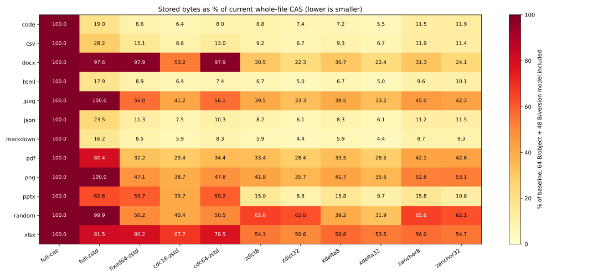

# ファイル版の保存方式: 実測結果と実装提案

2026-11-12 / 対象コミット `ad548e7598198d4019da10dcef37fa3a401a2966` / 関連 [#488](https://github.com/imanect-labs/shiki-platform/issues/488)

## 提案

**論理的な版と、実体の保存表現を分離する。基準版から直接復元する圧縮と、変更されていない断片の共有を、同じ保存層で選択できる構造にする。**

最初の候補は「全文」「独立全文圧縮」「基準版を辞書にした直接圧縮」「断片共有」の4表現。人間とAIを共通に扱い、既存の版番号・作者・内容ハッシュ・復元できる内容を保ったまま容量を減らす。自動保存の間隔や版の間引きは、この物理保存の改善とは独立した製品仕様として扱う。

今回の測定では、Officeの再保存には基準版方式が有効で、大きいファイルには断片共有が有効だった。一方式への固定は勧めない。特に「Zstdの生辞書として直前版を渡す」方法を汎用バイナリ差分と同一視すると、大きなファイルで削減できないケースを見落とす。

## 何をどこまで測ったか

- 主測定: **491履歴、10,091版、12形式、11方式、各3反復**。16,203測定、333,003回の復元を元バイト列と照合し、全件一致。
- Markdown/コード/CSV/JSONL/HTML、docx/xlsx/pptx、PNG/JPEG/PDF、乱数バイナリ。局所・先頭挿入・末尾追加・削除・分散変更・大量変更・全面変更・同一内容・取り消し・ZIP再梱包を含む。
- 通常17版、長期129版、大きいファイルは約4 MiBで9版。Officeライブラリによる実際のload/edit/saveは36履歴。既存5 fixture由来は15履歴。
- 追加: ローカルファイルへの保存・復元を52履歴・1,284版・7方式・各3回。26,964回の復元が全件一致。
- 設定感度: 大きいファイルなど20履歴・292版に対して辞書のwindowを4/16 MiBに変更。各2方式・3回、合計3,504回の復元が全件一致。
- AMD EPYC 9V74、CPU quota 4 cores、メモリ上限16 GiB、Python 3.12.14。圧縮等はnativeライブラリ。xdeltaのみCLI経由。

**生成データと既存fixture由来の制御された編集履歴であり、顧客の実作業ログではない。** サイズ・形式ごとの実利用の比率は不明で、全体の削減率をそのまま本番容量予測には使わない。生成画像は高エントロピー画像で、自然写真の代表標本ではない。Officeの実保存もMicrosoft Office/Collaboraそのものではない。

完全なケース一覧・条件・再実行方法は [README](README.md)、全版のサイズとSHA-256は [corpus.jsonl](results/main/corpus.jsonl)。

## 主測定の結果

現行相当の基準は、完全に同じ内容をファイル全体のSHA-256で共有する方式。基準容量は2,622,042,414 bytes。物理表現の実バイトに実体1件64 bytes・論理版1件48 bytesの共通モデルを加える。DB/WAL/プロバイダの実容量ではない。

「最新版込み」は、署名付きURLで配信する最新版の元ファイルを別に併置する容量の計算。非同期生成・配信処理自体の性能は未計測。保存と復元のp95はローカルのcodec計測。

| 方式 | 現行比の容量 | 最新版の全文併置込み | 保存p95 | 復元p95 | 最大読出数 |
|---|---:|---:|---:|---:|---:|
| 現行相当・全文CAS | 100.00% | 100.00% | 0.724 ms | 0.072 ms | 1 |
| 全文を独立にZstd圧縮 | 38.87% | 45.66% | 3.171 ms | 0.875 ms | 1 |
| 内容に応じた16 KiB分割・共有 | 15.82% | 22.61% | 2.414 ms | 1.043 ms | 269 |
| 直前版を辞書にして連鎖・32版で区切る | 14.89% | 21.69% | 5.746 ms | 2.352 ms | 32 |
| VCDIFF差分を連鎖・32版で区切る | 12.09% | 18.89% | 14.791 ms | 35.575 ms | 32 |
| 基準版を辞書にして直接圧縮・32版で更新 | 20.28% | 27.08% | 5.788 ms | 0.958 ms | 2 |

同じ元ファイルを繰り返した場合の共有は全方式で有効。全体にはそうしたケースも含む。全11方式、形式別、編集別、履歴ごとの中央値は [tables.md](results/main/tables.md) / [summary.csv](results/main/summary.csv)。

### 形式と編集内容で効き方が変わる

以下は最新版の全文併置を加える前の値で、各行内の現行比。

| ケース群 | 独立全文圧縮 | 16 KiB断片共有 | 基準版から直接圧縮・32版 |
|---|---:|---:|---:|
| Markdown | 16.23% | 5.89% | 9.32% |
| CSV | 28.19% | 8.78% | 11.39% |
| docx | 97.62% | 53.22% | 24.12% |
| xlsx | 81.48% | 67.69% | 54.66% |
| pptx | 62.60% | 39.66% | 10.85% |
| PNG | 100.00% | 38.69% | 53.06% |
| JPEG | 100.00% | 41.18% | 42.34% |
| Officeのライブラリ再保存36履歴 | 73.30% | 50.89% | 30.99% |
| 長期129版・16履歴 | 53.86% | 22.64% | 5.37% |
| 約4 MiB・6履歴 | 56.65% | 23.20% | 56.65% |

docxは独立圧縮だけではほぼ減らない。ZIPを単純に固定64 KiBで分ける方式もdocxでは97.86%と弱かった。一方、基準版を使う方式は同じZIP内の共通部分を活かせた。

4 MiBのケースでは辞書方式の既定設定が不利だった。参照windowを増やして確認しても、このケース群の基準版方式は4 MiB設定で48.83%、16 MiB設定で48.39%。断片共有の23.20%には届かなかった。**設定だけを変えれば大きいファイルにも同じ削減率が出るとは言えない。** [追加測定22](results/window-22/tables.md) / [追加測定24](results/window-24/tables.md)

全面変更は新しい実体を必要とする。特に乱数バイナリの全面変更では共有・圧縮でほぼ減らせない。圧縮と共有で、無期限に増える独立した内容の総量に上限ができるわけではない。

### 容量と読み出し数を合わせて判断する

断片共有の物理実体数は60,290、全文CASと基準版方式は9,024。小さな断片を1オブジェクトずつ置くと、管理領域だけでなくリクエスト数も増える。実体あたりの管理容量を64から1,024 bytesに増やすと、断片共有は15.82%から17.96%、基準版方式は20.28%から20.55%になる。容量だけでは依然断片共有が有利でも、API課金やRTTはこの計算に含まれない。 [感度分析](results/main/sensitivity.csv)

基準版方式は129版の履歴でも最大2実体の復元を維持した。容量を最小にしたVCDIFF連鎖は最大32実体を必要とした。復元済み基準版の共有キャッシュは使っていないため、キャッシュがあれば変わる。

xdeltaの時間には毎回のプロセス起動と一時ファイルI/Oが含まれる。native API版のCPU性能まで遅いと結論づけない。3反復ごとの復元p95は基準版32が0.950–0.964 ms、断片共有が1.033–1.048 ms、VCDIFF連鎖32が35.35–35.92 msだった。 [反復別](results/main/trials.csv)

### ローカルファイルI/Oの追加測定

各実体を実際に別ファイルとして保存・読み出す52履歴の結果。OSキャッシュ有効、fsyncなし。ケース構成は主測定全体と異なる。

| 方式 | 保存p95 | 復元p95 | 最大読出数 |
|---|---:|---:|---:|
| 全文CAS | 3.220 ms | 0.216 ms | 1 |
| 全文圧縮 | 3.994 ms | 0.958 ms | 1 |
| 16 KiB断片共有 | 8.670 ms | 2.094 ms | 269 |
| 基準版から直接圧縮・32版 | 7.619 ms | 1.253 ms | 2 |

分割後のファイル操作コストを加えると、断片共有の保存時間も増えた。この測定はネットワークストアの実測ではなく、GCS/RustFSのRTT・並列GET・Range・課金・耐久化を代替しない。 [全結果](results/files/tables.md)

## 実装案

### 1. 論理的な内容と物理実体を分離する

`node_version → blob（元内容のSHA-256・元サイズ）→ 保存表現 → 物理オブジェクト` とする。`blob` の論理的な識別は変えず、保存表現にcodec/version、基準版または断片への参照、物理バイト数を持たせる。

読み書きは引き続きStorageServiceに集約する。表現の解決・復元・元SHA-256との照合を共通処理にし、Officeや共同編集のハンドラごとに保存方式を実装しない。

現在は内容ハッシュからrawのオブジェクトキーを組み立てる前提が、ダウンロード・内部読取・版復元・提案版・workspace・RAG索引向けURLにある。これらを共通の解決処理に通してから、古いraw実体を減らす。

### 2. 最新版を配信可能な全文で保ち、旧版を非同期に最適化する

保存時は従来の内容検証・版・監査・outboxを確定し、旧内容の最適化を既存のジョブ基盤へ渡す。最新版のダウンロードとWOPIは全文の配信を維持する。

旧版は独立全文圧縮と、独立した基準版からの直接圧縮を候補にする。基準版は別の差分に依存させず、復元を最大2実体に保つ。今回の8/32版の設定を出発点に、圧縮効果が落ちたら基準を早く更新できるようにする。32版が全形式で最適とは決めない。

大きなファイルなど基準版方式の効果が低い内容にはCDC断片共有を候補にする。候補の実バイト数と必要読出数を保存し、実際のストアのGETコスト・復元目標に応じて採用する。拡張子や作者だけで固定せず、効果がない場合は全文表現を使う。断片を小オブジェクトのまま大量に置く方式と、packに集約してRangeで読む方式の比較は次のストア実測で行う。

### 3. 物理実体のGCと、安全な切り替えを一体で作る

- 最適化先の実体を書き、全内容のSHA-256一致を確認してからDBの保存表現を原子的に切り替える。失敗しても旧表現から読める状態を保つ。
- 旧rawを消す前に、発行済みURLの最大TTL、読取中の処理、RAG等の未処理ジョブ、バックアップによる参照を保護する。
- 論理版からの参照と、基準版・断片への物理的な依存を分けて数える。現行の「blob.refcount = node_version行数」だけで基準版や断片を削除しない。
- 最新版、残す旧版、提案版、明示的な保護、実行中の読取・バックアップのいずれかが必要とする実体を残す。孤児回収と再試行は冪等にする。
- 共有範囲は現在と同じtenant/org内。アップロード時の所持証明・認可・監査を維持する（PIT-14）。バックアップは物理的な依存も含めて整合させる（PIT-38）。

履歴の保持期限は、この「表現の変換」とは別の方針として決める。今回の容量値は論理版を削除せずに得たもので、保持版の間引きによる利益は含まない。

### 実装を進める順序と完了条件

1. 既存rawを読める保存表現モデルと共通resolverを追加する。最新・履歴・提案・復元・内部読取・索引の経路を通す。
2. 全文圧縮と基準版方式をnative Rustで実装し、旧版の非同期最適化を入れる。互換性・並行保存・中断再開・hash一致を検証する。
3. CDCを同じ表現モデルへ追加し、実ストアで小オブジェクト/pack、コールド復元、並列GET、CPU/RSS、署名付きURL、GCとバックアップを測る。方式選択の既定値はその結果で固定する。

本番データで必要な量は形式ごとのバイト比、保存頻度、変更量、旧版へのアクセス頻度。内容を収集しなくてもサイズ・ハッシュ・保存間隔・アクセス集計から利用構成を把握できる。今回の形式別実測をその構成で重み付けして容量を見積もる。

この初回調査時点の成果物は比較コード・実測・実装提案。その後、承認された実装を進めた。[実装・導入手順](../../docs/storage/version-storage.md) と [RustFSでの小オブジェクト/pack/Range追加比較](README.md#rustfsでの配置比較) を参照。初回調査の性能値はnative Rustの製品性能値とは区別する。
